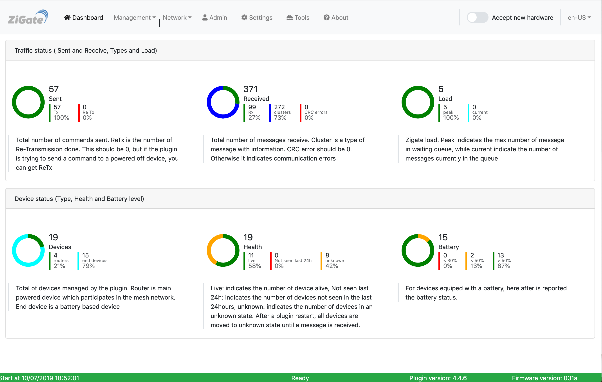

> **📝 The English wiki is under review (October 2026)** and is the only maintained version: it is being checked page by page against the current plugin (`stable9`). Progress is tracked in the [`review-2026-10` issues](https://github.com/zigbeefordomoticz/wiki/issues?q=label%3Areview-2026-10).
>
> **⚠️ The French and Dutch wikis are obsolete.** They are no longer updated and describe older versions of the plugin: please use the English wiki.

|  | [__Click here to access English Wiki__](en-eng/Readme.md)      |
|:------------:|:----------:|
|    | [__Cliquer ici pour accéder au wiki en français__](fr-fr/Readme.md) — *obsolète, n'est plus mis à jour* |
|      | [__Klik hier om Nederland Wiki te opene__](nl-dut/Readme.md) — *verouderd, wordt niet meer bijgewerkt* |

# About

This repository aim to centralize all ZigBeeForDomoticZ plugin's documentation.

In particular you can find the various version of the plugin Wiki.

If you would like to translate a part or the totality of the Wiki into an other language, please let us know.

If you find some issues, mistakes ... feel free to submit a change via the GitHub PR mechanism.

The ZigBeeForDomoticZ plugin code is available at https://github.com/zigbeefordomoticz/Domoticz-Zigbee 

# Support the project

The ZigBeeForDomoticZ plugin is developed by [@pipiche38](https://github.com/pipiche38) on spare time. Any help is welcome and really appreciated:

* **Improve the wiki**: report a mistake or a missing page in the [wiki issues](https://github.com/zigbeefordomoticz/wiki/issues), or propose a change with a pull request.
* **Contribute to the code**: report bugs, test new versions, or propose changes on the [plugin repository](https://github.com/zigbeefordomoticz/Domoticz-Zigbee).
* **Fund the project**: even 5 € helps to buy new devices to test, integrate and certify. Donations can be made via [PayPal](https://paypal.me/pipiche).

Thank you!
