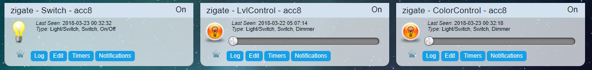

# Ikea Tradfri corner

## How to pair a device?

Put the plugin in pairing mode (see [Add a new device](HowTo_Pairing-device.md)), then reset the device:

* **Bulb**: turn it off and on 6 times (with the power switch, not with an Ikea remote). The bulb sends a device announcement to the coordinator, the plugin asks the bulb which model it is and creates its widgets in DomoticZ.
* **Remote controls, motion sensor, tiny on/off switch**: press the pairing button 4 times within 5 seconds.



For a bulb, you should find between 1 and 3 new devices in your DomoticZ Device list:

* simple switch, to turn on or off your bulb
* Level Control (LvlControl), to set the brightness level of your bulb
* Color Control (ColorControl), to set the color of your bulb

If the device is not in the certified devices database, the pairing takes a little longer: the plugin discovers what the device can do before creating the widgets.

## How to reset the round remote control

Press the pairing button 4 times (fast).

## How to reset a Bulb

Power it off for a few minutes. Then switch it on: it sends a Device Announcement to start the pairing process.

## Remote controls and motion sensor: how the events reach DomoticZ

The Ikea remote controls and the motion sensor don't send their commands to the coordinator: they send them to a **Zigbee group**, created when you pair them with a bulb or an outlet. To see their events in DomoticZ, the coordinator must be a member of that group:

1. Enable the group management, if not yet done (__Enable Groups__ in the WebUI [Settings](WebUI_Settings.md), restart needed).
1. Pair the bulb (or outlet) and the remote (or motion sensor) with the coordinator.
1. Pair the remote (or motion sensor) with the bulb (see below). This creates the group.
1. In **Admin > Group**, click **Scan all** (or tick the bulb and click **Scan N selected**; **Full scan** or **Scan** before plugin 9.1.009): the plugin asks the routers which groups they belong to, and finds the new group. The group gets its own widget in DomoticZ.
1. In **Management > Group Management**, check **Coordinator (in the group)** for this group and click **Validate**.

From then on, each action on the remote or the motion sensor is visible on its widget, and you can use it in Blockly, dzVents or Lua scripts.

A step-by-step example is given in [Ikea remote control as a pure remote](Corner_Ikea-Remote.md). For more details on groups, see [Group Management](HowTo_Group-management.md).

## How to use the 5 buttons round Remote Control

* Pair the Ikea Bulb with the coordinator, this creates a Switch widget.
* Pair the Ikea Remote with the coordinator, this creates a Switch selector.
* Pair the Ikea Remote with the Ikea Bulb (bring the remote close to the bulb and press the pairing button), in order to get them associated and to create a group.
* Add the coordinator to this group, as described [above](#remote-controls-and-motion-sensor-how-the-events-reach-domoticz).

See [Ikea remote control as a pure remote](Corner_Ikea-Remote.md) for the step-by-step approach, including the Left/Right buttons.

## How to use the tiny Remote switch On/off (square, usually sold with the plug)

Here is the method to get a Widget associated in DomoticZ and then to get it updated.

ATTENTION:
Once reset, the switch controls group 0x0000 (which is also used by Xiaomi plugs and switches). You might have to do some cleanup in the group membership, if you want to avoid the tiny switch controlling an unexpected plug.

1. Pair it with the coordinator

   * Press 4 times in 5 seconds when the plugin is in pairing mode.
   * This creates a Switch widget in DomoticZ, which gets the On and Off events.

1. Make sure that the coordinator is a member of group 0000

   * With a Silicon Labs (EZSP) coordinator, enable __Create Group 0000__ (`zigatePartOfGroup0000`) in the WebUI Settings (advanced settings, Group management section), then restart the plugin.
   * Otherwise, add the coordinator to group 0000 in **Management > Group Management** (**Coordinator (in the group)**).

1. To add devices to the group

   * Don't use the pairing button of the switch to pair devices, otherwise you'll lose the link with the coordinator and the events in DomoticZ.
   * Add the devices to group 0000 in **Management > Group Management**.

[More info](Corner_Ikea-Remote.md)

## How to use the Tradfri Motion sensor

1. Pair it with the coordinator

   * This creates a Motion widget.
   * If needed, reset the Motion sensor by pressing the pairing button 4 times within 5 seconds.

1. Pair it with a bulb

   * Hold the motion sensor close to the light source you want to add (no more than 5cm). Press and hold the pairing button for at least 10 seconds. At the end of the pairing process, the light source flashes one time.

1. Add the coordinator to the group created by the Motion sensor, as described [above](#remote-controls-and-motion-sensor-how-the-events-reach-domoticz).

From then on, every time the motion sensor turns on the light, you also get the motion widget On.

You might want to align the Time setting of the Motion sensor with the Reset Time of the Motion widget in DomoticZ.

[More info](Corner_Ikea-Tradfri-Motion.md)

## How to use Fyrtur connected roller blind

When an IKEA Fyrtur blind is purchased, it comes in a package which contains the blind, a wireless remote controller and a wireless repeater.
All three are connected together out-of-the box, and the remote controller can be used to control the blind.
Additional blind(s) can be purchased, and added to the remote controller by following the IKEA instructions.

You can factory reset blind/remote/repeater, and pairing all three together gives you the out-of-the box functionality back.

To use the blind, the blind remote and the repeater with the plugin:

1. Put the plugin in pairing mode and factory reset the repeater.
   * The repeater pairs with the coordinator and acts as a general purpose Zigbee repeater in your network.
1. Put the plugin in pairing mode and factory reset the blind (long press on both blind buttons).
   * The blind pairs with the coordinator, and a DomoticZ widget is created. The widget can be used to control the blind.
1. Put the plugin in pairing mode and factory reset the blind remote (click the remote's pairing button rapidly four times).
   * The remote pairs with the coordinator, and a DomoticZ widget is created. The widget can be used to receive the remote's button presses (the coordinator must be in the group the remote sends to, see the tiny Remote switch above for group 0000).

After steps 1-3, the remote can be used by receiving the button presses in DomoticZ, and using DomoticZ scripting to control the blind with the blind widget.

With the following additional steps, the remote controls the blind(s) directly, through a group, and DomoticZ scripting is not necessary:

1. In the WebUI, **Management > Group Management**, press **Add a new Group** and select the blind(s) in the group. Press **Validate**: the group is created. Refresh the page to see the created group, and note its **Group id**.
   * A DomoticZ group widget is also created.
1. Bind the remote to this group. There is no WebUI page for group binding, so use the plugin REST API, for example with curl from the DomoticZ host:
   * Find the remote IEEE address in **Management > Device Management**. We use the IEEE address `680ae2fffeaae6cb` in this example.
   * Unbind the remote from its default group `0000`:

     ```bash
     curl -X PUT -d '{"sourceIeee":"680ae2fffeaae6cb", "sourceEp": "01", "groupId": "0000", "cluster": "0102"}' http://127.0.0.1:9440/rest-z4d/1/unbinding-group
     ```

   * Bind the remote to the group containing the blind(s), using the Group id from the previous step. We use group id `0002` in this example:

     ```bash
     curl -X PUT -d '{"sourceIeee":"680ae2fffeaae6cb", "sourceEp": "01", "groupId": "0002", "cluster": "0102"}' http://127.0.0.1:9440/rest-z4d/1/binding-group
     ```

   * The remote doesn't appear in the Group Management page, but if everything went well it controls the blind(s) in the group.

Test that the remote controls the blind(s), and that the blind DomoticZ widget controls the blind.
If you need to read the remote button presses from its DomoticZ widget, add the coordinator to the same group as the blinds (**Coordinator (in the group)** in Group Management).

If you need to redo the grouping of the remote, it is best to remove it from the plugin (remove the DomoticZ widget), pair it again (step 3 of the first list) and bind it to the group again.

## Firmware updates

Ikea devices can be updated over the air by the plugin. See [Upgrading device firmware](HowTo_Update-device-firmware.md), and [IKEA: downloading the whole catalogue](HowTo_Update-device-firmware.md#ikea-downloading-the-whole-catalogue) for the `Tools/ikea-ota-download.py` helper.
