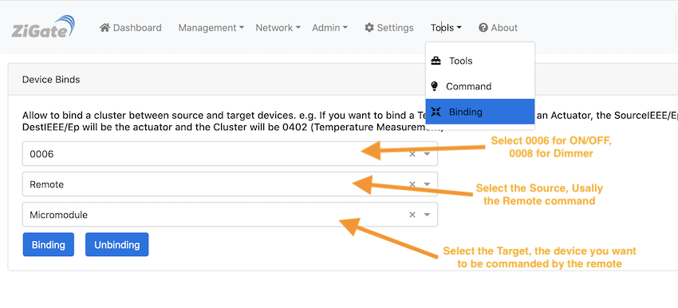

# Bind two devices

## What a binding is

A binding links two devices directly: the **source** device (a switch, a remote, a sensor) sends its commands or its reports straight to the **target** device (a light, a micromodule, a thermostat), without going through Domoticz. For example, a wall switch bound to a micromodule switches it on and off even when Domoticz is stopped.

The binding is stored in the source device, for one cluster (one type of command): to bind several clusters, make one binding per cluster.

Not all devices support bindings: it depends on the firmware of the source device. Some devices accept a binding but ignore it.

The messages from the source to the target travel through the Zigbee network. If the source is a battery device whose parent is the coordinator, its messages go through the coordinator: the coordinator must be running (but not Domoticz). See [Mesh graph](WebUI_Network-Mesh.md) to find the parent of a device.

## Before you start

* Pair both devices (see [Add a new device](HowTo_Pairing-device.md)) and check that each one works from Domoticz.
* Give each device a friendly name in *Management > Device Management* (see [WebUI Management](WebUI_Management.md#device-management)): the binding page lists the devices by name.

## Create a binding

1. Go to *Tools > Binding* (see [WebUI Tools](WebUI_Tools.md#bindings)).

   

1. Select the **cluster**. The list only shows the clusters that your devices have, among:

   | Cluster | Use |
   | ------- | --- |
   | `0006` On/Off | switch on and off |
   | `0008` Level Control | dim |
   | `0102` Windows Covering | open, close, stop a cover |
   | `0201` Thermostat | thermostat |
   | `0300` Colour Control | color and color temperature |
   | `0402` Temperature Measurement | send the temperature, for example from a sensor to a thermostat valve |

1. Select the **source** device: the one that triggers the action (the switch, the remote, the sensor).
1. Select the **target** device: the one that is commanded.
1. If the source is a battery device, wake it up (press one of its buttons) just before the next step, so that it receives the request.
1. Click *Binding*.

To remove a binding, select the same cluster, source and target and click *Unbinding*.

### Devices with several endpoints

A device with several buttons or outputs has one *endpoint* per button or output, and one widget per endpoint. The endpoint is the number at the end of the widget name. For example, a Legrand double remote switch gets two widgets:

```text
Double gangs remote switch_LegrandSelector-000474000082702a-01
Double gangs remote switch_LegrandSelector-000474000082702a-02
```

Each endpoint is one button. Press a button and see which widget changes to know which endpoint it is, then select that endpoint as source (or target).

## Example: Legrand double remote switch and micromodule

1. Pair the micromodule, and check that you can switch it from Domoticz. It has one widget, for example `Micromodule switch_Switch-00047400001f09a4-01`.
1. Pair the double remote switch, and check that pressing its buttons updates its two widgets (`-01` and `-02`).
1. In *Tools > Binding*, select the cluster `0006`, the remote endpoint of the button you want (for example `01`) as source, the micromodule as target, wake the remote, and click *Binding*.
1. That button now switches the micromodule directly. With a dimmer as target, add a second binding with the cluster `0008` to dim it too.

The Legrand *Remote Shutter* doesn't accept bindings.

## Bind to a group

A source can also be bound to a Zigbee group (see [Manage Zigbee groups](HowTo_Group-management.md)): its commands then go to all the devices of the group. The WebUI doesn't offer it; use the REST API (see [Use the plugin tools](HowTo_Using-tools.md#how-to-use-the-rest-api)):

```bash
curl -X PUT http://127.0.0.1:9440/rest-z4d/1/binding-group \
     -d '{"sourceIeee": "000474000082702a", "sourceEp": "01", "groupId": "1001", "cluster": "0006"}'
```

`unbinding-group`, with the same data, removes it.

## Check the bindings of a device

The plugin can read the binding table of a device, also through the REST API only. With the short address (NwkId) of the device:

1. `curl http://127.0.0.1:9440/rest-z4d/1/binding-table-req/<NwkId>` asks the device for its binding table.
1. A few seconds later, `curl http://127.0.0.1:9440/rest-z4d/1/binding-table-disp/<NwkId>` displays it.

Replace `9440` with the port set in the plugin hardware parameters if you changed it.
