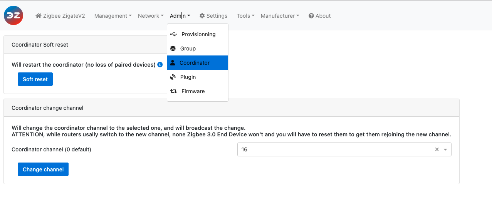
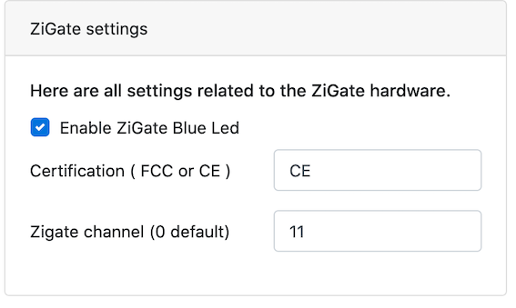

# Change the Zigbee channel

## Introduction

A Zigbee network uses one channel of the 2.4 GHz band, from 11 to 26. Choose a channel away from your Wi-Fi: see [Zigbee and Wi-Fi](Info_ZigBee-and-Wifi.md), and measure the radio activity with [Network > Interference level](WebUI_Network.md#interference-level) or a [real-time interference scan](HowTo_Real-time-interference-scan.md).

When a zigpy coordinator (Texas Instruments, Silicon Labs, ConBee/RaspBee…) forms a new network with the `channel` setting left to `default`, it runs an energy scan and picks the quietest of the channels 11, 15, 20 and 25.

Some devices were reported to need a specific channel (findings from the ZiGate era):

* Konke: channel 15
* Livolo: channel 26 (see [Livolo](Corner_Livolo.md))
* Legrand: channel 11 for some devices (see [Legrand](Corner_Legrand-Netatmo.md))

There are two ways to change the channel.

## Method 1: live channel change (recommended)

The coordinator moves to the new channel and broadcasts the change to the whole network. The paired devices are kept.

1. Go to *Admin > Coordinator* (see [WebUI Admin](WebUI_Admin.md#zigate)).
1. In the **Coordinator change channel** panel, select the new channel.
1. Click *Change channel*.

The routers (mains-powered devices) receive the broadcast and follow. End devices (battery devices) sleep and miss it:

* Zigbee 3.0 end devices look for the network on the other channels when they wake up and no longer reach their parent, and rejoin it;
* older end devices don't: **reset them** to make them rejoin the network on the new channel (see [Add a new device](HowTo_Pairing-device.md)).

Wait a while, then check in *Management > Device Management* which devices don't report any more.

## Method 2: form a new network on the chosen channel

The `channel` setting (WebUI *Settings*, *Coordinator settings*, advanced) is only applied when the coordinator forms a new network. **Forming a new network erases it: all the devices must be paired again.** Use this method only when you start a network from scratch.

1. Set `channel` to the channel you want and click *Validate*.

   

1. Form a new network: in Domoticz, *Setup > Hardware*, set *Initialize Coordinator* to *True* on the plugin hardware and click *Update* (see [Plugin settings](Plugin_Settings.md)).
1. Once the plugin has started, set *Initialize Coordinator* back to *False*, otherwise the network is erased again at the next start.

With a ZiGate, the `channel` setting is applied with a coordinator restart (*Admin > Coordinator*, *Soft reset*) instead.

## Check the channel

Go to *Tools > Tools* and click **Coordinator info**: the `Channel` field gives the current channel. See [Use the plugin tools](HowTo_Using-tools.md).
