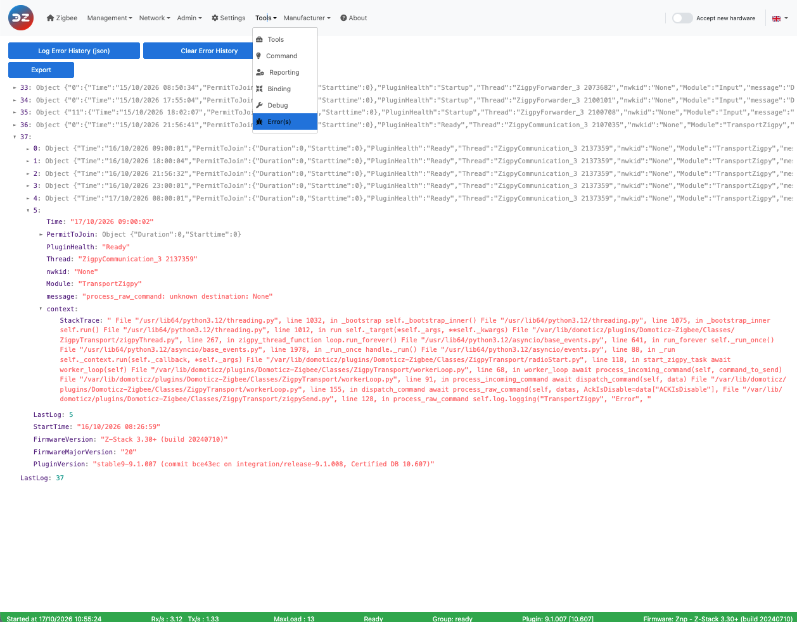

# Deal with plugin errors

The plugin records its errors, with their context, so that you can see them in the WebUI and send them with a bug report.

## The error indicator

When the plugin records an error, a blinking red triangle, **Error(s) detected**, appears in the WebUI menu bar. Click it to open *Tools > Error(s)*.

## The Error(s) page

*Tools > Error(s)* (see [WebUI Tools](WebUI_Tools.md#error)) has two buttons:

*This picture may have changed since this documentation was written.*

* **Log Error History (json)** displays the recorded errors. *Export* downloads them as a JSON file.
* **Clear Error History** empties the list.

Either button turns the red triangle off until a new error is recorded.

The errors are grouped by plugin session (each start of the plugin), with the plugin version and the coordinator firmware version of that session. Each error comes with its context: the module, the message, the device concerned and the data the plugin was handling. The plugin keeps the last 5 sessions, 20 errors per session, and drops the errors older than 7 days.

The history is also saved in the file `PluginZigbee_log_error_history_<hardware id>.json` of the plugin `Logs` folder (`<hardware id>` is the Domoticz hardware ID of the plugin, on two digits), so it survives a plugin restart.

## What to do with an error

1. Look at the error message and the device concerned: many errors come from a device that doesn't answer (see [Troubleshooting pairing or connection](Troubleshooting_Pairing.md)) or from a device that isn't optimized (see [Dealing with a non-optimized device](Problem_Dealing-with-none-optimized-device.md)).
1. Check the [plugin FAQ](Problem_FAQ.md).
1. If the error comes back, report it on [GitHub](https://github.com/zigbeefordomoticz/Domoticz-Zigbee/issues), with:
   * the exported error history (JSON file);
   * the Domoticz log around the time of the error, if possible with the debug mode enabled for the module concerned (see [Debug mode](Problem_Debuging-mode.md));
   * for a device problem, the device data: *Tools > Tools*, **Plugin Raw Devices**, then *Export* (see [Use the plugin tools](HowTo_Using-tools.md)).

The exports can contain your network details: look at them before posting them publicly.
