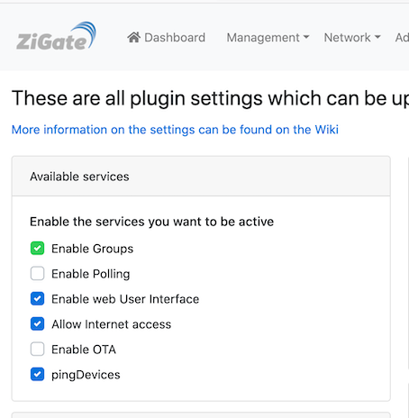
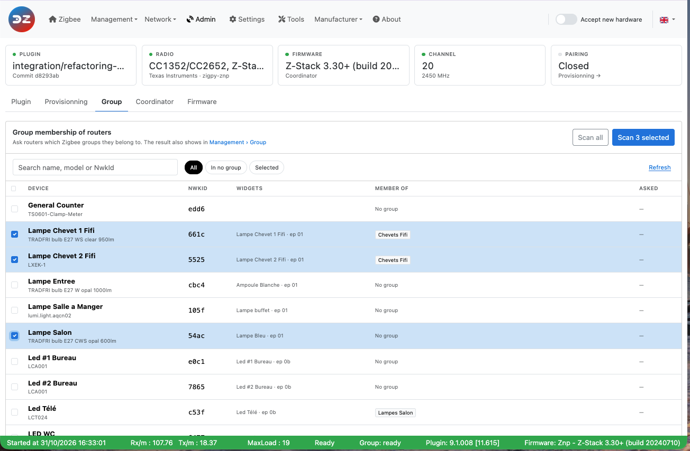
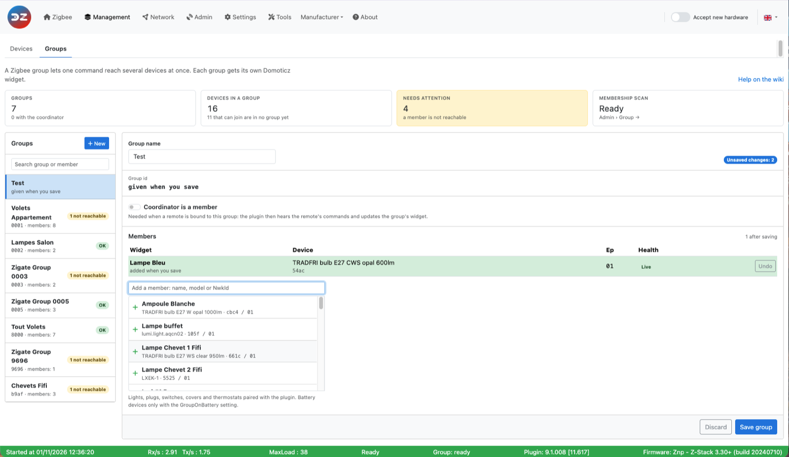
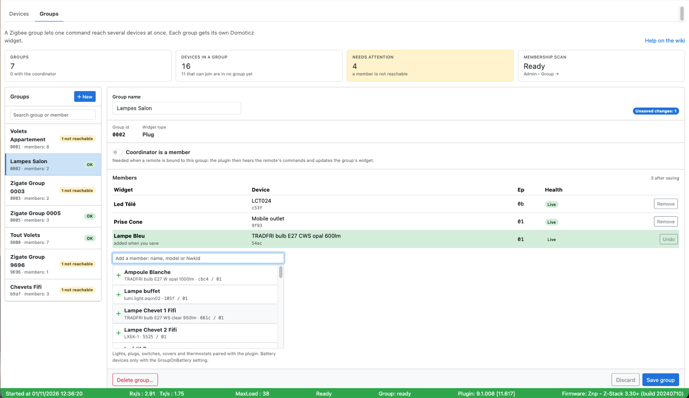

# Manage Zigbee groups

This how-to explains how to create and use Zigbee groups with the plugin.

## How Zigbee groups work

A Zigbee group puts several devices behind a single widget in Domoticz: an action on the group widget is applied by all the devices of the group, at the same time.

* **The membership is stored in the devices**, not in the coordinator: each device remembers which groups it belongs to (usually a few groups at most, depending on the device).
* A command to a group is **broadcast** to the whole network with the group address (for example `1001`): every device receives it, and the devices that belong to that group apply it.
* To apply a group command, a device must be listening to the network. End devices (battery) sleep most of the time, so they **can't follow group commands**: only routers (mains-powered devices) can be put in a group. The `GroupOnBattery` setting lets you select battery devices anyway, for devices that do listen.
* Zigbee groups are **independent from Domoticz groups** (*Setup > More Options > Scenes/Groups*).

In Domoticz, each Zigbee group is a switch widget, whatever the number of devices in the group.

## Enable group management

1. In the WebUI, go to *Settings*, *Available services*, and enable __Enable Groups__ (`enablegroupmanagement`).

   

1. Click *Save* (*Validate* before plugin 9.1.009) and restart the plugin.
1. Scan the groups (see below).

## Scan the groups

Since the groups are stored in the devices, the plugin must ask the devices which groups they belong to. Do it after enabling group management, and whenever groups were created outside the plugin (for example by pairing an Ikea remote with a bulb).

1. Make sure all the devices are connected to the network.
1. Go to *Admin > Group* (see [WebUI Admin](WebUI_Admin.md#group)).
1. Click *Scan all* to ask every router, or tick some routers and click *Scan N selected* (before plugin 9.1.009: *Full scan*, or *Scan* of the selected routers).
1. The routers answer over the next minutes: click *Refresh* to see their groups in the *Member of* column.

The plugin creates a widget for every group found.

## Create a group

1. Go to *Management > Groups* (see [WebUI Management](WebUI_Management.md#group-management)).
1. Click *New*.

   

1. Enter the *Group name*: it becomes the name of the Domoticz widget.
1. Leave *Group id* empty, unless the group must have a given id, for example to match a remote set on a fixed group. Enter it as four hexadecimal digits, such as `0a2b` (plugin 9.1.010 and later). `0000`, `fff8` to `ffff` and the group of the `pingViaGroup` setting cannot be used, nor an id that another group has.
1. Click the *Add a member* field and pick the devices (endpoints) of the group from the list. Type part of a name, model or short id to narrow it. Each one added shows in green, *added when you save*; *Undo* takes it back out.
1. If needed, switch on *Coordinator is a member* (see below).
1. Click *Save group*.

The plugin gives the group the first free group id, unless you chose one, sends the membership request to each device and creates the group widget in Domoticz. The page reads the groups again a few seconds later and opens the new group.

Before plugin 9.1.009: *Management > Group Management*, *Add a new Group*, enter the name, select the devices in the drop-down, tick *Coordinator (in the group)* if needed, and click *Validate*. Refresh the page if the group doesn't show.

### Adding the coordinator to a group

Switch on *Coordinator is a member* (before plugin 9.1.009: tick *Coordinator (in the group)*) when the coordinator must receive the commands sent to the group, so that the plugin sees them and updates the widgets. This is needed, for example, to receive the commands of an Ikea remote: see [Ikea remote](Corner_Ikea-Remote.md).

The coordinator can only belong to a limited number of groups: see [Coordinators](Coordinators.md#limited-number-of-groups).

### Remotes

A remote sends commands to a group; it isn't a member of it. So most remotes don't appear in the device list, even with `GroupOnBattery` enabled:

* Legrand remote switches get their own group when they are paired: see [Using a remote with a group](Corner_Legrand-Netatmo.md#using-a-remote-with-a-group).
* Ikea remotes: see [Ikea remote](Corner_Ikea-Remote.md).
* Other remotes: bind the remote to the group, see [Bind to a group](HowTo_Binding.md#bind-to-a-group).

## Update a group

1. Make sure all the devices of the group are connected to the network: the *Health* column of the members shows *Live* for them.
1. Go to *Management > Groups* and click the group in the list.
1. Change what you need:
   * rename the group: the Domoticz widget is renamed too;
   * add members with the *Add a member* field;
   * click *Remove* on a member to take it out of the group (*Undo* to keep it);
   * switch *Coordinator is a member* on or off.
1. Click *Save group*. *Discard* drops your changes.

   

As for the creation, the requests are sent to the devices and the change shows once they have answered. A device that is off keeps its old membership until then. Members the page can't offer for groups (a remote, a battery device without `GroupOnBattery`) are marked *not offered for groups now; kept as it is* and stay in the group when you save.

Before plugin 9.1.009: *Management > Group Management*, add or remove devices in the drop-down of the group, and click *Validate*. Saving there could drop the members it couldn't list, such as a remote or a battery device.

## Delete a group

Either:

* delete the group widget in Domoticz;
* or, in *Management > Groups*, open the group, click *Delete group…* and confirm (before plugin 9.1.009: click the trash icon of the group in *Management > Group Management*, then *Validate*).

The plugin asks each device of the group to leave the group. When the last one has answered, it removes the group and its widget.

## Group settings

The group settings are in the *Group management* section of the WebUI *Settings* (see [Group management settings](WebUI_Settings.md#group-management-settings)):

| Setting | Use |
| ------- | --- |
| `GroupOnBattery` | Allow battery devices in groups. Off by default, since most battery devices can't receive group commands. It doesn't make remotes appear: see [Remotes](#remotes). |
| `OnIfOneOn` | The group widget shows *On* when at least one device of the group is on. When off, all the devices must be on. |
| `pingViaGroup` | When set to a group address, the plugin checks that the devices are alive through that group instead of pinging each device; `0` (default) pings each device. |
| `zigatePartOfGroupTint` | Adds the coordinator to the group of the Müller Licht Tint remote (Silicon Labs coordinators). See [Müller Licht / Tint](Corner_Tint.md). |
| `zigatePartOfGroup0000` | Creates group `0000`, used by some Ikea and Xiaomi switches (Silicon Labs coordinators). |
| `GroupLevelWithOnOff` | Send the *Move to Level with On/Off* command to groups, so that setting a level also switches the lights on. |

## Scenes

A group can hold [Zigbee scenes](HowTo_Zigbee-scenes.md): a state stored in its devices, and recalled with one frame.

## Warnings

* Make sure all the devices of a group are connected to the network before you scan, create or change a group: a device that is not reachable doesn't get the change.
* During a scan the plugin waits for each device to answer before moving to the next one. If some devices are not reachable, the scan takes longer, and the other commands you send meanwhile are queued.
