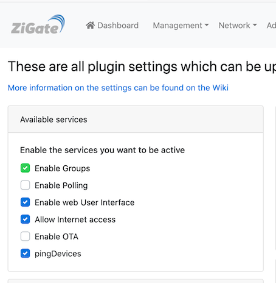
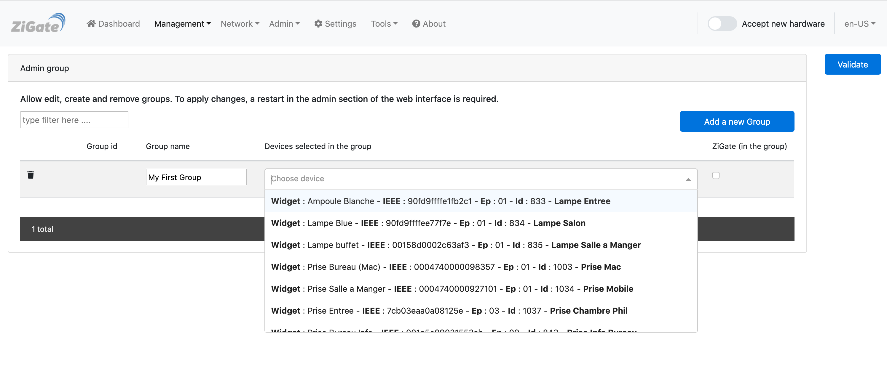

# Manage Zigbee groups

This how-to explains how to create and use Zigbee groups with the plugin.

## How Zigbee groups work

A Zigbee group puts several devices behind a single widget in Domoticz: an action on the group widget is applied by all the devices of the group, at the same time.

* **The membership is stored in the devices**, not in the coordinator: each device remembers which groups it belongs to (usually a few groups at most, depending on the device).
* A command to a group is **broadcast** to the whole network with the group address (for example `1001`): every device receives it, and the devices that belong to that group apply it.
* To apply a group command, a device must be listening to the network. End devices (battery) sleep most of the time, so they **can't follow group commands**: only routers (mains-powered devices) can be put in a group. The `GroupOnBattery` setting lets you select battery devices anyway, for devices that do listen.
* Zigbee groups are **independent from Domoticz groups** (*Setup > More Options > Scenes/Groups*).

In Domoticz, each Zigbee group is a switch widget, whatever the number of devices in the group.

## Enable group management

1. In the WebUI, go to *Settings*, *Available services*, and enable __Enable Groups__ (`enablegroupmanagement`).

   

1. Click *Save* (*Validate* before plugin 9.1.009) and restart the plugin.
1. Scan the groups (see below).

## Scan the groups

Since the groups are stored in the devices, the plugin must ask the devices which groups they belong to. Do it after enabling group management, and whenever groups were created outside the plugin (for example by pairing an Ikea remote with a bulb).

1. Make sure all the devices are connected to the network.
1. Go to *Admin > Group* (see [WebUI Admin](WebUI_Admin.md#group)).
1. Click *Scan all* to ask every router, or tick some routers and click *Scan N selected* (before plugin 9.1.009: *Full scan*, or *Scan* of the selected routers).
1. The routers answer over the next minutes: click *Refresh* to see their groups in the *Member of* column.

The plugin creates a widget for every group found.

## Create a group

1. Go to *Management > Group Management* (see [WebUI Management](WebUI_Management.md#group-management)).

   

1. Click *Add a new Group*.
1. Enter the name of the group: it becomes the name of the Domoticz widget.
1. Select the devices (endpoints) of the group from the list. Use the small cross to remove one.
1. If needed, tick *Coordinator (in the group)* (see below).
1. Click *Validate*.

The plugin sends the membership request to each device and creates the group widget in Domoticz. It can take a few seconds: refresh the page if the group doesn't show.

### Adding the coordinator to a group

Tick *Coordinator (in the group)* when the coordinator must receive the commands sent to the group, so that the plugin sees them and updates the widgets. This is needed, for example, to receive the commands of an Ikea remote: see [Ikea remote](Corner_Ikea-Remote.md).

The coordinator can only belong to a limited number of groups: see [Coordinators](Coordinators.md#limited-number-of-groups).

### Remotes

A remote sends commands to a group; it isn't a member of it. So most remotes don't appear in the device list, even with `GroupOnBattery` enabled:

* Legrand remote switches get their own group when they are paired: see [Using a remote with a group](Corner_Legrand-Netatmo.md#using-a-remote-with-a-group).
* Ikea remotes: see [Ikea remote](Corner_Ikea-Remote.md).
* Other remotes: bind the remote to the group, see [Bind to a group](HowTo_Binding.md#bind-to-a-group).

## Update a group

1. Make sure all the devices of the group are connected to the network.
1. Go to *Management > Group Management*.
1. Add or remove devices of the group.
1. Click *Validate*.

As for the creation, the requests are sent to the devices and the change takes a few seconds.

## Delete a group

Either:

* delete the group widget in Domoticz;
* or, in *Management > Group Management*, click the trash icon of the group and click *Validate*.

The plugin asks each device of the group to leave the group.

## Group settings

The group settings are in the *Group management* section of the WebUI *Settings* (see [Group management settings](WebUI_Settings.md#group-management-settings)):

| Setting | Use |
| ------- | --- |
| `GroupOnBattery` | Allow battery devices in groups. Off by default, since most battery devices can't receive group commands. It doesn't make remotes appear: see [Remotes](#remotes). |
| `OnIfOneOn` | The group widget shows *On* when at least one device of the group is on. When off, all the devices must be on. |
| `pingViaGroup` | When set to a group address, the plugin checks that the devices are alive through that group instead of pinging each device; `0` (default) pings each device. |
| `zigatePartOfGroupTint` | Adds the coordinator to the group of the Müller Licht Tint remote (Silicon Labs coordinators). See [Müller Licht / Tint](Corner_Tint.md). |
| `zigatePartOfGroup0000` | Creates group `0000`, used by some Ikea and Xiaomi switches (Silicon Labs coordinators). |
| `GroupLevelWithOnOff` | Send the *Move to Level with On/Off* command to groups, so that setting a level also switches the lights on. |

## Warnings

* Make sure all the devices of a group are connected to the network before you scan, create or change a group: a device that is not reachable doesn't get the change.
* During a scan the plugin waits for each device to answer before moving to the next one. If some devices are not reachable, the scan takes longer, and the other commands you send meanwhile are queued.
