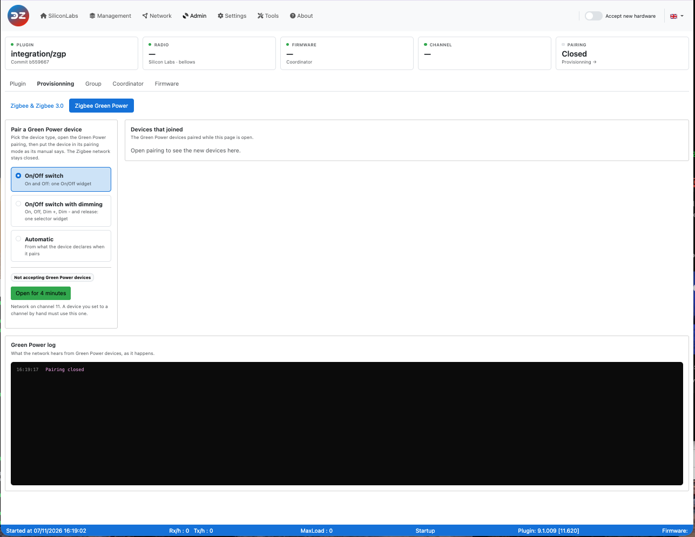
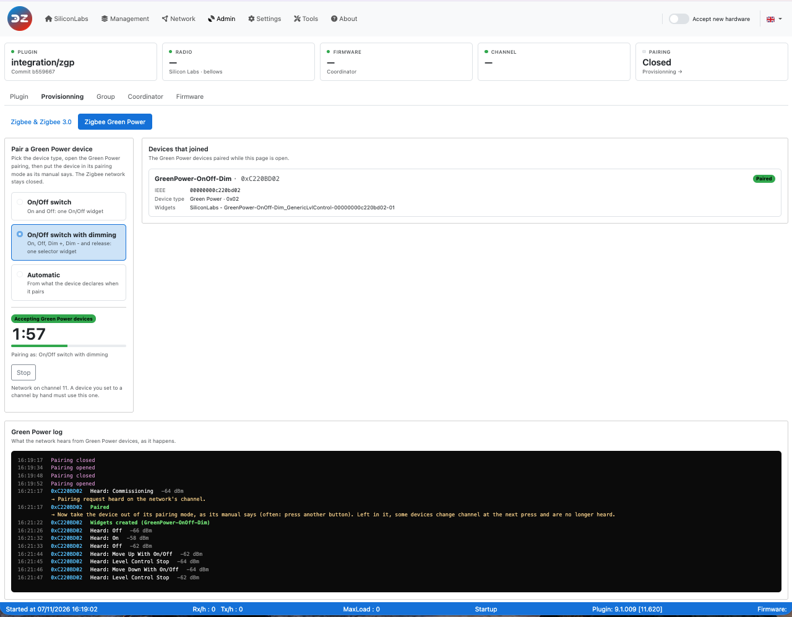

# Pair a Green Power device

This how-to explains how to pair a Zigbee Green Power device (switch, remote, sensor) with the plugin, on the *Admin > Provisionning > Zigbee Green Power* page of the WebUI.

## What is different with Green Power

A Green Power device is built to use as little energy as possible: some run on the energy of the button press itself, others on a battery that lasts for years. To save that energy:

* it **does not join** the Zigbee network like other devices: it only sends short frames, and the coordinator (or a router close to it) picks them up;
* it **does not listen**: it never gets an answer. Nothing tells the device that it is paired, so **you have to take it out of its pairing mode yourself**;
* it **sends on one channel**. Some devices start their pairing mode on channel 11 and move to the next channel at each press, until they reach the channel of your network;
* it **tells little about itself**. Many devices give neither their manufacturer nor their model, only a device type such as *On/Off switch*, even when they also dim. So **you choose the device type** before pairing.

The plugin learns about a Green Power device from the pairing request (*Commissioning*) the device sends in its pairing mode, while the Green Power pairing is open. The *Green Power log* of the page shows, as it happens, what the network hears.

## Before you start

* **Let Domoticz accept new devices**, as for any pairing: see [Add a new device](HowTo_Pairing-device.md#before-you-start-let-domoticz-accept-new-devices).
* **Know your network channel.** The page shows it under the pairing buttons: *Network on channel N*. A device you set to a channel by hand must use this one. Green Power devices use channels 11 to 26.
* **Coordinator.** Tested with a Silicon Labs (EZSP) coordinator. With a deCONZ (ConBee, RaspBee) coordinator, Green Power pairing stays closed. Other coordinators have not been tested yet.

## The Zigbee Green Power page

*Admin > Provisionning* has two pages: **Zigbee & Zigbee 3.0** for the other devices (see [Add a new device](HowTo_Pairing-device.md)), and **Zigbee Green Power**.

* **Pair a Green Power device**: the device type, the *Open for 4 minutes* and *Stop* buttons, the time left, and the network channel. The Green Power pairing opens for Green Power devices only: the Zigbee network stays closed.
* **Devices that joined**: the Green Power devices paired while the page is open, with their model, their Green Power device type and their widgets.
* **Green Power log**: what the network hears from Green Power devices and the pairing steps, newest line at the bottom.

### Device types

Choose the type before opening the pairing: the device paired during that pairing gets it. No type is selected when the page opens, and *Open for 4 minutes* stays disabled until you choose one.

| Type | Widget | For |
|------|--------|-----|
| **On/Off switch** | One On/Off switch | A switch with an *On* and an *Off* button |
| **On/Off switch with dimming** | One selector: *Off*, *On*, *Dim +*, *Dim -*, *Stop* | A switch that also dims while a button is held: *Dim +* and *Dim -* when held, *Stop* when released |
| **Automatic** | From what the device declares | A device that gives its model or its commands |

A device keeps its type when it is paired again. To change the type of a paired device, [remove it](#remove-a-green-power-device), then pair it again with the new type.

## Pairing

1. Open the WebUI, *Admin > Provisionning > Zigbee Green Power*.
1. Choose the **device type**. *Open for 4 minutes* stays disabled until you do.
1. Click **Open for 4 minutes**. The page shows **Accepting Green Power devices**, the time left and *Pairing as:* the type you chose; the log shows **Pairing opened**.
1. Put the device in its pairing mode, as its manual says (see [the Sunricher switch](#sunricher-zgp2801k2-dim) for an example).
1. Watch the **Green Power log**: each frame the network hears is listed with its time, the device ID (for example `0xC220BD02`), what it sent and the signal strength.
1. As soon as the log shows **Paired**, **take the device out of its pairing mode**, as its manual says (often: press another button). Left in its pairing mode, some devices change channel at the next press, and the network no longer hears them.
1. The log then shows **Widgets created**, and the device appears in **Devices that joined** as *Paired*, with its model and its widget.

### What the Green Power log tells you

| Line | Meaning | What to do |
|------|---------|------------|
| *Heard: Commissioning* · *Pairing request heard on the network's channel* | The device is in its pairing mode, on the right channel | Wait for *Paired* |
| *Paired* · *Now take the device out of its pairing mode* | The plugin has paired the device | Take the device out of its pairing mode, now |
| *Widgets created (…)* | The Domoticz widget exists | Done |
| *Heard: On* (or another command) · *The device reaches the network, but is not in its pairing mode* | A device not paired yet, on the right channel, used normally | Put it in its pairing mode |
| *Heard: Commissioning* · *Pairing request refused: pairing is closed* | The Green Power pairing was not open | Open it, then repeat |
| *Heard an encrypted frame* · *A device not paired yet* | A device not paired yet, used normally | Put it in its pairing mode |
| *Paired, but no widget for this device* | The device is paired, but no configuration gives it a widget (with *Automatic*) | Pair it again with a device type, or report it with the plugin log |
| *The device is paired but still in its pairing mode* | A paired device still sends pairing requests | Take it out of its pairing mode |
| *Heard: Off*, *Heard: Move Up With On/Off*… without a hint | A paired device used normally (listed while the pairing is open) | Nothing |
| Nothing at all | The network does not hear the device | Check the channel, move closer to the coordinator, check the pairing mode |

### Green Power with the Zigbee pairing

The setting **Accept Green Power devices when pairing is open** (`GreenPowerEnable`, *Settings*, advanced, *Zigpy* section) only concerns the **Zigbee & Zigbee 3.0** page and the *Accept new hardware* switch of the menu bar: when it is on, opening the Zigbee pairing also opens the Green Power pairing, without a device type (*Automatic*). The Green Power page does not need it.

## Sunricher ZGP2801K2-DIM

Green Power switch with an *On* and an *Off* button: a short press sends *On* or *Off*, holding a button dims up or down until it is released. Tested on 7 November 2026 with a Silicon Labs coordinator on channel 11.

1. On the *Zigbee Green Power* page, choose **On/Off switch with dimming**, click **Open for 4 minutes**, and wait for **Pairing opened** in the log.
1. Put the switch in its pairing mode, always with the **On** button:
   1. press and hold *On* for more than 10 seconds, then release it;
   1. press *On* once, then release it;
   1. press and hold *On* for more than 10 seconds again, then release it.
1. Wait for a second, then press *On*, and keep pressing *On* every second or two.
1. As soon as the log shows **Paired**, close the pairing mode of the switch: press **Off** once.

Each press of *On* in the pairing mode sends a pairing request and moves the switch to the next channel, starting at channel 11: keep pressing until the log shows *Paired*. A press of the other button ends the pairing mode.

The switch declares itself as an On/Off switch (Green Power device type `0x02`) and gives neither its manufacturer nor its model, so *Automatic* gives it an On/Off widget only. With **On/Off switch with dimming**, it gets a selector: *On* and *Off* on a short press, *Dim +* and *Dim -* while *On* or *Off* is held, *Stop* when the button is released.

## Check a paired device

* **Management > Devices** lists the Green Power devices with the other devices; the *Green Power* chip shows them alone. Each row shows the model and the widgets, the source ID and the IEEE, the LQI of the last frame, and when the device was last heard. The rows are read-only: no details, no name, no parameters, no removal there (see [Remove a Green Power device](#remove-a-green-power-device)).
* **Dashboard**: the Green Power devices have a *Green Power* segment of their own in *Plugin devices* and in *Type of devices*, and *Devices live* adds *+ N Green Power*. They are never counted as live: the plugin never sends a Green Power device anything, so it has no health status, and a battery-free switch can stay silent for days.
* **Tools > Data > Green Power devices (raw)** shows what the plugin keeps for each Green Power device: its ID, its device type, the security level, the last frame counter, its model and its widgets. The security key of the device is never shown.

A Green Power device is not listed in *Tools > Data > Device names* or *Devices (raw)*, which show the Zigbee devices only.

A Green Power device **never appears in a topology report** (*Network > Topology*, *Network > Mesh graph*). It does not join the network: it has no neighbour table and no route, and no router lists it as a neighbour. That is expected.

## Remove a Green Power device

Delete its widget in Domoticz (*Setup > Devices*). When the last widget of a Green Power device is deleted, the plugin removes the device from its list and from the network.

To pair it again, follow [Pairing](#pairing) from the start.
