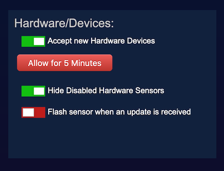

# Add a new device (pairing)

This how-to explains how to add a new Zigbee device to the coordinator and get its widgets in Domoticz.

## Principle

A Zigbee network is encrypted. To pair a device, the network is *opened* for a short time (*permit to join*): the new device joins, receives the network key, and can then talk to the coordinator once the network is closed again.

Once the device has joined, the plugin interviews it (endpoints, clusters, model), configures it, and creates the matching widgets in Domoticz.

## Before you start: let Domoticz accept new devices

The plugin creates the widgets itself, but Domoticz refuses any new widget while its own *Accept new Hardware Devices* setting is off: the Domoticz log then shows `Device creation failed, Domoticz settings prevent accepting new devices`.

In Domoticz, go to *Setup > Settings > System* and check that *Accept new Hardware Devices* is enabled (or click *Allow for 5 minutes* before pairing).

This Domoticz setting is not the *Accept new hardware* switch of the plugin WebUI menu bar: the WebUI switch opens the **Zigbee network** for pairing for 4 minutes, the Domoticz setting allows the **widgets** to be created.

The new widgets are listed in Domoticz under *Setup > Devices* (the last ones). Click the green arrow of the ones you want to use to add them to the dashboards.

## Pairing tips

* Pair one device at a time, and open the pairing again for each device.
* Pair devices where they will be used, not next to the coordinator: a device remembers the parent it joined through.
* Pair the routers (mains-powered devices) first, starting with the ones closest to the coordinator and moving away, then the end devices (battery devices).
* Check whether your device needs a special procedure: see the [Devices specifics](Readme.md#devices-specifics) pages.

More advice in [Build a Zigbee network](HowTo_Build-a-ZigBee-network.md).

## Pairing methods

Pairing is done on the *Admin > Provisionning* tab of the WebUI (see [WebUI Admin](WebUI_Admin.md#pairing)). The steps below are for plugin 9.1.009 and later; the [older page](#before-plugin-91009) is described at the end of this section.

In the **Pair a new device** card, choose where the device may join:

1. [Anywhere on the network](#1-anywhere-on-the-network): the usual way.
2. [Through one router](#2-through-one-router): the device joins through the router you choose.

------------------------------------------------
### 1. Anywhere on the network

1. Select **Anywhere on the network** and click *Open for 4 minutes*. The card shows *Accepting new devices* and the time left. The *Accept new hardware* switch of the WebUI menu bar does the same.
1. Check that the coordinator LED blinks or changes color (depending on the coordinator).
1. Reset the device to start its pairing (see the device documentation).
1. **Devices that joined** shows the device as *Discovering* while the plugin reads what it can do, then *Paired*, with what the plugin learned about it (model, certified or not, endpoints and clusters) and the widgets created.

*4 minutes again* gives 4 more minutes, *Stop* closes the network before the end. The list of joined devices is kept until you leave the page; leaving the page doesn't close the network.

Only devices joining for the first time are listed. A device that was already known to the plugin (re-paired) doesn't appear: check the Domoticz log (*Setup > Log*, you can filter on the plugin name) to see that it has rejoined.

If a device shows *Failed* or *Unexpected*, or if nothing happens after 2 minutes:

* check the Domoticz log for errors;
* prepare a full reset of the device (see [Reset of a device](#reset-of-a-device)) and pair it again;
* restart the plugin and try again.

------------------------------------------------
### 2. Through one router

By default a new device joins through whichever router or coordinator answers it. You can make it join through a router you choose, for example a device far from the coordinator.

The device is only forced to join through that router: later, the network may route its messages another way, and you have no control over that.

1. Make sure the network is not open for pairing: if it is, click *Stop*.
1. Select **Through one router**, then choose the router in the list.

   

1. Click *Open for 4 minutes*. Only this router accepts new devices.
1. Reset the device to start its pairing, and follow it in **Devices that joined** as above.

After a device has joined, the network may be opened on all the routers. To pair another device through that specific router only, start again from step 1.

------------------------------------------------
### Before plugin 9.1.009

The *Admin > Provisionning* page has one panel per method:

* **Pairing a new device with the assistant**: click *Pairing*, reset the device, and the assistant shows what the plugin learned about it. Click *Exit* to close the assistant.
* **Pairing a new device for a period of time**: *4 minutes* opens the network, *Stop* closes it. You follow the pairing in the Domoticz log.
* **Pairing a new device on a router**: select the router, then *4 minutes*.

## Managing the widgets of a device

When a device is paired, the plugin creates one widget per function of the device. For example an Aqara temperature sensor gets 5 widgets: Temperature, Humidity, Pressure, Temperature + Humidity, and Temperature + Humidity + Pressure.

You can delete the widgets you don't need in Domoticz. A deleted widget is not created again on its own. To get it back:

* **Recreate the widgets**: on the *Admin > Provisionning* tab, in **A device already paired**, choose the device and click *Recreate widget* (before plugin 9.1.009: the **Recreate widget(s) of existing device** panel). All the widgets of the device are created again, so you get duplicates of the ones you kept (in the example above: 2 kept + 5 recreated = 7 widgets). Delete the duplicates you don't want in Domoticz.
* **Or remove and pair again**: delete all the remaining widgets of the device (this removes the device from the plugin, see [Remove a device](HowTo_Remove-device.md)), then pair it again. The 5 widgets are created again, but **the history of the old widgets is lost**.

Don't delete **all** the widgets of a device unless you want to remove it: deleting the last widget removes the device from the network.

## Reset of a device

If you factory-reset a device that is already paired, prepare the plugin first: on the *Admin > Provisionning* tab, in **A device already paired**, choose the device and click *Reset mode* (**Prepare a full reset**; before plugin 9.1.009: the **Preparing device for full reset** panel).

The plugin forgets what it learned about the device (bindings, reporting configuration…). At its next pairing, the device goes through the full discovery and configuration again, as if it were paired for the first time. Its existing widgets are kept.

## If the pairing fails

See [Troubleshooting pairing or connection](Troubleshooting_Pairing.md).
