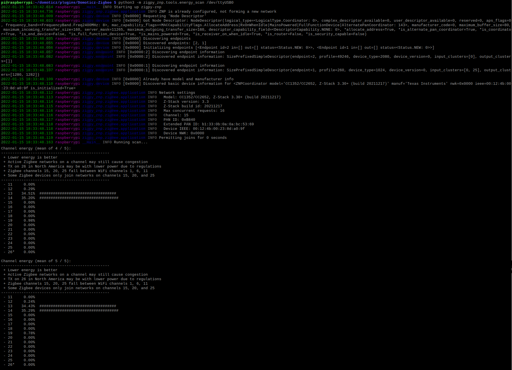

# Real-time interference scan

An *energy scan* measures the radio activity (Wi-Fi, other Zigbee networks, Bluetooth…) on each Zigbee channel, 11 to 26. It helps you choose a quiet channel for your network (see [ZigBee and Wi-Fi](Info_ZigBee-and-Wifi.md) and [Change the Zigbee channel](HowTo_Change-ZigBee-channel.md)).

The WebUI *Network > Interference level* page runs one scan at a time while the plugin is running (see [WebUI Network](WebUI_Network.md#interference-level)). The command-line tools below scan continuously, with the plugin stopped. They also test that the system can talk to the coordinator: if they fail, the problem is between the system and the dongle (port, access rights, firmware), not in the plugin.

**The lower the value, the quieter the channel.**

These tools work with zigpy coordinators (Texas Instruments, Silicon Labs, ConBee/RaspBee…), not with a ZiGate.

## Before you start

1. **Stop the plugin**: the coordinator port can only be used by one program at a time.
1. Open a terminal and activate the Python virtual environment of Domoticz, where the plugin's Python modules are installed (see [Python virtual environment](HowTo_PythonVirtualEnv.md)). Don't install anything with `sudo pip3`.

In the commands below, replace `/dev/ttyUSB0` with the serial port of your coordinator (preferably its `/dev/serial/by-id/...` path).

## With zigpy-cli (all zigpy coordinators)

The `zigpy` command (zigpy-cli) is installed with the plugin:

```bash
zigpy radio znp /dev/ttyUSB0 energy-scan
```

Use `znp` for Texas Instruments, `ezsp` for Silicon Labs and `deconz` for ConBee/RaspBee.

## With the zigpy-znp tool (Texas Instruments only)

Texas Instruments (ZNP) coordinators also have a dedicated tool, which displays a live chart of all the channels:

```bash
python3 -m zigpy_znp.tools.energy_scan /dev/ttyUSB0
```

It scans until you stop it; add `-n 10` to stop after 10 scans. If it reports a missing module (such as `coloredlogs`), install it with `pip install coloredlogs` in the Domoticz virtual environment.



*This picture may have changed since this documentation was written.*

## Stop the scan

Press `Ctrl`+`C` to stop the scan, then start the plugin again.
