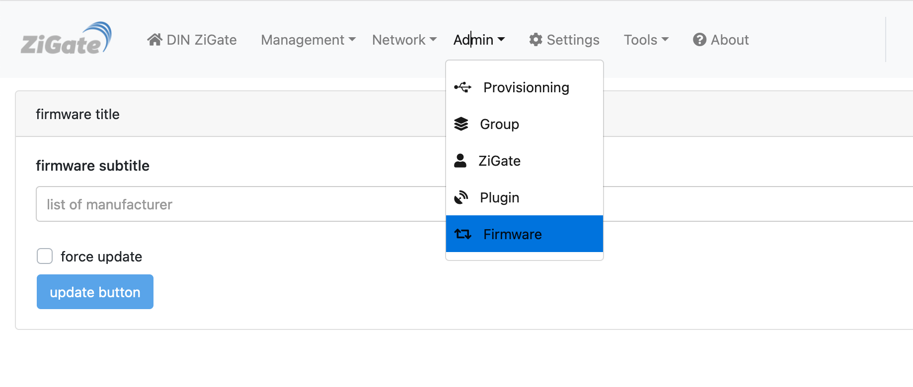

# Updating the firmware of a Zigbee device (OTA)

## Overview

The plugin can update the firmware of a Zigbee device over the air (OTA), for any
manufacturer that follows the Zigbee OTA Upgrade cluster.

The important thing to understand first: **the plugin is an OTA server.** The device
downloads its new firmware; the plugin answers its requests. When you start an update
from the WebUI, the plugin sends the device an *Image Notify* ("a new image is ready
for you"). A mains-powered device usually asks for the image within a second. A
battery-powered device sleeps, misses the notification, and asks on its own schedule,
which belongs to its firmware: typically hours, sometimes a day or more. The plugin
keeps the update ready for it.

An update is slow by design: about 35 minutes for a 250 KB image on a busy network
(see [What to expect](#what-to-expect)).

> **Note:** updating several devices at once (the [queue](#several-devices-the-queue)),
> the Status lines described on this page and the refusal reasons are available from
> plugin version **9.1.009**. Earlier versions update one device at a time: a request
> for several devices, or made while another update runs, is refused with a Warning in
> the log.

You also have to obtain the firmware yourself. Some manufacturers publish their
images, many do not, and the plugin never downloads an image for you.

## How an update actually happens

1. The device sends a *Query Next Image Request* carrying its manufacturer code, its
   image type and its current version.
2. The plugin looks through the images it loaded **at startup** for one matching that
   **manufacturer code and image type**. The brand name and the folder play no part in
   this match — both come from the image's own header.
3. If it has a matching, newer image *and* you authorised the update, it serves the
   image block by block until the device reports *Upgrade End*. The device then
   reboots on its new firmware.
4. If it has a matching, newer image but no update is planned for that device, it says
   so once in the log (from plugin version **9.1.009**):

   ```
   Firmware 1021-0013-003f45ff-NLV.zigbee (version 0x003F45FF) is available for NLV Legrand [d841], which runs version 0x00234203: start the update from the WebUI
   ```
5. If it has no matching image, it can look the device up in an online firmware index
   and tell you in the log that an update exists and where to put it.

Step 5 is usually how you find out an update is available at all.

## Step 1 — Find out that a firmware exists

With `checkFirmwareAgainstZigbeeOTARepository` enabled (it is, by default), the plugin
checks devices against published firmware indexes and reports what it finds:

```
Z4D detects a potential new firmware for device Kitchen bulb [1a2b]
   current version: 419499589
     firmware type: 432
    newest version: 423638661
     firmware type: 432
   URL to download: https://raw.githubusercontent.com/Koenkk/zigbee-OTA/master/images/...
   Folder to store: INNR
```

That last line is the one to act on: it names the folder the image belongs in.

The indexes consulted are the [Koenkk zigbee-OTA
index](https://github.com/Koenkk/zigbee-OTA), IKEA's own firmware feed and Sonoff's
firmware feed. All three are configurable — see [Settings](#settings).

If instead of a folder you see this:

```
   to get this Manufacturer supported: 4454
   provide those informations: {...}
```

then the plugin has no entry for that manufacturer — see
[When your manufacturer is not supported](#when-your-manufacturer-is-not-supported).

## Step 2 — Put the firmware in the right folder

Download the image and save it under the plugin's `OTAFirmware/` directory, in the
folder matching the manufacturer:

| Brand (as shown in the WebUI) | Manufacturer code | Firmware folder(s) |
| --- | --- | --- |
| Danfoss | `0x1246` | `OTAFirmware/DANFOSS/` |
| devbis | `0xDB15` | `OTAFirmware/XIAOMI/` |
| Develco-frient | `0x1015` | `OTAFirmware/GENERIC-1015/`<br>`OTAFirmware/DEVELCO/` |
| EcoDim | `0x126A` | `OTAFirmware/ECO-DIM/` |
| Eurotronic-LiXee-Lumi | `0x1037` | `OTAFirmware/GENERIC-1037/`<br>`OTAFirmware/EUROTRONICS/`<br>`OTAFirmware/LIXEE/`<br>`OTAFirmware/LUMI/` |
| Ikea | `0x117C` | `OTAFirmware/IKEA-TRADFRI/` |
| Innr | `0x1166` | `OTAFirmware/INNR/` |
| Ledvance | `0x1189` | `OTAFirmware/LEDVANCE/` |
| Legrand | `0x1021` | `OTAFirmware/LEGRAND/` |
| Namron | `0x1224` | `OTAFirmware/NAMRON/` |
| Nodon | `0x128B` | `OTAFirmware/NODON/` |
| Osram1 | `0xBBAA` | `OTAFirmware/OSRAM/` |
| Osram2 | `0x110C` | `OTAFirmware/LEDVANCE/` |
| Philips | `0x100B` | `OTAFirmware/PHILIPS/` |
| Salus | `0x1078` | `OTAFirmware/SALUS/` |
| Schneider | `0x105E` | `OTAFirmware/SCHNEIDER-WISER/` |
| SonOff | `0x1286` | `OTAFirmware/SONOFF/` |
| Xiaomi | `0x115F` | `OTAFirmware/XIAOMI/` |
| z03mmc | `0x0084` | `OTAFirmware/XIAOMI/` |

Each folder contains a `README.md` naming where that manufacturer publishes its
firmware.

A few things worth knowing:

- **The file name does not matter.** The plugin reads the manufacturer code, image
  type and version out of the image header, so you can rename files freely. Keep only
  `README.md` and firmware images in these folders.
- **Several brands can share a folder**, and that is fine — `Xiaomi`, `devbis` and
  `z03mmc` all read from `OTAFirmware/XIAOMI/`.
- **The root is configurable.** `pluginOTAFirmware` (an advanced setting) can point
  the whole tree somewhere else, for instance to keep large images off an SD card.

### Why some folders are named `GENERIC-<code>`

A Zigbee manufacturer code is not unique to a company. `0x1037` is used by Eurotronic,
LiXee **and** Lumi; `0x1015` by Develco and frient. Since an image is matched on its
manufacturer code and image type, there is no way — and no need — to tell those
vendors apart.

Those codes therefore have a single entry covering all of their vendors, with a
`GENERIC-<code>` folder as the place to put new images. The former per-vendor folders
(`EUROTRONICS/`, `LIXEE/`, `LUMI/`, `DEVELCO/`) are still read, so firmware you
already put there keeps working and nothing needs moving.

## Step 3 — Restart the plugin and check the image was loaded

**Firmware folders are read once, when the plugin starts.** Dropping a file in while
the plugin is running has no effect until you restart it.

After the restart, the log lists everything it loaded:

```
Z4D loads the firmware images
 --> Brand: Innr Image File: 1166-01b0-19403685-rb282c-1.9.64.ota
```

If your file is not listed, see [Troubleshooting](#troubleshooting).

## Step 4 — Run the update

Go to **Admin → Firmware** in the WebUI:



Select:

* the **brand**, as spelled in the table above
* the **firmware image** to use
* the **devices** to send it to

You can select **several devices at once**, and start more updates while others are
running, even with different firmware images.

`force update` lets the image be served to a device that is not on an older version —
use it to re-flash or to go back to an earlier version. Without it, a device is only
offered an image strictly newer than what it runs.

### Several devices: the queue

> **Note:** available from plugin version **9.1.009**.

The plugin upgrades **three devices at a time**. Each update you start takes a
*transfer slot* if one is free, otherwise it waits in the queue:

* A device with a slot is notified at once and is served when it asks.
* The other devices wait, oldest request first. When a transfer ends (success, failure,
  or no block requested for 5 minutes), the next device in the queue gets the slot
  and is notified.
* A **battery-powered** device that asks on its own while the three slots are taken
  gets a fourth slot: it might not ask again for hours. Mains-powered devices never use
  it.
* A device that does not answer its notifications (10 tries, 5 seconds apart) gives its
  slot back so the queue keeps moving, but stays authorised for **24 hours**. If it
  asks within that time it is served; after that the request is dropped and the
  notification widget says so.

With a ZiGate in native mode, the coordinator holds one image at a time: one transfer
at a time.

While several transfers run, the plugin spaces the blocks of each device by the number
of transfers (twice as much for two, four times for four, up to one second), so that
together they load the network about as much as a single transfer.

### What you see in the WebUI

The footer shows the devices holding a slot, then their progress, in the same order:


`OTA: 4333, b1b7 30%, 35%` reads: `4333` at 30%, `b1b7` at 35%. A device that was
notified but has not asked yet shows `Notified`. Devices waiting in the queue are not
shown in the footer: the log says which ones wait.

When the last transfer ends, the footer keeps its outcome (`Success`, `Timeout`, …).

On the Firmware page, the device list shows for each device the date (`OTALastTime`),
image type and version of its last completed update.

### What you see in the log

> **Note:** available from plugin version **9.1.009**.

Each update you start gets one Status line saying whether it took a slot, followed by
the state of the queue:

```
Firmware update started for 4333 with 1021-0010-004445ff-NLM.zigbee: the device is notified (active: 4333 - queued: none)
Firmware update started for b1b7 with 1021-000e-004e45ff-NLF.zigbee: the device is notified (active: 4333, b1b7 - queued: none)
Firmware update started for d841 with 1021-0013-003f45ff-NLV.zigbee: the device is notified (active: 4333, b1b7, d841 - queued: none)
Firmware update queued for 9a9a with 1021-0013-003f45ff-NLV.zigbee: waits for a free transfer slot (active: 4333, b1b7, d841 - queued: 9a9a)
```

Then, while it runs:

```
Firmware transfer for b1b7/01 - Progress:  5.0%
...
OTA upgrade completed with success - b1b7/01 0019 Version: 0x004e45ff Type: 0x000e Code: 0x1021 Status: 00
Firmware update started for 9a9a with 1021-0013-003f45ff-NLV.zigbee: the device is notified (active: 4333, d841, 9a9a - queued: none)
```

Progress is logged once per 5% step. A device that asks on its own (battery device,
or one that missed its notifications) gets `…: the device asked for it (…)`.

### When an update is refused

> **Note:** available from plugin version **9.1.009**.

Some requests are refused straight away, with a Warning or Status line in the log:

| Reason | What to do |
| --- | --- |
| Unknown brand / Unknown firmware file | The file is not loaded. Most often it was removed or renamed after the plugin started, or the WebUI page shows a list from before a restart: reload the page. |
| Unknown device / Unknown endpoint | The device was removed or re-paired; reload the page. |
| A firmware update is already queued or in progress for this device | Nothing to do: it is on its way. |
| The device already runs this firmware version or a newer one | The device reported that version the last time it asked. Use `force update` to install it anyway. |

A device that asks and turns out to run that version already, or whose hardware
version the image does not support, has its request dropped with the reason in the
log and in the notification widget.

> The Firmware page shows its "update requested" message even when the request is
> refused. Check the log.

### What to expect

Field measurements on an EZSP coordinator, Legrand devices, 250 KB images:

| Situation | Speed | 250 KB image |
| --- | --- | --- |
| One transfer | about 220 bytes/s | about 20 minutes |
| Two transfers at the same time | about 115 bytes/s each | about 35 minutes each |
| Three or four transfers | the same total, shared: about 75 or 55 bytes/s each (estimate) | about 55 or 75 minutes each (estimate) |

After *Upgrade End* the device reboots on its new firmware (about one minute for these
devices), announces itself again, and reports its new version the next time it asks.

**Stopping or restarting the plugin forgets the queue and the transfers in
progress.** Start the update again from the Firmware page afterwards. Whether the
device continues its download depends on the device: the Legrand devices tested
continued where they stopped, but started again from the beginning after a power cut.

### Updating without picking devices by hand

Enabling `autoServeOTA` makes the plugin serve any matching image to any device that
asks for one, without going through the Firmware page. Convenient if you keep a
curated set of images; be aware it will update every device matching an image you have
placed in the folders. The queue applies: a device that asks while the slots are taken
is queued and notified when its turn comes (from plugin version **9.1.009**).

## Settings

All under **Settings → OTA** in the WebUI.

| Setting | Default | What it does |
| --- | --- | --- |
| `autoServeOTA` | off | Serve a matching image to any device that asks, without selecting it in the WebUI |
| `checkFirmwareAgainstZigbeeOTARepository` | on | Look devices up in the online indexes and report available firmware in the log |
| `EnableOTATracing` | off | Verbose OTA transfer tracing (advanced; useful when reporting a problem) |
| `ZigbeeOTA_Repository` | Koenkk `index.json` | URL of the main firmware index (advanced) |
| `IkeaTradfri_Repository` | IKEA feed | URL of the IKEA firmware feed (advanced) |
| `Sonoff_Repository` | Sonoff feed | URL of the Sonoff firmware feed (advanced) |

> OTA support is enabled by default and no longer has a visible on/off switch. Older
> versions of this page described an "Enable OTA" checkbox under *Available services*;
> that setting is now internal, and there is nothing to turn on.

## When your manufacturer is not supported

If the log prints a bare manufacturer code instead of a folder:

```
   to get this Manufacturer supported: 4454
   provide those informations: {'fileName': '...', 'manufacturerCode': 4454, ...}
```

the plugin recognises that a firmware exists but has nowhere to file it, and it will
not read the image even if you download it. Adding a manufacturer is a small change —
please [open an
issue](https://github.com/zigbeefordomoticz/Domoticz-Zigbee/issues/new/choose) and
paste those two lines in full. The `provide those informations` line carries
everything needed.

## IKEA: downloading the whole catalogue

For IKEA TRÅDFRI a helper script fetches every published image:

```bash
cd Domoticz-Zigbee/OTAFirmware/IKEA-TRADFRI
../../Tools/ikea-ota-download.py
```

That pulls a lot of files. If you only want to update, say, the signal repeater or the
control outlet, keep the images whose names contain `TRADFRI-signal-repeater` or
`TRADFRI-control-outlet` and delete the rest — fewer images means a faster startup
scan.

## Troubleshooting

**The image is not listed at startup.**
Check in order: it is in a folder from the table above; the plugin was restarted after
you put it there; the file is a real `.ota`/`.zigbee` image rather than an HTML error
page saved under the wrong name; and the folder contains nothing but `README.md` and
images.

**`another firmware with the same ImageType and another brand is already loaded`.**
Two images declare the same image type. Only one can be kept; remove the one you do
not need.

**The device never starts the transfer.**
Check the log first: the update may be queued behind three others (`waits for a free
transfer slot`). Otherwise, a battery device starts when it next asks, which can be
hours; it stays authorised for 24 hours. Some mains-powered devices ignore the
notification too and only ask at power-on: switching the device off and on makes it
ask within a few seconds.

**The transfer starts and stalls.**
Usually a mesh problem: move the device closer to a router, or retry when the network
is quieter. The plugin keeps per-manufacturer timing settings (block size, delay,
retries); if a particular manufacturer stalls consistently, report it with
`EnableOTATracing` turned on so the timing can be adjusted.

**The device reports a version that does not change after a successful update.**
Some devices only report the new version after a power cycle. After a `force update`
of the same file, the device reports the same version as before: that is expected.

**The progress goes back to 0%.**
The device restarted its download, usually after a power cut. The plugin serves it
again from the beginning.

## See also

* [Device OTA firmware list and sources](Info_Firmware-list.md)
* [Retrieving Legrand firmware](Corner_Retreiving-Legrand-Firmware.md)
* [Updating the ZiGate coordinator firmware](HowTo_Update-ZiGate-firmware.md) — a
  different procedure, for the coordinator rather than a device

## References

* [Koenkk zigbee-OTA — image repository and index](https://github.com/Koenkk/zigbee-OTA)
* [deCONZ OTA image types and firmware versions](https://github.com/dresden-elektronik/deconz-rest-plugin/wiki/OTA-Image-Types---Firmware-versions)
* [Older IKEA-specific procedure (archived)](Archives/IKEA-OTA-Upgrade-old.md)
