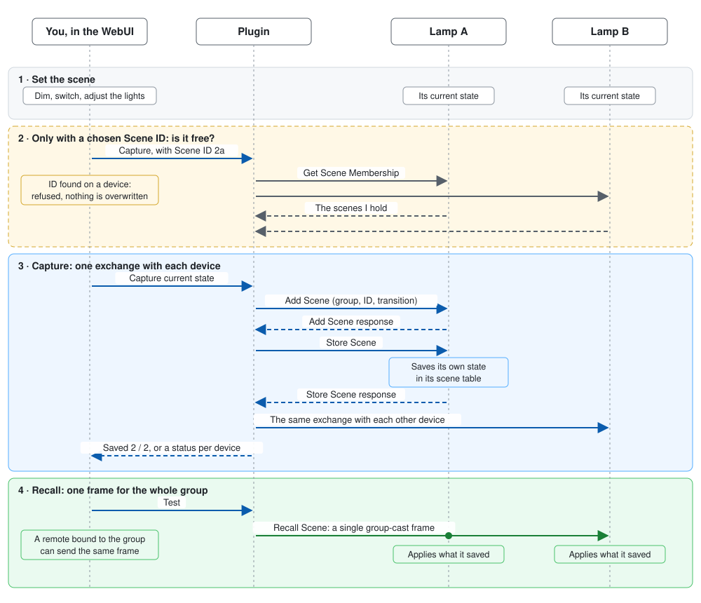
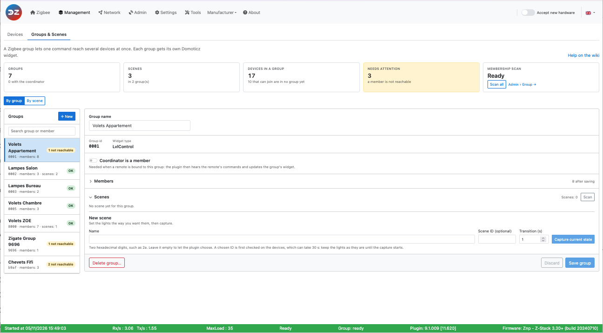
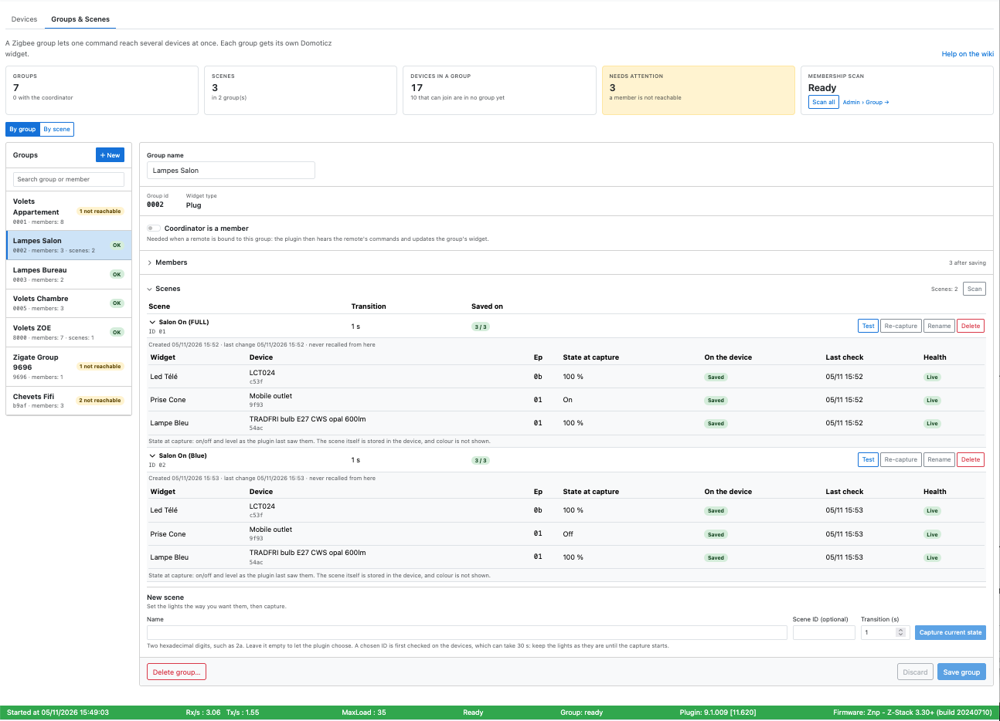
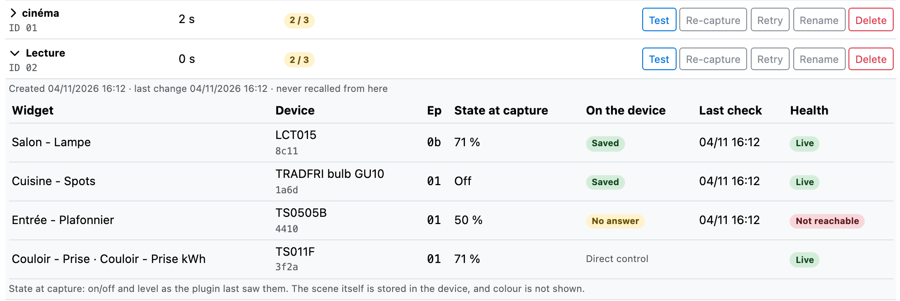
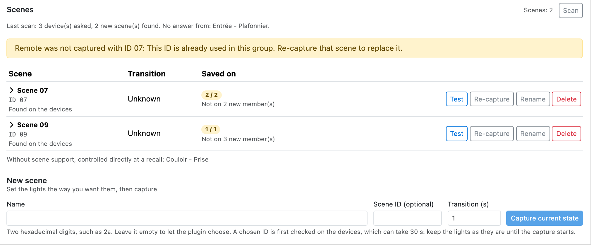
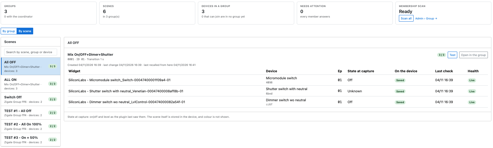

# Zigbee scenes

This page explains what a Zigbee scene is, how it differs from a Domoticz scene, how the plugin records one, and how to use the WebUI to manage them.

> **Plugin 9.1.010 and later, zigpy radios only.** Native scenes are not available on ZiGate.

## What a Zigbee scene is

A Zigbee scene is a state that **the devices remember themselves**. You set your lights the way you want them, you ask each device to save that state under a number, and from then on one short command tells them all: "go back to number 3".

* **A scene lives in the devices**, not in the plugin and not in Domoticz. Each device keeps its own scene table, with what it has to do: its on/off state, its level, its colour if it has one.
* **A scene belongs to one group.** On a device, a scene is identified by its group and its scene ID, from `00` to `ff`. Scene `01` of group `0001` and scene `01` of group `0002` are two different scenes. So you need a [Zigbee group](HowTo_Group-management.md) first.
* **The name is only known to the plugin.** The devices only know the ID.
* **Recalling a scene takes a single frame**, sent to the group. Each device of the group receives it, looks in its own table, and applies what it saved.

## Zigbee scenes or Domoticz scenes?

Domoticz has its own scenes (*Setup > More Options > Scenes/Groups*). They are a different thing: a list of commands that Domoticz sends one after the other.

| | Zigbee scene | Domoticz scene |
|---|---|---|
| Where it is stored | In each device | In Domoticz |
| What is sent | One frame to the group | One command per device |
| Timing | All the devices start together | One after the other: on a large scene you can see the lights change in turn |
| Network load | One frame, whatever the size of the group | Grows with the number of devices |
| Fading | Done by the devices, from the transition time of the scene | Depends on what each command allows |
| Without Domoticz | A Zigbee remote that recalls the scene keeps working | Nothing happens |
| Devices | Zigbee only, in the same group | Anything Domoticz controls: Zigbee, Wi-Fi, 433 MHz… |
| Triggers | The WebUI, or a Zigbee remote (see [Limits](#limits-today)) | Timers, events, dzVents, the Domoticz dashboard |
| Capacity | Limited by the table of each device | No real limit |

**Choose a Zigbee scene** when several Zigbee lights must change together, without a visible delay, or when a remote must keep working if Domoticz is down.

**Stay on a Domoticz scene** when you mix technologies, or when you need timers and Domoticz events. Today a Domoticz scene cannot trigger a Zigbee scene (see [Limits](#limits-today)).

## How a scene is recorded and recalled



1. **Set the scene.** Use your widgets or switches to put the lights in the state you want. The plugin does not choose the state: it captures what is there.
1. **Check the ID, only if you chose one.** Saving a scene replaces whatever a device already holds under that ID, and the plugin only knows its own scenes. So it first asks each device which scenes it holds, and refuses if the ID is taken (see [Choosing the scene ID](#choosing-the-scene-id)).
1. **Capture.** The plugin talks to **each device separately**, not to the group, because only a direct command gets an answer. It sends *Add Scene*, which creates the entry with the transition time, then *Store Scene*, which makes the device save its current state. The answer to *Store Scene* decides: the device is *Saved*, or the page tells you why not.
1. **Recall.** The plugin sends one *Recall Scene* to the group. The devices do the rest.

A device of the group **without the Scenes cluster**, such as some plugs, cannot store anything. The plugin keeps its on/off state and level at the capture and sends them as direct commands at each recall. It shows as *Direct control*. A device with a Scenes cluster only as an output, such as a remote, is not part of the scene.

## Before you start

1. Enable [group management](HowTo_Group-management.md#enable-group-management) and create a group with your lights.
1. In *Settings*, *Available services*, enable __Enable native Zigbee scenes__ (`enableNativeScenes`).
1. Click *Save* and restart the plugin.

The coordinator does not have to be a member of the group: *Coordinator is a member* plays no part in capturing or recalling a scene.

## The Groups & Scenes page

Everything happens on *Management > Groups & Scenes*. The page has the [key figures](WebUI_Management.md#key-figures) on top, a switch **By group / By scene**, and below it the list and the detail of what you selected.



With scenes enabled, the key figures gain **Scenes**: the number of scenes, the number of groups that have some, and how many need a look, for example a device that did not save the scene. In the list of groups, each group shows its number of scenes.

### By group

This is where you create and change scenes. Select a group: its scenes are in the **Scenes** section, under its members. Both sections fold when you click their title.



| Column | What it shows |
|---|---|
| Scene | The name, and the scene ID in hexadecimal. Click it to see the [devices](#the-devices-of-a-scene). *Found on the devices* marks a scene the plugin did not create (see [Scan](#find-the-scenes-already-on-the-devices)). |
| Transition | The time the devices take to reach the state of the scene when it is recalled, in seconds (see [The transition time](#the-transition-time)). *Unknown* on a scene found by a scan. |
| Saved on | How many devices with the Scenes cluster hold the scene: `3 / 3`. Green when all do, orange when one is missing, grey during a capture. *Direct control* devices are not counted. *Not on n new member(s)* means devices joined the group since the capture. |

| Button | What it does |
|---|---|
| **Test** | Recalls the scene, for real: the lights change. |
| **Re-capture** | Replaces the scene with the current state of the lights, and lets you change the transition time. Devices that joined the group since then are added. |
| **Retry** | Only when a device failed. Captures again on the failed devices only. Each one saves **the state it is in now**, so put the lights back first. |
| **Rename** | Changes the name in the plugin. Nothing is sent to the devices. |
| **Delete** | Removes the scene from the devices of the group and from the plugin, after a confirmation. |

[The transition time](#the-transition-time) can only change with *Re-capture*: on a device, it is saved with the scene.

### The devices of a scene

Click a scene to open it. The first line gives its dates: when it was created (or found), its last change, and when it was last recalled from the WebUI.



| Column | What it shows |
|---|---|
| Widget, Device, Ep | The Domoticz widget, the model and short address of the device, its endpoint. |
| State at capture | On/off and level **as the plugin last saw them** at the capture. It is a reminder, not what the device holds: nothing reads it back, and colour is not shown. *Unknown* means the plugin had no value. That is normal on a shutter, which does not report on/off or level, and on a scene found by a scan. The scene itself is fine. |
| On the device | *Saved*, *Waiting…* during a capture, or what went wrong (see [Troubleshooting](#troubleshooting)). *Direct control* for a device without the Scenes cluster. |
| Last check | When the device last confirmed this scene: at the capture, or at a scan. |
| Health | The state of the device, as on the [device list](WebUI_Management.md#device-management). |

### Create a scene



1. Set the lights the way you want them.
1. Select the group and go to **New scene**.
1. Give it a **Name**: up to 32 characters, without `|`, and unique in the group.
1. Set the **Transition**, in whole seconds (see [The transition time](#the-transition-time)).
1. Click **Capture current state**. The scene appears with *Waiting…* on its devices, then *Saved*.

Leave **Scene ID** empty unless you need a particular one: the plugin takes the lowest free ID.

### The transition time

**Transition** is the time a device takes to go from the state it is in to the state of the scene, **when the scene is recalled**. It is a fade, and it has nothing to do with the capture: capturing a scene changes nothing on the lights, whatever the transition.

For example, a scene saved with a lamp at 100 % and a transition of 5:

* the lamp is at 20 %: on a recall it rises to 100 % over 5 seconds;
* the lamp is off: it comes on and rises to 100 % over 5 seconds;
* the lamp is already at 100 %: nothing shows.

| Transition | What happens at a recall |
|---|---|
| `0` | The device goes to the state as fast as it can. |
| `1` | One second. This is the default. |
| Up to `65534` | About 18 hours. Whole seconds only. |

What to know about it:

* **The device keeps it, with the scene.** A recall carries no time, so the transition is the same from the WebUI and from a Zigbee remote.
* **To change it, re-capture.** There is no other way, and *Re-capture* also saves the state the lights are in now: put them back first.
* **The device does the fade.** It only applies to what can change gradually. A plug or a relay goes straight to on or off. If a device jumps instead of fading, its firmware ignores the transition: the plugin cannot change that, and it does not know it either. Try it with *Test*.
* **A *Direct control* device** has no scene to hold it. At a recall the plugin sends it the level with the same time. On or off without a level goes at once.
* **On a scene found by a scan it shows *Unknown*:** the device holds one, but a scan cannot read it. *Test* shows it in practice. *Re-capture* sets it, starting from `1`, and so does *Retry* on a failed device.

It is not the same thing as the [Command transitions for Lights in Groups](WebUI_Settings.md#command-transitions-for-lights-in-groups) of the *Settings*. Those are in tenths of a second, for the commands of the group widget. They play no part in a scene.

### Choosing the scene ID

You may need a given ID, typically for a remote that recalls a fixed scene. Enter it in **Scene ID** as two hexadecimal digits, such as `2a`. Be careful with remotes that document a decimal number: scene 42 is `2a`.

Such a remote usually has a fixed group too, and the scene must be in that group: a scene is identified by both. In that case, create the group with the [*Group id*](HowTo_Group-management.md#create-a-group) it uses.

Since saving under an ID replaces what a device holds, the plugin first scans the group:

* *Checking that ID 2a is free on the devices…* shows during the scan. It can last 30 seconds if a device does not answer. **Leave the lights as they are**: they are captured when the scan ends, not when you clicked.
* If the ID is free, the capture starts on its own.
* If a device holds the ID, nothing is overwritten and a message tells you. The scene it holds now shows in the list as *Found on the devices*. If it is the one you want to replace, use its *Re-capture*.

A device that does not answer the scan cannot be checked, and it is captured like the others.

### Find the scenes already on the devices

A remote or another controller may have set scenes on your devices. The **Scan** button of the Scenes section asks each device of the group which scenes it holds.

A scene the plugin does not know appears as *Scene 07*, marked *Found on the devices*, with an *Unknown* transition. You can test it, rename it or delete it. A scan can only learn the ID, not what the scene contains: to see it, test it. *Re-capture* makes it a normal scene.

A scan also checks the scenes the plugin knows: a device that no longer holds one shows *No longer on this device*.

The line under the title gives the result of the last scan, and which devices did not answer.

### By scene

**By scene** turns the page around: Scene, then Group, then Device. It is the place to see everything at a glance.



The list on the left has every scene, with its groups, its number of devices and how many saved it. Search by scene, group or device.

**Scenes with the same name are shown as one**, with their groups below it. A `Cinema` scene on two groups is really two scenes, but this is how you think of it. In that case **Test in the n groups** recalls them all, one frame per group.

Each group has its **Test** button and **Open in the group**, which takes you to that scene in *By group*: re-capture, rename and delete are done there, as they apply to one group.

## Limits today

* **No Domoticz widget yet.** A scene can be recalled from the WebUI, from the [REST API](#for-the-curious) or by a Zigbee remote, not from a Domoticz widget, so neither from a Domoticz scene, timer or script directly.
* **The plugin does not follow a recall sent by a remote.** *Last recalled* only counts the WebUI.
* **Colour** is saved by the devices that support it, but not shown in *State at capture*. A *Direct control* device gets on/off and level only.
* **Battery devices** do not follow group commands (see [Zigbee groups](HowTo_Group-management.md#how-zigbee-groups-work)), so they do not follow a scene either.
* **Group `0000`** cannot hold scenes.
* **The table of a device is limited**, and the limit depends on the device. It is shared by all its groups.
* A device that **leaves a group** through the plugin loses the scenes of that group. A scene with no device left disappears, so deleting a group deletes its scenes.

## Troubleshooting

| What you see | What it means | What to do |
|---|---|---|
| *Restart the plugin to use scenes.* | The setting is on, the plugin was not restarted. | Restart the plugin. |
| No Scenes section | The setting is off, or the group is new and not saved yet. | See [Before you start](#before-you-start). |
| *None of the devices in … supports Zigbee scenes.* | No device of the group has the Scenes cluster. | The devices can still be used in a group. |
| *No answer* | The device did not answer within 30 seconds. | Check that it is powered and reachable, set it in the right state, then *Retry*. |
| *Scene table full* | The device has no room left. | Delete scenes on this device, in any of its groups. |
| *Refused: status xx* | The device refused, with this ZCL status. | Note the status and turn on the *Scene* debug. |
| *Interrupted by a restart* | The plugin restarted during a capture. | *Retry*. |
| *No longer on this device* | A scan did not find the scene on the device: it was reset, or the scene was removed by something else. | *Retry* or *Re-capture*. |
| *Not on n new member(s)* | The devices joined the group after the capture. | *Re-capture*. |
| *The coordinator is busy.* | The plugin has too many commands waiting. | Try again in a moment. |
| A scene does not do what you saved | The device stored something else, or was not in the state you thought. | *Test* it, then *Re-capture* with the lights set. |

## For the curious

* **Debug.** Turn on the *Scene* category in [*Tools > Debug*](WebUI_Tools.md#debug) to see each step in the plugin log.
* **REST.** A scene can be recalled from a script, with the port of the plugin:

  ```sh
  curl -X PUT http://<server>:9440/rest-z4d/1/scenes/0001/01/recall
  ```

  Here `0001` is the group and `01` the scene. The change is a `PUT`, like the other changes of the plugin.
* **Where the plugin keeps them.** Names, transition times and statuses are in `Z4D_Scenes-<HardwareID>.json`, in the plugin data folder, and in the Domoticz hardware record. To read that record:

  ```sh
  python3 Tools/query_domoticz_hardware_configuration_record.py \
    --db domoticz.db \
    --id <HardwareID> \
    --decode-b64 \
    --entry PluginStore-Z4D_Scenes.Records
  ```
