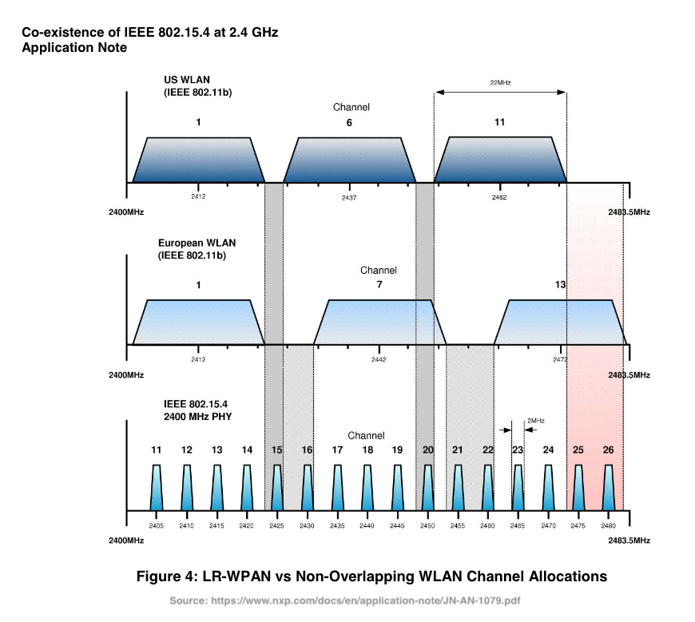

# ZigBee and Wifi

## Plugin Configuration

The choice of 2.4-GHz band channel for the network is pre-configured as either a fixed channel (in the range 11-26) or a set of channels from which the best channel will be selected by the Coordinator. In the latter case, the Coordinator performs an energy scan of the possible channels and chooses the quietest channel.

The channel is set with the `channel` setting of the WebUI (*Settings*, *Coordinator settings*, advanced): `default` lets the coordinator choose, or pick a fixed channel from 11 to 26. Changing it on a running network is described in [Change the Zigbee channel](HowTo_Change-ZigBee-channel.md).

## 1. Channel Selection
The channels 25 and 26 can be used in North America for operation clear of Wi-Fi interference.
For deployment in an environment where resource planning and bandwidth allocation can be guaranteed (see Section 1.2.5
 ‘Channel Allocation’), a channel centre-frequency offset of 7 MHz is recommended to ensure acceptable co-existence with Wi-Fi.   The non-overlapping channels (1, 6 and 11 for North America, 1, 7 and 13 for Europe) can also be used
to avoid Wi-Fi interference where non-overlapping Wi-Fi channels have been allocated.

## 2. Physical Separation
Ensuring a physical separation of at least 8 m from a Wi-Fi Access Point (AP) will ensure acceptable co-channel IEEE 802.15.4 performance.

## 3. Mesh Networking
The ZigBee protocol offers the additional benefits of a self-organizing and self-healing dynamic mesh network. In this kind of environment, path diversity offers better channel use. If a chosen path fails as a result of interference, the network will select a different path

Source: https://www.nxp.com/docs/en/application-note/JN-AN-1079.pdf
