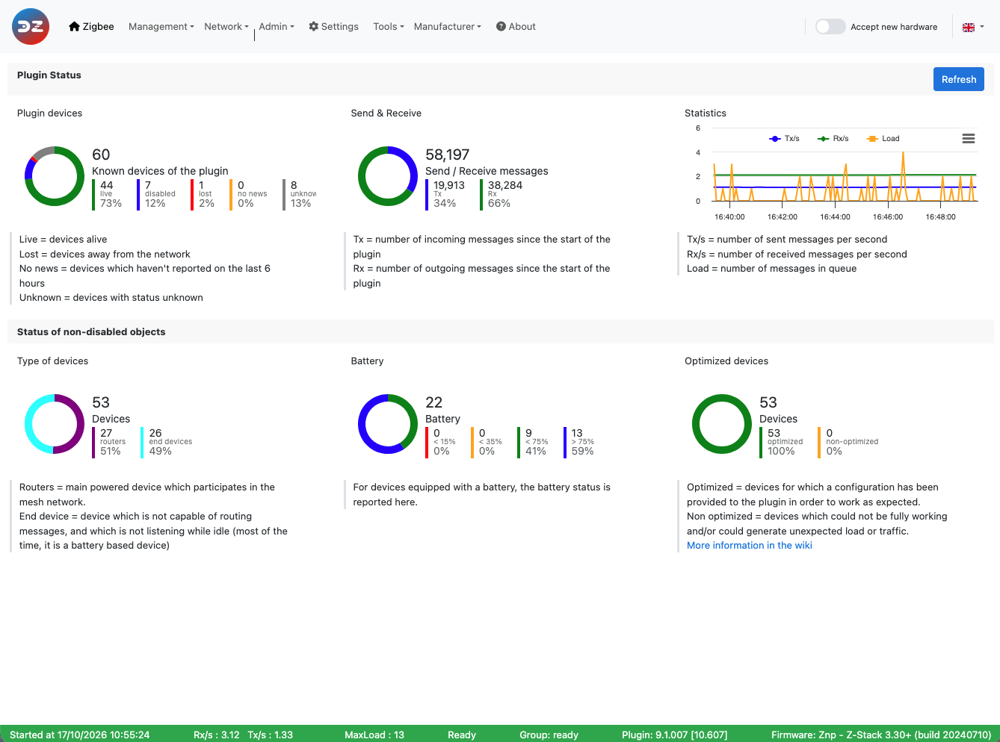

# Plugin configuration

This is step 3 of the installation: open the plugin WebUI and check its settings. You should have finished [Step 1: Plugin installation](Plugin_Installation.md) and [Step 2: Plugin settings](Plugin_Settings.md).

## Open the WebUI

The plugin has its own web interface (WebUI), separate from the Domoticz one. It gives access to:

* a dashboard of the plugin, the coordinator and the devices;
* device and group management;
* the network topology and the radio interference level;
* the administration of the coordinator, the plugin and the devices (pairing, firmware updates…);
* the plugin settings;
* tools to send commands to devices, bind them, debug and see the errors.

Open `http://<Domoticz server address>:9440/z4d/` in your browser, where `9440` is the *Plugin WebUI port* set in the plugin hardware. On the Domoticz server itself: `http://127.0.0.1:9440/z4d/`.

By default the plugin also adds an entry, with the name of the plugin hardware, to the Domoticz *Custom* menu, which opens the WebUI inside Domoticz (see [Step 4: Plugin integration](Plugin_Integration.md)).

*This picture may have changed since this documentation was written.*

If the WebUI doesn't open:

* check that you use the *Plugin WebUI port* of the plugin hardware (each plugin instance has its own port);
* check that the plugin is started (Domoticz log) and that a firewall doesn't block the port;
* if the *Plugin WebUI port* is `127.0.0.1:9440`, the WebUI is only reachable from the Domoticz server itself (or through a reverse proxy).

## Security

The WebUI and its REST API have no login: anyone who can reach the port can manage your Zigbee network. **Don't open the port to the Internet.** To reach the WebUI from outside:

* restrict the WebUI to the local machine with a *Plugin WebUI port* of `127.0.0.1:9440`, and put it behind a reverse proxy that asks for a login (see [Reverse proxy with Caddy](HowTo_Reverse-Proxy-with-Caddy.md), [Reverse proxy with Apache 2](HowTo_Reverse-Proxy-with-Apache2.md));
* the WebUI can also be served over HTTPS by the plugin itself, with the `SSLCertificate` and `SSLPrivateKey` settings (see [WebUI Settings](WebUI_Settings.md)). This encrypts the traffic but doesn't add a login.

See also the security notes of the [REST API](Technical/REST-API.md#security).

## Check the settings

Go to the *Settings* page of the WebUI (see [WebUI Settings](WebUI_Settings.md)). The defaults suit most installations; switch *Advanced settings* on to see all of them. A setting marked *plugin restart* takes effect after a restart: the *Restart needed* indicator blinks in the menu bar until you restart the plugin (*Admin > Plugin*).

## Find your way in the WebUI

* The menu bar: the pages, the *Accept new hardware* switch that opens the network for pairing, and the indicators (restart needed, errors). See [General presentation](WebUI_General-presentation.md).
* The bar at the bottom of every page: start time, messages per second, *MaxLoad* (a value above 5 can be a sign of congestion, often caused by devices polled too often), plugin state, plugin and coordinator firmware versions. See [The footer](WebUI_Dashboard.md#the-footer).
* The other pages are described in the [plugin Web interface](Readme.md#4-the-webui) section.

Next step: [Step 4: Plugin integration](Plugin_Integration.md), then [pair your devices](HowTo_Pairing-device.md).
