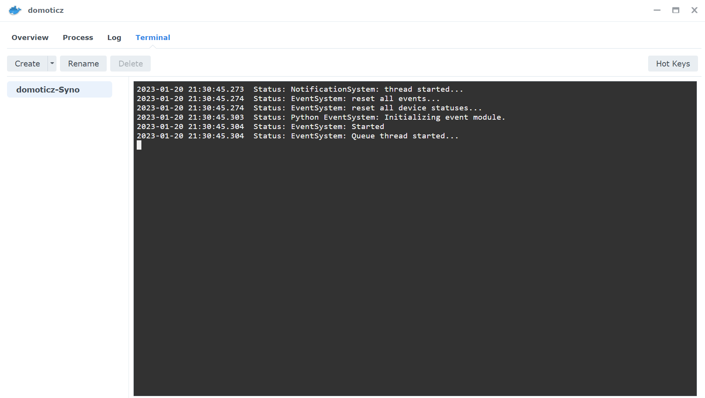
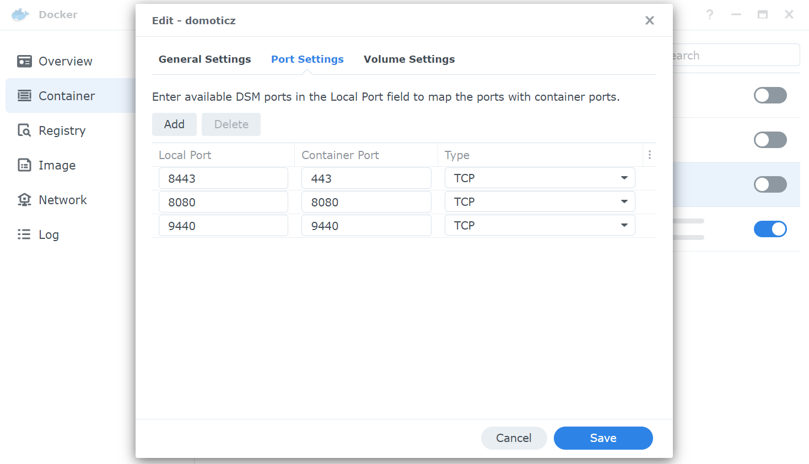

# ZigBeeForDomoticZ plugin installation

## Requirements

`stable9` (version 9.1.xxx) is the current production branch of the plugin, and the one this page installs.

* **Domoticz 2026.3 is the recommended version.** The plugin starts on Domoticz 2025.1 or newer (the first release with the Domoticz Extended Framework, which `stable9` is built on), but you get the best results with the latest Domoticz release.
* **Python 3.11 or newer**, with the matching __python3-dev__ package. The plugin refuses to start on an older Python. More information on the [Domoticz Python page](https://www.domoticz.com/wiki/Using_Python_plugins).
* **A supported Zigbee coordinator**: see [Compatible coordinators](Coordinators.md).
* Linux is the reference platform (Raspberry Pi OS, Debian, Ubuntu, or Docker). Windows is not officially supported.

> **Several instances of the plugin on Python 3.11:** with Domoticz 2026.x and Python 3.11 (for example Debian/Raspberry Pi OS Bookworm), the second instance of the plugin fails to start because of a Python 3.11 problem ([domoticz/domoticz#6763](https://github.com/domoticz/domoticz/issues/6763)). If you need more than one coordinator, use Python 3.12 or newer.

You are on an older branch (`stable8` or below)? Don't reinstall: follow [Upgrading from stable8 to stable9](HowTo_Upgrade-stable8-to-stable9.md).

## Installation methods

* 1 - [Manual installation on Linux](#1---manual-installation-on-linux)
* 2 - [Installation on Docker](#2---installation-on-docker)
* 3 - [Installation on a Synology NAS (Docker)](#3---installation-on-a-synology-nas-docker)
* 4 - [Installation on Windows](#4---installation-on-windows)
* 5 - [Installation on OpenWRT](#5---installation-on-openwrt)
* 6 - [Python Plugin Manager](#6---python-plugin-manager)

PiZigate installation (Raspbian and Fedora) has moved to [Legacy - PiZigate installation](Legacy_PiZigate-Installation.md): ZiGate coordinators are no longer supported.

------------

## 1 - Manual installation on Linux

This method is valid for Linux: Raspberry Pi OS, Debian, Ubuntu, etc. Adapt the command lines to your system.

### 1.A - Prerequisites

* Domoticz and Python as described in [Requirements](#requirements).
* `git`, `python3-venv` and `python3-dev` installed:

  ```bash
  sudo apt update
  sudo apt install git python3-venv python3-dev
  ```

* On Raspberry Pi OS, the Lite version is not recommended because many packages are missing.

The examples below assume:

* user: `pi`
* user home directory: `/home/pi`
* Domoticz installed under: `/home/pi/domoticz`
* Python virtual environment for Domoticz: `/home/pi/Domoticz_Python_Environment`

### 1.B - Find the Python version used by Domoticz

If you have several Python 3 versions installed, the Python modules must be installed for the one Domoticz uses. Look for this line in the Domoticz log:

`Status: PluginSystem: Started, Python version '3.13.5', 12 plugin definitions loaded.`

See [What is the python version running under Domoticz](HowTo_PythonVirtualEnv.md#1-find-the-python-version-of-domoticz) for details.

### 1.C - Procedure

1. Go to the __plugins__ folder of Domoticz:

   ```bash
   cd /home/pi/domoticz/plugins/
   ```

1. Get the plugin (`stable9` branch):

   ```bash
   git clone -b stable9 https://github.com/zigbeefordomoticz/Domoticz-Zigbee.git
   ```

   The folder __Domoticz-Zigbee__ is created in the plugins folder.

1. Create the Python virtual environment for Domoticz, if you don't have one yet (use `python3.xx` instead of `python3` if Domoticz runs another version than your default `python3`):

   ```bash
   cd /home/pi
   python3 -m venv Domoticz_Python_Environment
   source Domoticz_Python_Environment/bin/activate
   pip install --upgrade pip
   ```

1. Install the Python modules required by the plugin, inside the virtual environment:

   ```bash
   source /home/pi/Domoticz_Python_Environment/bin/activate
   cd /home/pi/domoticz/plugins/Domoticz-Zigbee
   python3 -m pip install -r requirements.txt --upgrade
   ```

1. Make Domoticz start with this virtual environment (`VIRTUAL_ENV` and `PATH` in the systemd service or in `domoticz.sh`). This is a one-time setup, described in [Using Python Virtual Environment](HowTo_PythonVirtualEnv.md#5-start-domoticz-with-the-virtual-environment).

1. Give the plugin files to the user running Domoticz (adapt __pi:pi__ to your __user:group__; mind the dot at the end) and make __plugin.py__ executable:

   ```bash
   sudo chown -R pi:pi .
   chmod +x plugin.py
   ```

1. Restart Domoticz:

   ```bash
   sudo systemctl restart domoticz
   ```

   (or `sudo service domoticz.sh restart` if you still use the old init script).

The ZigBee for DomoticZ plugin appears in the hardware list (at the very bottom of the __Type__ list).
Move on to [step 2 Plugin settings](Plugin_Settings.md).

------------

## 2 - Installation on Docker

These steps use the official `domoticz/domoticz` image. It already comes with a Python virtual environment (`VIRTUAL_ENV` is set in the container), so there is no venv to configure. Everything the plugin needs lives in the Domoticz __userdata__ folder, which must be a volume mapped to the host so the plugin survives container updates.

For a complete step-by-step example on a Raspberry Pi, see [How to install Zigbee4Domoticz on a Docker based setup](How-To-Install-RPI-Docker.md).

### 2.A - Get the plugin

From the host, in the folder mapped to `/opt/domoticz/userdata`:

```bash
cd userdata/plugins
git clone -b stable9 https://github.com/zigbeefordomoticz/Domoticz-Zigbee.git
```

### 2.B - Install the Python modules

The modules are installed inside the container, and must be installed again whenever the container is recreated from a new image. Choose one of these options:

* **Custom start script (recommended).** Copy `Domoticz-Zigbee/Tools/customstart.sh` to the root of your __userdata__ folder. The Domoticz image runs it when the container starts: on the first start of a new container, it installs a few tools and runs `Tools/plugin-auto-upgrade.sh`, which installs the modules from `requirements.txt`.

  ```bash
  cp userdata/plugins/Domoticz-Zigbee/Tools/customstart.sh userdata/customstart.sh
  ```

* **Your own image.** The plugin ships `Docker/dockerfile` and `Docker/docker-compose.yml`, which build a Domoticz image with the Python modules already installed. Copy both files next to your __userdata__ folder, adapt the time zone, the image name and the coordinator device path, then build and start. `Tools/update_domoticz_docker_container.sh` helps you rebuild the image and update the plugin.

* **Manually**, from a shell in the container:

  ```bash
  docker exec -it domoticz bash
  cd /opt/domoticz/userdata/plugins/Domoticz-Zigbee
  python3 -m pip install -r requirements.txt --upgrade
  ```

### 2.C - Coordinator and WebUI port

* Pass the coordinator to the container (`devices:` in docker-compose). Use the `/dev/serial/by-id/...` path on the host, as it doesn't change between reboots, for example `/dev/serial/by-id/usb-ITEAD_SONOFF_Zigbee_3.0_USB_Dongle_Plus_V2_...-if00:/dev/ttyUSB0`.
* Publish the plugin WebUI port (__9440__ by default) in addition to the Domoticz ports:

  ```yaml
      ports:
        - "8080:8080"
        - "443:443"
        - "9440:9440"
  ```

Restart the container. The ZigBee for DomoticZ plugin appears in the hardware list (at the very bottom of the __Type__ list).
Move on to [step 2 Plugin settings](Plugin_Settings.md).

------------

## 3 - Installation on a Synology NAS (Docker)

On a Synology NAS, run Domoticz in Docker (Container Manager). The old native Domoticz package for Synology (from Jadahl) stopped in 2020 and doesn't work on DSM 7.

### 3.A - Prerequisites

Domoticz must be installed in a Docker container, with a __domoticz__ folder mapped to `/opt/domoticz/userdata`, and the USB drivers of your coordinator loaded. Follow [Installation with Docker on Synology](Info_Install-Domoticz-NAS-Synology-Docker.md) first.

### 3.B - Install the plugin

There are two ways to install the plugin and its Python modules. In both cases, open a terminal in the container first:



#### 3.B.1 - With the custom start script

The `customstart.sh` script is run by Domoticz each time the container starts; on the first start of a new container it installs the Python modules of the plugin.

```bash
cd /opt/domoticz/userdata/plugins
git clone -b stable9 https://github.com/zigbeefordomoticz/Domoticz-Zigbee.git
cp Domoticz-Zigbee/Tools/customstart.sh /opt/domoticz/userdata/customstart.sh
```

Then restart the container.

#### 3.B.2 - Manually

```bash
cd /opt/domoticz/userdata/plugins
git clone -b stable9 https://github.com/zigbeefordomoticz/Domoticz-Zigbee.git
cd Domoticz-Zigbee
python3 -m pip install -r requirements.txt --upgrade
```

With this method, run the `pip install` again each time the container is recreated (for example after a Domoticz image update).

### 3.C - WebUI port

Stop the container, click __Edit__ and go to the __Port Settings__ tab. Add the plugin WebUI port (9440 by default):



Start the container. The ZigBee for DomoticZ plugin appears in the hardware list (at the very bottom of the __Type__ list).
Move on to [step 2 Plugin settings](Plugin_Settings.md).

------------

## 4 - Installation on Windows

__Windows is not officially supported:__ the plugin is developed and tested on Linux, and we cannot test on Windows. These notes come from users who run it; feedback is welcome on the [forum](https://www.domoticz.com/forum/viewforum.php?f=68).

### 4.A - Domoticz

* Install all the software as Administrator (right click, __Run as administrator__), otherwise an installation can silently be partial.
* Install Domoticz in a folder where it can write, such as `C:\Domoticz`. The plugin writes files in its own sub-folders (`Conf`, `Data`, `Logs`, `Reports`...): under `C:\Program Files (x86)` you would have to change the folder access rights.
* If the Windows PC is your home automation box, remember that Domoticz must restart on its own after a power cut: a Windows login prompt stops the automatic start (`netplwiz` lets you sign in automatically, at the cost of an unlocked PC).

### 4.B - Coordinator

Install the USB-serial driver of your coordinator (for example Silicon Labs CP210x or WCH CH9102/CH343, depending on the model) and note the COM port it gets in the Device Manager.

### 4.C - Python and Git

* Install Python 3.11 or newer, the version and architecture (64 bits) matching your Domoticz build, from [python.org](https://www.python.org/downloads/windows/). Check the Domoticz log at startup: `PluginSystem: Started, Python version '3.x.y'` means Domoticz found it; a "Python failed" message means it didn't. See [Installing Python for Windows](https://www.domoticz.com/wiki/Using_Python_plugins#Installing_Python_for_Windows) on the Domoticz wiki.
* Install [Git for Windows](https://gitforwindows.org/).

### 4.D - Plugin

* Stop the Domoticz service.
* Open a command prompt as Administrator in the __plugins__ folder of Domoticz (for example `C:\Domoticz\plugins`), then run:

  ```bat
  git clone -b stable9 https://github.com/zigbeefordomoticz/Domoticz-Zigbee.git
  cd Domoticz-Zigbee
  py -m pip install -r requirements.txt --upgrade
  ```

  Use the same Python as Domoticz (`py -3.13 -m pip ...` if several versions are installed).

* Start the Domoticz service.

The ZigBee for DomoticZ plugin appears in the hardware list (at the very bottom of the __Type__ list).
Move on to [step 2 Plugin settings](Plugin_Settings.md).

------------

## 5 - Installation on OpenWRT

__Community procedure, not tested by the plugin maintainers.__

1. Install Domoticz, Python and the USB serial drivers with opkg:

   ```bash
   opkg update
   opkg install domoticz python3 python3-pip python3-dev git-http kmod-usb-serial kmod-usb-serial-cp210x shadow-usermod curl
   ```

   Some modules of `requirements.txt` need to be compiled; OpenWRT also provides prebuilt `python3-*` packages (for example `python3-aiohttp`, `python3-cryptodome`) that you can install with opkg first.

1. The opkg Domoticz package uses its own paths:

   ```bash
   cd /etc/domoticz/plugins
   git clone -b stable9 https://github.com/zigbeefordomoticz/Domoticz-Zigbee.git
   cd Domoticz-Zigbee
   python3 -m pip install -r requirements.txt
   chmod +x plugin.py
   ```

1. Domoticz runs as the `domoticz` user and group. Give it access to the plugin and to the serial port:

   ```bash
   chown -R domoticz:domoticz /etc/domoticz/plugins/Domoticz-Zigbee
   usermod -a -G dialout domoticz
   ```

1. Restart Domoticz:

   ```bash
   service domoticz restart
   ```

1. Check that your Zigbee USB dongle is detected:

   ```bash
   lsusb
   dmesg | grep ttyUSB
   ```

------------

## 6 - Python Plugin Manager

__Not maintained by the plugin team.__ If you use [pp-manager](https://github.com/ycahome/pp-manager), search for the "Zigbee for domoticz Plugin" entry. You still have to install the Python modules (`requirements.txt`) as in [the manual installation](#1c---procedure), and make sure you get the `stable9` branch.
