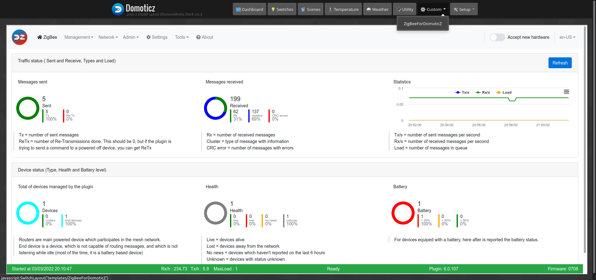
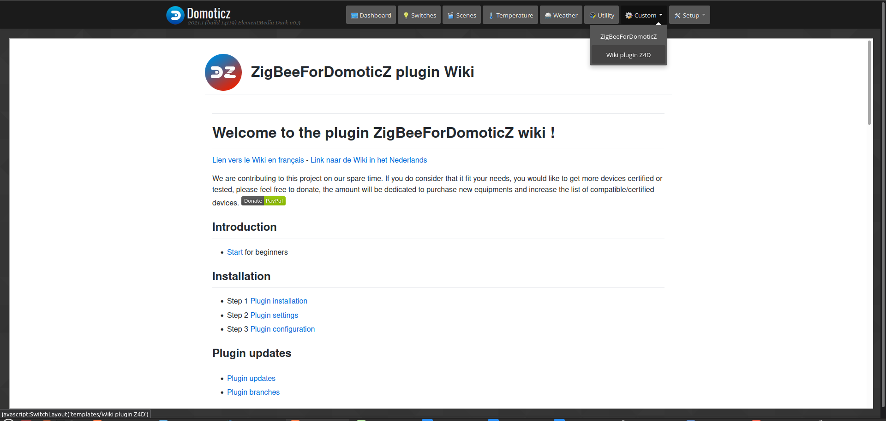

# Integration of the plugin in DomoticZ

The plugin administration interface (WebUI) is available at `http://IP_DomoticZ:9440/z4d/` (9440 is the default WebUI port, set in the [plugin settings](Plugin_Settings.md)). It can also be opened from inside DomoticZ, through an entry of the DomoticZ __Custom__ menu.


*This image is likely to have evolved since writing this documentation.*

## The menu is added automatically

By default, the plugin adds the menu entry itself when it starts, and removes it when it stops. The entry has the name of the plugin hardware in DomoticZ (for example __Zigbee__).

Behind the scenes, the plugin writes the file `www/templates/<hardware name>.html` in the DomoticZ folder. This page opens the WebUI in a frame, at `http://<address you use for DomoticZ>:<WebUI port>/z4d/`.

The __Custom__ menu must be visible in DomoticZ: go to __Setup > Users__ and check the __Custom__ tab for each user who needs it.

### Limits of the automatic menu

The automatic page always opens the WebUI over plain `http`, on the WebUI port, at the same host name as DomoticZ. It doesn't work when:

* you open DomoticZ over `https`: the browser blocks the `http` frame;
* you reach DomoticZ through a reverse proxy, or from outside your home network, where the WebUI port isn't reachable.

In these cases, disable the automatic menu and add your own (see below). For a reverse proxy, see the [Custom Menu section of the Caddy page](HowTo_Reverse-Proxy-with-Caddy.md#5--domoticz-custom-menu).

## Disable the automatic menu

Uncheck __Enable Plugin WebUI from Domoticz Custom menu__ (`DomoticzCustomMenu`) in the WebUI [Settings](WebUI_Settings.md) page, __Available services__ section, then restart the plugin.

## Add the menu manually

1. Disable the automatic menu (see above).

2. Go to the folder __domoticz/www/templates__.

3. Create a file, for example __ZigBeeForDomoticZ.html__. The file name is used as the menu name.

   Don't give it the name of the plugin hardware: the plugin deletes `www/templates/<hardware name>.html` each time it stops, even when the automatic menu is disabled.

4. Put the following line in the html file, with the address and port you use to reach the WebUI:

   ```html
   <IFRAME SRC="http://IP_DomoticZ:9440/z4d/" height="800" width="100%"></IFRAME>
   ```

__Note :__ Do not use 127.0.0.1 or localhost if you connect to DomoticZ from a remote machine. Put the IP you use to connect to the machine hosting DomoticZ, 192.168.1.X for example. Behind a reverse proxy, use the external URL of the WebUI instead.

## Bonus : Add a menu for the Wiki

The wiki can be opened from DomoticZ the same way:

1. Go to the folder __domoticz/www/templates__.

2. Create a file __Wiki plugin Z4D.html__. The file name is used as the menu name.

3. Put the following line in the html file :

   ```html
   <IFRAME SRC="https://zigbeefordomoticz.github.io/wiki/en-eng" height="800" width="100%"></IFRAME>
   ```

You will have access to the EN page of the wiki directly from DomoticZ :


*This image is likely to have evolved since writing this documentation.*

Thanks to __waltervl__ for sharing this [info](https://www.domoticz.com/forum/viewtopic.php?t=38114) with us.
