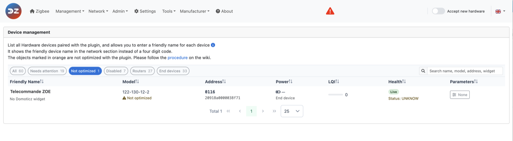
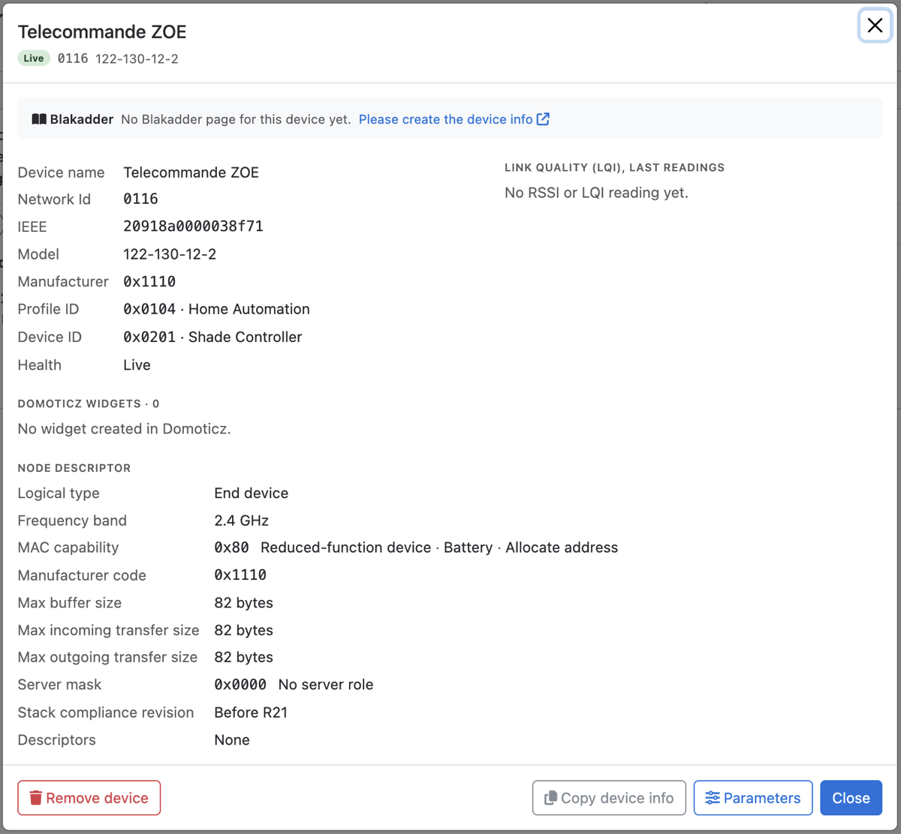

# Dealing with a non-optimized device

## Optimized and non-optimized devices

A device is **optimized** (or *certified*) when the plugin has a configuration file for its model, in the [z4d-certified-devices](https://github.com/zigbeefordomoticz/z4d-certified-devices) database: the widgets to create, the reporting to set up, the device-specific decoding are known and tested.

A device is **non-optimized** when no work has been done yet to integrate its model. The plugin then relies on the Zigbee standard: during pairing it discovers what the device offers (endpoints and clusters: on/off, level, color, window covering, temperature…) and creates widgets from that.

You can see which devices are optimized:

* on the *Dashboard*, in the **Optimized devices** chart (see [WebUI Dashboard](WebUI_Dashboard.md));
* in *Management > Device Management*, under the model of each device: *Optimized* in green, *Not optimized* in orange; the *Not optimized* filter lists them (see [WebUI Management](WebUI_Management.md#device-management)). Before plugin 9.1.009: the green or orange icon of the **Optimized** column;
* in *Tools > Tools*, with the **Non-optimized devices** button, which lists the discovery data of every non-optimized device (see [Use the plugin tools](HowTo_Using-tools.md)).

## After pairing a non-optimized device

Two cases:

1. **The device doesn't work, or only partly**: no widget is created, a widget is missing (for example a switch and a level but no color), or the values are wrong. An integration work is needed to make it work, if the device is compatible.
1. **The device works as expected**: it is still worth checking that the discovery went well, and whether there is something to improve (reporting, widgets, battery…). Non-optimized devices may also generate unexpected traffic.

In both cases, sharing the device data helps get the device optimized, for you and for the other users.

## Ask for the device to be optimized

1. Go to *Management > Device Management*, click the device row to open its details, and click *Copy device info* (before plugin 9.1.009: click the orange icon of the device in the *Optimized* column). Its discovery data (what the plugin learned during pairing) is copied to the clipboard. This is the minimum needed to work on the device.

   

   If the details show *Please create the device info* on the *Blakadder* line, you can also add the device to [zigbee.blakadder.com](https://zigbee.blakadder.com).
1. Create an issue on GitHub: [request a certified device model](https://github.com/zigbeefordomoticz/z4d-certified-devices/issues/new?assignees=&labels=Device+Integration&projects=&template=certified-device-model.md&title=%5BModel+Certification%5D+-+).
1. Paste the discovery data, and add:
   * the product name and brand;
   * a link to the product page, or where you bought it;
   * what works, what doesn't, and what you expect;
   * the Domoticz log of the pairing, if you have it.

If asked, also export the full device data: *Tools > Tools*, *Plugin Raw Devices*, then *Export* (it saves an `export.json` file).

## Fix it yourself

You can write the configuration file of the device yourself and put it in the `Conf/Local-Devices` folder of the plugin, where updates don't touch it. See:

* [Get devices well integrated with the plugin (device customization)](HowTo_Device-Customization.md);
* [Integrate Tuya TS0601 devices with the plugin](HowTo_Device-Customization-TS0601.md);
* [Model name resolution and `Conf/Local-Devices` precedence](Technical/Model-name-resolution.md).

Please share the file in the issue, so that it can be added to the certified database for everyone.
