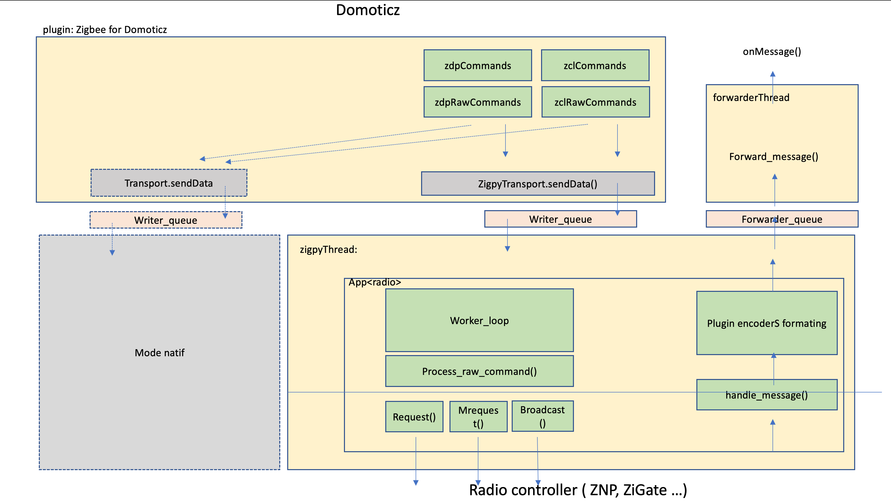

# Plugin technical information

Technical notes for developers and advanced users. Some pages were written while a device was being integrated and haven't been updated since: when in doubt, the plugin code is the reference.

## Plugin internals

* [Plugin directory structure](Plugin-directory-structure.md)
* [Enrolment process](Enrolment-process.md)
* [Plugin database (ListOfDevices)](Plugin_ListOfDevices.md)
  * [Structure of ListOfDevices](Structure-of-ListOfDevices.md)
* [REST API](REST-API.md)
* [Zigpy transport](ZigpyTransport.pptx) (diagram below)
* [Plugin architecture diagram](Plugin%20Architecture%20Diagram.pptx): an old diagram (some of the files it names, such as `output.py` and `domoticz.py`, no longer exist), kept for the overall picture.
* [Developing a Python plugin (Domoticz wiki)](https://wiki.domoticz.com/Developing_a_Python_plugin)

## Device configuration

* [Device configuration files](Device_Configuration_file.md)
  * [Device configuration attributes](device-configuration-attributes.md)
  * [Device specific parameters ("Param" section)](device_specific-parameters.md)
* [Model name resolution and `Conf/Local-Devices` precedence](Model-name-resolution.md)
* [Device-side auto-off: On With Timed Off (ZCL and Tuya)](OnOff-timed-off.md)
* [Standard cluster / widget association](Clusters_Widget.md)
* [Manufacturer codes](Manufacturer-codes.md)
* [Profile ID and ZDevice ID](ProfileID---ZDeviceID.md)

## Device notes

* [Aqara Cube decoding](Aqara-Cube-decoding.md)
* [Orvibo](Orvibo.md)
* [Salus corner](Salus_corner.md)
* [Tuya 0xEF00](Tuya-0xEF00.md)
* [Tuya TS0601 eTRV](Tuya-TS061-eTRV.md)
* [Wiser thermostat](Wiser-Thermostat.md)
* [Xiaomi corner](Xiaomi-Corner.md)
* [Xiaomi smart plug](Xiaomi-Smart-Plug.md)
* [ZLinky integration](zlinky-integration.md)
* [TICmeter integration](ticmeter-integration.md)

## Legacy ZiGate

ZiGate coordinators are no longer actively supported. These pages describe ZiGate internals:

* [NXP ZFCG ZiGate](NXP-ZFCG-Zigate.md)
* [ZiGate PDM on host](ZiGate-PDMonHost.md)
* [ZiGate transport](Transport.pptx) (diagram)
