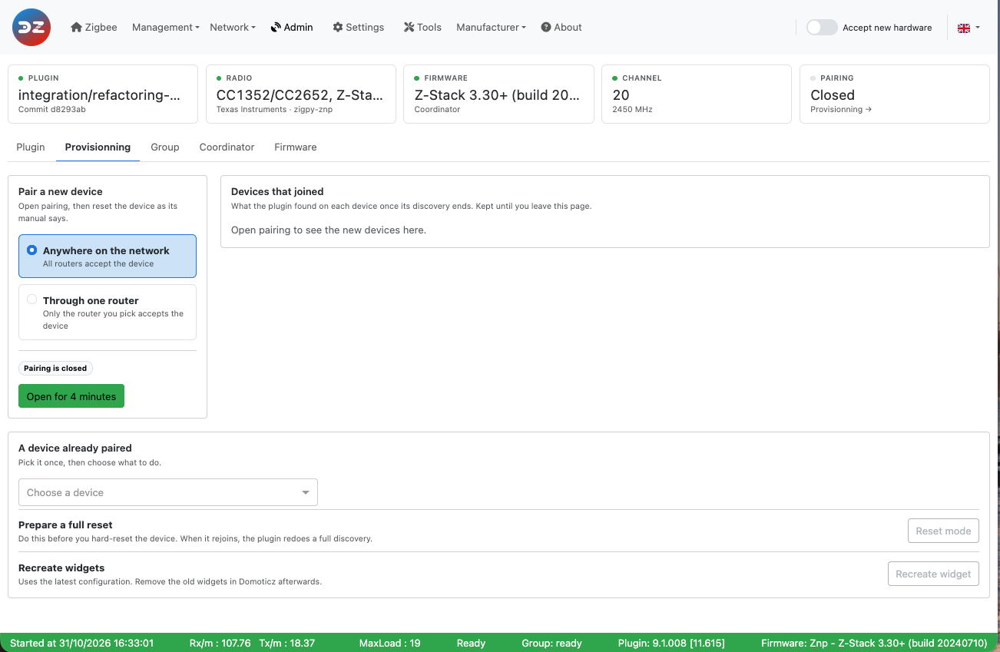
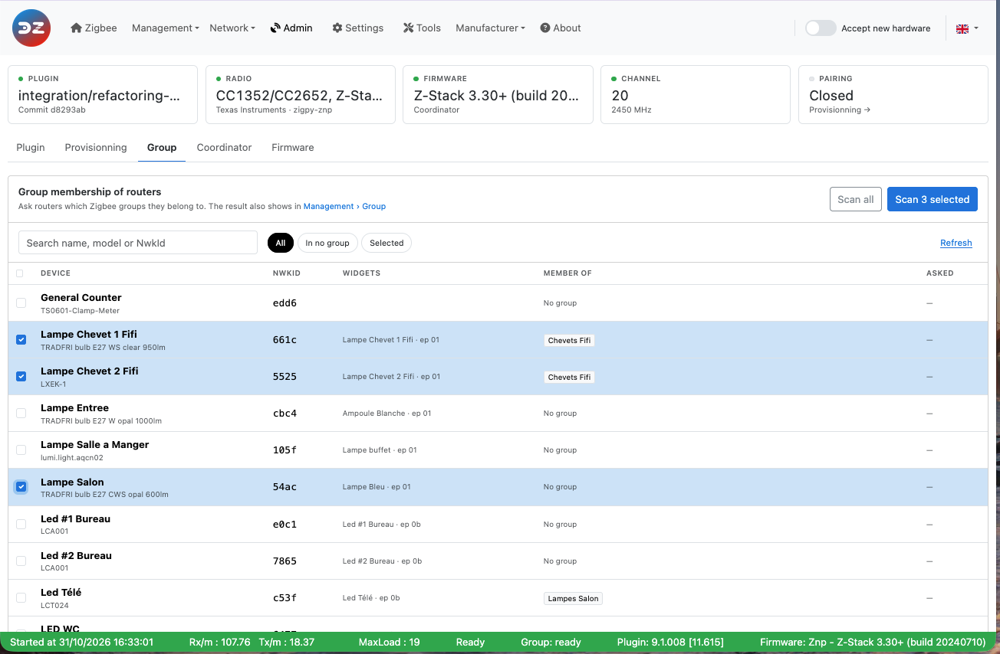
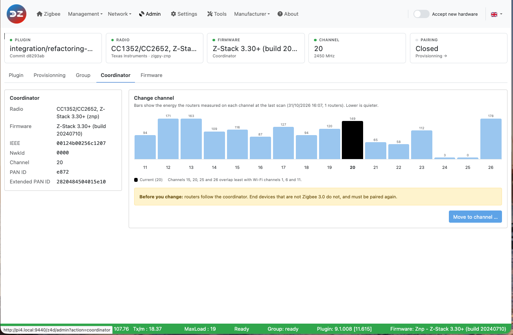
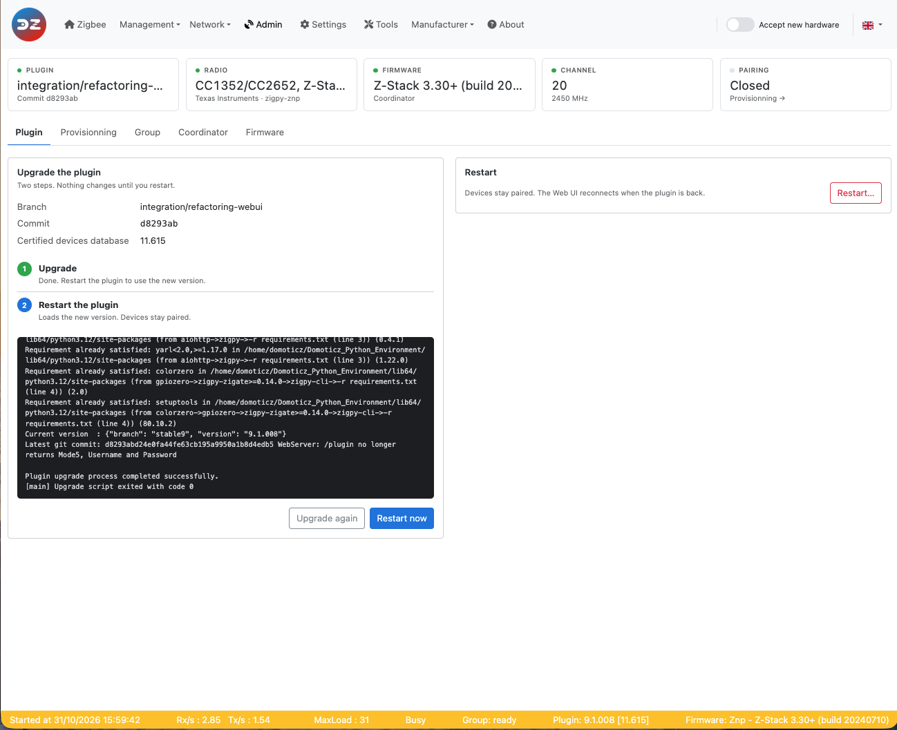
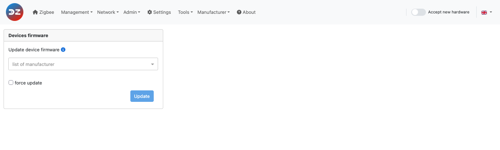

# The Web interface - Admin section

Please refer to STEP 3 [Plugin Configuration](Plugin_Configuration.md) to get access to the Web interface administration.

The __Admin__ menu contains the pages:

* [Provisionning](#pairing) — pair devices
* [Group](#group) — scan the groups
* [Coordinator](#zigate) — restart the coordinator, change the Zigbee channel
* [Plugin](#plugin) — upgrade and restart the plugin
* [Firmware](#firmware) — update the firmware of your devices

------------------------------------------------
## Pairing

The __Provisionning__ page (*Admin > Provisionning*) is used to pair your devices with the coordinator and Domoticz.

*This picture may have changed since this documentation was written.*

It has five panels:

* **Pairing a new device with the assistant**: click *Pairing* to open the network, then reset the device (see its documentation). The assistant shows, for each device that joins, its pairing status, short address (NwkId), IEEE, profile, device type, model, whether the plugin certifies it, its endpoints and clusters, and the widgets created. Click *Exit* to close the assistant.
* **Pairing a new device for a period of time**: *4 minutes* opens the network for pairing for 4 minutes; *Stop* closes it. This is the same as the *Accept new hardware* switch of the menu bar.
* **Pairing a new device on a router**: select a router and click *4 minutes* to let a device join through that router only (useful when the device is far from the coordinator); *Stop* closes it.
* **Preparing device for full reset**: if you are going to factory-reset a device that is already paired, select it and click *Reset mode* first. The plugin forgets what it learnt about the device (bindings, reporting configuration, neighbours…) and, when the device rejoins, redoes a full discovery and configuration as for a first pairing.
* **Recreate widget(s) of existing device**: select a device and click *Recreate widget* to create its Domoticz widgets again, using the latest device configuration. You may end up with duplicate widgets in Domoticz: delete the ones you don't need.

Refer to the tutorial [Add a new device](HowTo_Pairing-device.md) for more information.

------------------------------------------------
## Group

The __Group__ page (*Admin > Group*) scans the group memberships of your devices, so that the plugin knows which device is in which group:

* **Complete analysis of the groups**: *Full scan* asks every device for its groups.
* **Selective analysis of the groups**: select one or more routers and click *Scan* to scan only those.

*This picture may have changed since this documentation was written.*

The groups created via the plugin are seen in Domoticz as a single switch widget, whatever the number of devices in the group. An action on that switch is sent to all the devices of the group.

Groups must be enabled first with the `enablegroupmanagement` setting (see [Group management settings](WebUI_Settings.md#group-management-settings)). Groups themselves are created and edited in *Management > Group Management* (see [Group Management](WebUI_Management.md#group-management)).

Refer to the tutorial [Group Management](HowTo_Group-management.md) for more information.

------------------------------------------------

## Coordinator

The __Coordinator__ page (*Admin > Coordinator*) has two panels:

* **Coordinator Soft reset**: *Soft reset* restarts the coordinator. **Paired devices are kept.**
* **Coordinator change channel**: select a Zigbee channel (11 to 26) and click *Change channel*. The coordinator moves to the new channel and broadcasts the change to the network. Routers usually follow; end devices that are not Zigbee 3.0 may not, and then need to be reset to rejoin the network on the new channel. See [Change the Zigbee channel](HowTo_Change-ZigBee-channel.md).

*This picture may have changed since this documentation was written.*

------------------------------------------------
## Plugin

The __Plugin__ page (*Admin > Plugin*) has two panels:

* **Plugin Upgrade**: *Start upgrade* upgrades the plugin to the latest version of the branch you are on (it runs the plugin's `Tools/plugin-auto-upgrade.sh` script, and can take several minutes). The script output is displayed. If the upgrade succeeds, restart the plugin; if it fails, check the log and upgrade manually as described in [Plugin update](Plugin_Update.md).
* **Restart plugin**: *Restart* restarts the plugin (a confirmation is asked). Use it after a setting that needs a restart, when the *Restart needed* indicator blinks in the menu bar.

*This picture may have changed since this documentation was written.*

------------------------------------------------
## Firmware

The __Firmware__ page (*Admin > Firmware*) updates the firmware of your paired devices over the air (OTA):

1. Select the manufacturer.
2. Select the firmware file.
3. Select the device(s) to update. Tick *force update* to send the image even if the device is not on an older version (to re-flash it, or go back to an earlier version).
4. Click *Update* and confirm.

*This picture may have changed since this documentation was written.*

Refer to [Update device firmware](HowTo_Update-device-firmware.md) for where to put the firmware files and how the update runs.

------------------------------------------------
Look at the other pages of the [plugin Web interface](Readme.md#4-the-webui).
