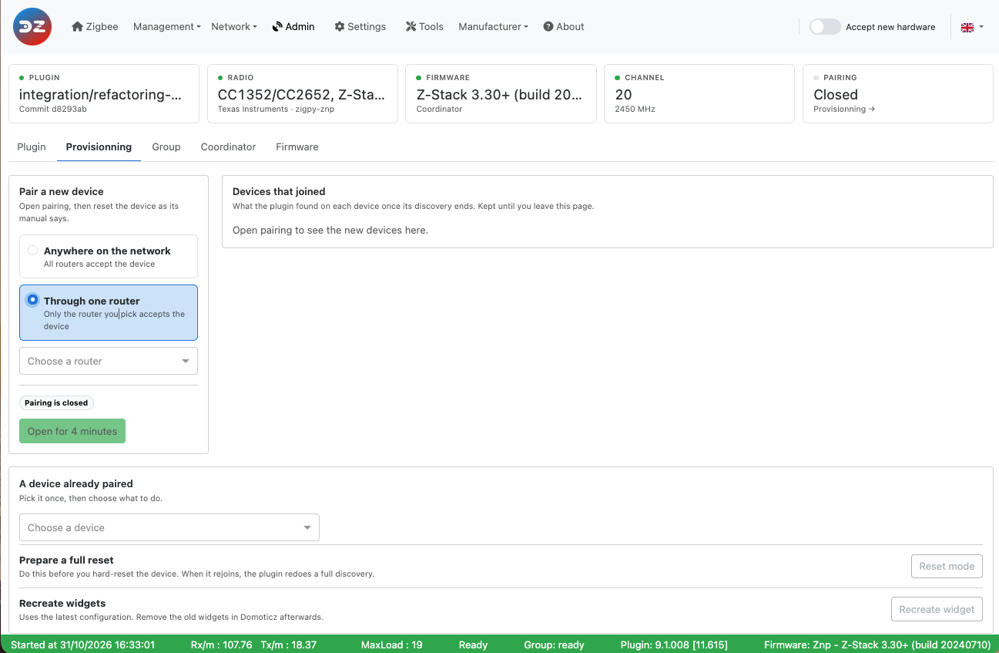

# The Web interface - Admin section

Please refer to STEP 3 [Plugin Configuration](Plugin_Configuration.md) to get access to the Web interface administration.

The __Admin__ page has five tabs:

* [Provisionning](#pairing) — pair devices
* [Group](#group) — scan the groups
* [Coordinator](#zigate) — restart the coordinator, change the Zigbee channel
* [Plugin](#plugin) — upgrade and restart the plugin
* [Firmware](#firmware) — update the firmware of your devices

> **Plugin 9.1.009 and later.** This page describes the Admin page available since plugin 9.1.009. In older versions, *Admin* is a drop-down menu that opens one page per entry.

*Admin* in the menu bar opens the *Plugin* tab.

### The status bar

Above the tabs, a row of cards shows the state of the installation. It is read when the page opens.

* **Plugin**: the version and branch of a release. When the plugin runs from a git branch, the branch name and the commit.
* **Radio**: the coordinator model, with the radio maker and the zigpy library used (for example *Texas Instruments · zigpy-znp*), or *ZiGate*.
* **Firmware**: the coordinator firmware.
* **Channel**: the Zigbee channel, with its frequency.
* **Pairing**: *Closed*, or *Open* with the time left (*No time limit* when pairing is open permanently). Click it to go to the *Provisionning* tab.

Some cards only appear when needed:

* **Firmware transfer**, while a device firmware update runs: the device and the progress. Click it to go to the *Firmware* tab.
* **Group**, while a group scan sends its requests. Click it to go to the *Group* tab.
* **Restart needed**, when a saved setting waits for a plugin restart. Click it to go to the *Plugin* tab.

------------------------------------------------
## Pairing

The __Provisionning__ tab (*Admin > Provisionning*) is used to pair your devices with the coordinator and Domoticz, and to act on a device already paired.

*This picture may have changed since this documentation was written.*

**Pair a new device**: choose where the device may join, then click *Open for 4 minutes* and reset the device as its manual says.

* **Anywhere on the network**: all the routers, and the coordinator, accept the device.
* **Through one router**: only the router you choose in the list accepts the device, for example a device far from the coordinator. *Open for 4 minutes* stays greyed out until a router is chosen.

While pairing is open, the card shows *Accepting new devices*, the time left and a progress bar. *4 minutes again* restarts the 4 minutes, and *Stop* closes pairing. Leaving the page doesn't close pairing. The *Accept new hardware* switch of the menu bar also opens pairing everywhere for 4 minutes.

**Devices that joined** lists each new device while it joins:

* *Discovering*: the device has joined and the plugin is reading what it can do;
* *Paired*: the discovery has ended. The card shows the model, the IEEE, whether the plugin has a certified configuration for it, its device type, its endpoints with their clusters, and the Domoticz widgets created;
* *Failed* or *Unexpected*: check the plugin log, then prepare a full reset (below) and pair the device again.

The list is kept until you leave the page, and emptied when you open pairing *Anywhere on the network*. A device that the plugin already knew (paired again) doesn't appear: check the Domoticz log to see that it has rejoined.

**A device already paired**: choose the device (search by name, NwkId or model), then:

* **Prepare a full reset** (*Reset mode*): do this before you factory-reset a device that is already paired. The plugin forgets what it learnt about the device (bindings, reporting configuration, neighbours…) and, when the device rejoins, redoes a full discovery and configuration as for a first pairing.
* **Recreate widgets** (*Recreate widget*): creates the Domoticz widgets of the device again, using the latest device configuration. You may end up with duplicate widgets in Domoticz: delete the ones you don't need.

Refer to the tutorial [Add a new device](HowTo_Pairing-device.md) for more information.

------------------------------------------------
## Group

The __Group__ tab (*Admin > Group*) asks the routers which Zigbee groups they belong to, so that the plugin knows which device is in which group. The result also shows in *Management > Group Management*.

*This picture may have changed since this documentation was written.*

The table lists the main-powered devices that can be in a group: name and model, short address (NwkId), widgets with their endpoint, the groups the device is a member of, and when it was last asked from this page. Search by name, model or NwkId, and filter with *All*, *In no group* or *Selected*.

* *Scan all* asks every device of the list.
* Tick one or more devices (or the box of the header, for all the devices shown) and click *Scan N selected* to ask only those.

The plugin sends the requests (*Sending the requests…* is shown meanwhile), and the devices answer over the next minutes: click *Refresh* to update the *Member of* column.

The groups created via the plugin are seen in Domoticz as a single switch widget, whatever the number of devices in the group. An action on that switch is sent to all the devices of the group.

Groups must be enabled first with the `enablegroupmanagement` setting (see [Group management settings](WebUI_Settings.md#group-management-settings)): until then, the tab only shows *Group management is off* and a link to the settings. Groups themselves are created and edited in *Management > Group Management* (see [Group Management](WebUI_Management.md#group-management)).

Refer to the tutorial [Group Management](HowTo_Group-management.md) for more information.

------------------------------------------------

## Coordinator

The __Coordinator__ tab (*Admin > Coordinator*) shows what the coordinator is and lets you change the Zigbee channel.

*This picture may have changed since this documentation was written.*

**Coordinator**: the radio, its firmware, its IEEE address, its short address (NwkId, always `0000`), the channel, the PAN ID and the extended PAN ID.

**Change channel**: the bars show, for each channel from 11 to 26, the energy the routers measured at the last energy scan (the average of the routers, from 0 to 255). Lower is quieter. The current channel is in black. Without a scan yet, run one from *Network > Interference level* (see [WebUI Network](WebUI_Network.md#interference-level)). Channels 15, 20, 25 and 26 overlap least with the Wi-Fi channels 1, 6 and 11.

Click a channel number to select it, then *Move to channel N* and confirm. The coordinator moves to the new channel and broadcasts the change to the network. Routers follow; end devices that are not Zigbee 3.0 do not, and then need to be paired again on the new channel. See [Change the Zigbee channel](HowTo_Change-ZigBee-channel.md).

**Soft reset** (ZiGate only): restarts the ZiGate. Paired devices are kept. It is not offered with zigpy coordinators.

------------------------------------------------
## Plugin

The __Plugin__ tab (*Admin > Plugin*) upgrades and restarts the plugin.

*This picture may have changed since this documentation was written.*

**Upgrade the plugin** shows the installed version (for a release), the branch, the commit and the version of the certified devices database. The upgrade has two steps, and nothing changes until you restart:

1. **Upgrade**: click *Upgrade*. The plugin pulls the latest version of the branch you are on and installs the Python modules it needs (it runs the plugin's `Tools/plugin-auto-upgrade.sh` script, and can take several minutes: keep the page open). The output of the script is displayed. If it fails, read the output and upgrade manually as described in [Plugin update](Plugin_Update.md).
2. **Restart the plugin**: when the upgrade is done, click *Restart now* to load the new version. *Upgrade again* runs the upgrade once more.

**Restart**: *Restart…* restarts the plugin, after a confirmation. Devices stay paired, and the WebUI reconnects when the plugin is back. Use it after a setting that needs a restart, when the *Restart needed* card or the blinking indicator of the menu bar says so.

------------------------------------------------
## Firmware

The __Firmware__ page (*Admin > Firmware*) updates the firmware of your paired devices over the air (OTA):

1. Select the manufacturer.
2. Select the firmware file.
3. Select the device(s) to update. Tick *force update* to send the image even if the device is not on an older version (to re-flash it, or go back to an earlier version).
4. Click *Update* and confirm.

*This picture may have changed since this documentation was written.*

Refer to [Update device firmware](HowTo_Update-device-firmware.md) for where to put the firmware files and how the update runs.

------------------------------------------------
Look at the other pages of the [plugin Web interface](Readme.md#plugins-web-interface).
