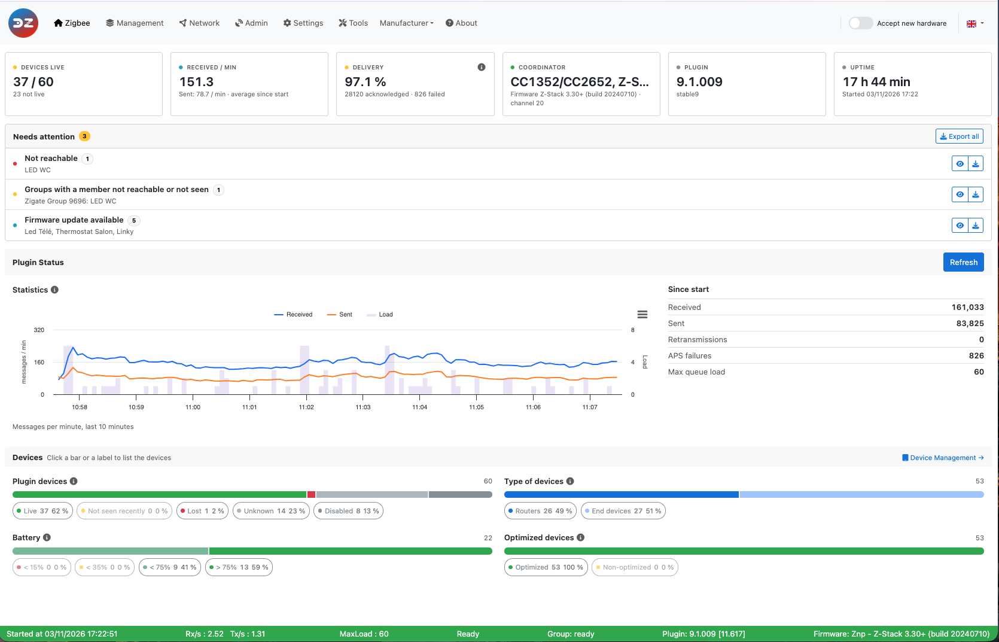

# The Web Interface — General Presentation

The plugin includes a built-in web interface accessible from your browser. It provides a graphical way to manage devices, monitor the Zigbee network, and configure the plugin without editing configuration files directly.

It opens on the [Dashboard](WebUI_Dashboard.md), below the menu bar that is shown on every page:



## Accessing the Web Interface

Please refer to [Step 3 — Plugin Configuration](Plugin_Configuration.md) for instructions on how to enable and access the web interface.

Once configured, the interface is available at:

```
http://<domoticz-ip>:<port>/z4d/
```

The port is the one set in the plugin's hardware parameters (9440 by default).

## Menu

The menu bar at the top of every page gives access to the following sections:

| Menu | Entries | Purpose |
|------|---------|---------|
| *(plugin name)* | — | [Dashboard](WebUI_Dashboard.md): overview of the plugin, the coordinator and the network. The menu shows the name you gave the plugin hardware in Domoticz. |
| [Management](WebUI_Management.md) | Devices, Groups (tabs) | List, rename and configure the paired devices and the Zigbee groups |
| [Network](WebUI_Network.md) | Topology, [Mesh graph](WebUI_Network-Mesh.md) (from plugin 9.1.008), Interference level | Neighbour tables of the mesh, the mesh drawn as a graph, and an energy scan of the Zigbee channels |
| [Admin](WebUI_Admin.md) | Plugin, Provisionning, Group, Coordinator, Firmware | One page with a status bar and five tabs (from plugin 9.1.009; a drop-down menu before). *Plugin*: upgrade and restart the plugin. *Provisionning*: open the network for pairing, full-reset pairing, recreate widgets. *Group*: ask the routers for their groups. *Coordinator*: coordinator details, change the Zigbee channel, soft reset (ZiGate). *Firmware*: device firmware updates (OTA). |
| [Settings](WebUI_Settings.md) | — | The plugin settings |
| [Tools](WebUI_Tools.md) | Data, Command, Binding / Reporting, Debug, Errors | One page with five tabs (from plugin 9.1.009; before, a drop-down menu with *Tools*, *Command*, *Reporting*, *Binding*, *Debug* and *Error(s)*). *Data*: view and download the plugin data, and a support bundle for an issue. *Command*: send commands, or a raw Zigbee frame, to a device. *Binding / Reporting*: the bindings of a device, and its attribute reporting (zigpy coordinators). *Debug*: the debug logging settings. *Errors*: the errors recorded by the plugin. |
| [Manufacturer](WebUI_Manufacturer.md) | CASA.iA, ZLinky, TICmeter, Chameleon | Pages dedicated to some devices. The menu only appears when at least one of these devices is paired, and only lists the ones you have. |
| [About](WebUI_About.md) | — | Plugin version, where to find help (wiki, Domoticz forum, Keybase) and acknowledgements |

## Header elements

On the right of the menu bar:

* **Accept new hardware**: a switch that opens the network for pairing for 4 minutes, then closes it again. See [Add a new device](HowTo_Pairing-device.md).
* **Language**: a flag selects the interface language (English, French, Dutch, Spanish, German, Italian).
* **Restart needed** (blinking exclamation mark): a change is waiting for a plugin restart. Click it to go to *Admin > Plugin*, where the plugin can be restarted. From plugin 9.1.009, a *Restart needed* card also shows at the top of the *Admin* page.
* **Error(s) detected** (blinking red triangle): the plugin has recorded errors. Click it to go to *Tools > Errors* (*Tools > Error(s)* before plugin 9.1.009). See [Deal with errors](HowTo_Dealing-plugin-errors.md).

On a narrow screen the menu collapses behind a ☰ button, and the *Accept new hardware* switch and the language flag move to the bottom of that menu.

## Status colours

From plugin 9.1.011, the cards of the [Dashboard](WebUI_Dashboard.md), [Management](WebUI_Management.md), [Network](WebUI_Network.md) and [Admin](WebUI_Admin.md) pages carry a coloured dot. A colour has the same meaning on every page:

| Dot | Meaning |
|-----|---------|
| 🟢 Green | Fine, nothing to do |
| 🟡 Yellow | Worth a look. It is not always a problem: see the **Plugin** card below |
| 🔴 Red | A problem |
| 🔵 Blue | For information, or in progress |
| ⚪ Grey | Nothing to judge, or not known yet |

### Plugin and coordinator

| Card (page) | 🟢 Green | 🟡 Yellow | 🔴 Red | 🔵 Blue | ⚪ Grey |
|---|---|---|---|---|---|
| **Plugin** (Dashboard, Admin) | never | not a release, or an update is available | never | — | a release, up to date |
| **Coordinator** (Dashboard), **Radio**, **Firmware** (Admin), **Channel** (Admin, Network) | *Ready* | *Busy*, *Starting Up*, *Reconnecting after failure*, *Enrollment in Progress* | *No Communication* with the coordinator, or the plugin is stopping | *Startup* | not known yet |
| **Delivery** (Dashboard) | 98 % or more acknowledged | from 90 % to less than 98 % | under 90 % | — | no acknowledged message yet |
| **Received / min** (Dashboard) | — | — | — | always | — |
| **Uptime** (Dashboard) | — | — | — | — | always |
| **Pairing** (Admin) | pairing is open | — | — | — | closed |
| **Firmware updates** (Dashboard), **Firmware transfer** (Admin) | — | — | — | while it runs | — |
| **Group** (Admin) | — | — | — | while a group scan runs | — |
| **Restart needed** (Admin) | — | always: a setting waits for a restart | — | — | — |

#### Why is the Plugin card yellow?

The plugin works normally. The dot is yellow in two cases:

* **The plugin is not a release.** It runs from a branch whose name does not start with `stable` (for example `integration/release-9.1.011`, to test a version before its release), or from a commit without a branch (*Detached HEAD*). This includes a previous release checked out by its tag, such as `stable9-9.1.006`. A plugin installed without git, from a zip file or with PyPluginStore, counts as a release. The card shows the branch and the commit, because the version number there is the one the branch started from. To come back to the latest release, `git checkout stable9` then `git pull`, and restart Domoticz (see [Go back to a previous version](Plugin_Update.md#go-back-to-a-previous-version)).
* **A newer version is available.** The version in the [footer](WebUI_Dashboard.md#the-footer) is then red: click it.

On an up-to-date release the dot is grey, not green: a version has nothing to be judged on.

#### What the coordinator colours say

They follow the plugin state written in the [footer](WebUI_Dashboard.md#the-footer). Radio, Firmware and Channel share one colour, because they are read from the same coordinator: a red *Channel* does not mean the channel is bad, it means the plugin has lost the coordinator. The dot does not say that a newer coordinator firmware exists.

*Busy* means that 10 messages or more wait to be sent to the coordinator. If it lasts, see *MaxLoad* in [The footer](WebUI_Dashboard.md#the-footer).

### Devices and groups

| Card (page) | 🟢 Green | 🟡 Yellow | 🔴 Red | ⚪ Grey |
|---|---|---|---|---|
| **Devices live** (Dashboard, Management), **Devices** (Network) | every enabled device is *Live* | at least one is not | never | not known yet |
| **Needs attention** (Management > Devices) | no device | at least one device, and none is *Not reachable* | at least one device is *Not reachable* | — |
| **Low battery** (Management > Devices) | none | at least one battery at 15 % or less | — | — |
| **Weak link** (Management > Devices) | none | at least one *Live* device with an LQI under 40 | — | — |
| **Optimized devices** (Management > Devices) | all | at least one is not optimized | — | — |
| **Needs attention** (Management > Groups & Scenes) | no group | a group with a member *Not reachable*, *Timed out* or *Not seen recently* | — | not known yet |
| **Scenes** (Management > Groups & Scenes) | — | a scene needs a look | — | otherwise |
| **Groups**, **Devices in a group** (Management > Groups & Scenes) | — | — | — | always |
| **Topology scan**, **Interference scan** (Network) | a scan is stored | — | — | no scan yet |

**Topology scan** and **Membership scan** (Management > Groups & Scenes) are blue while they run. *Membership scan* is grey otherwise.

The **disabled** devices count nowhere in these colours. A Green Power device is never polled, so it counts as live. A device that is off, such as a lamp on a wall switch, is not live: a yellow *Devices live* can be normal in your home.

### Needs attention, on the Dashboard

| Dot | Items |
|-----|-------|
| 🔴 Red | *Not reachable*, *New errors in the plugin log* |
| 🟡 Yellow | *Battery below 15 %*, *Not seen for n h*, *Timed out*, *Pairing not complete*, *Groups with a member not reachable or not seen*, *Not optimized* |
| 🔵 Blue | *Firmware update available* |

### The footer

| Colour of the bar | Plugin state |
|---|---|
| 🟢 Green | *Ready* |
| 🟡 Yellow | *Busy*, *Starting Up*, *Reconnecting after failure*, *Enrollment in Progress*; or the groups are not ready, for example during a group scan |
| 🔴 Red | *No Communication* with the coordinator |
| 🔵 Blue | *Startup* |

So the footer can be yellow while the coordinator dot is green: the coordinator is fine, and a group scan is running.

The cards of Admin and Network are read when the page opens, those of the Dashboard when it is [refreshed](WebUI_Dashboard.md#refreshing). The footer is read at each page. They can therefore differ for a moment.

------------------------------------------------

The plugin also sends anonymous usage statistics; what is sent and how to opt out is described on the [Statistics](WebUI_Statistics.md) page.

*The interface appearance may have changed since this documentation was written.*
