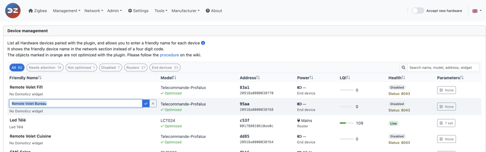
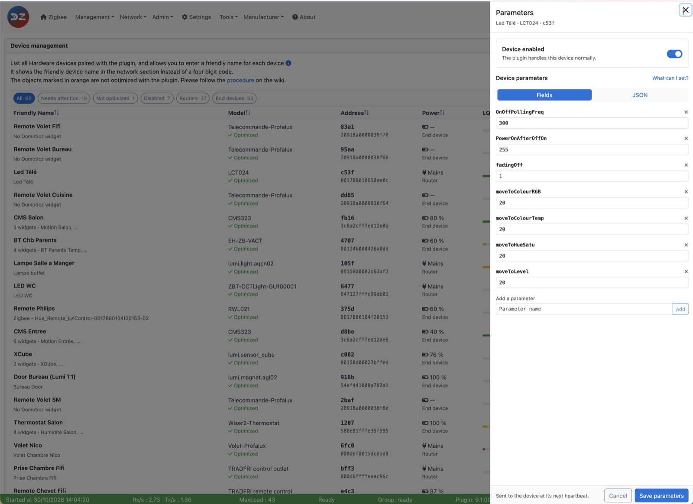
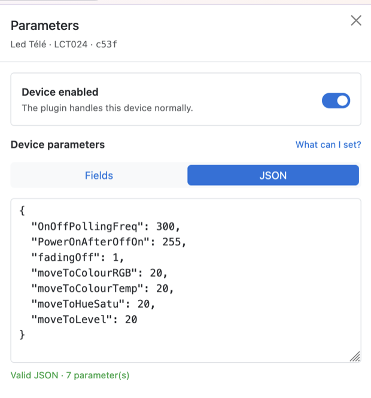
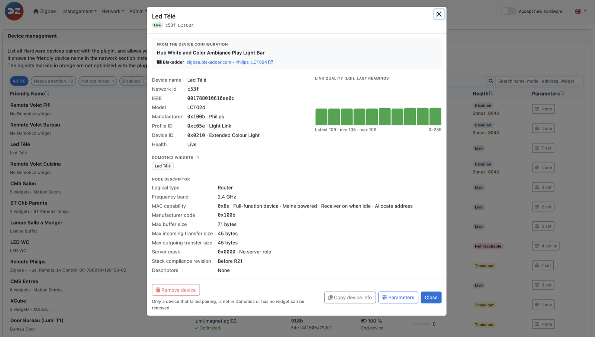
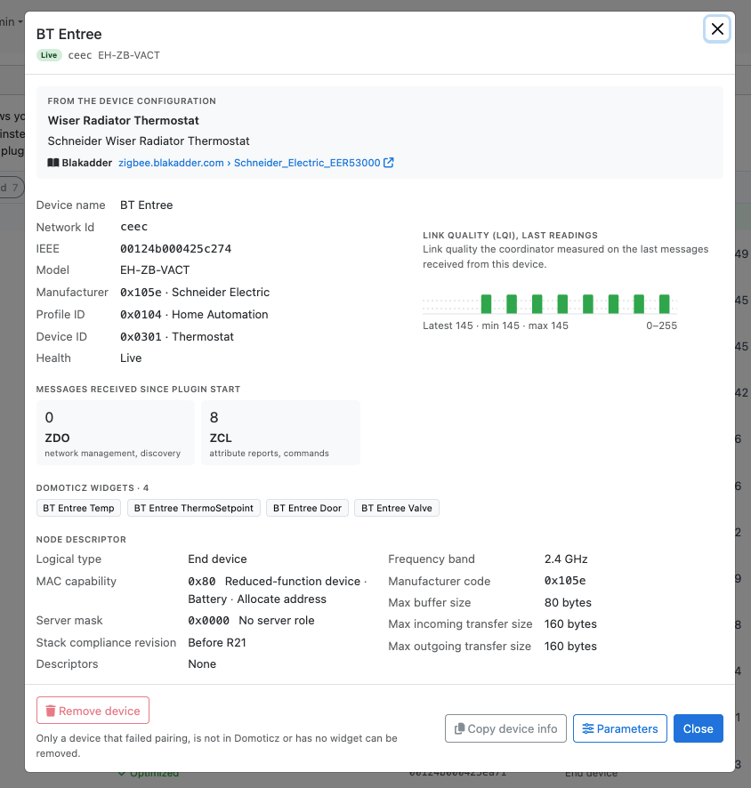

# The Web interface - Management section

Please refer to STEP 3 [Plugin Configuration](Plugin_Configuration.md) to get access to the Web interface administration.

The __Management__ menu contains the pages:

* [Device Management](#device-management)
* [Group Management](#group-management)

------------------------------------------------
## Device Management

The __Device Management__ page (*Management > Device Management*) lists all the devices paired with the plugin. From it you rename a device, set its parameters, enable or disable it, and open its details.

> **Plugin 9.1.009 and later.** This section describes the Device Management page available since plugin 9.1.009. In older versions, the page is a wide table with a *Del.* (trash) column, an *Optimized* icon to copy the device data, names typed in the table and saved with *Validate*, and a parameter window where the parameters are typed as one text.

*This picture may have changed since this documentation was written.*

### The list

| Column | Content |
|--------|---------|
| Friendly Name | The name you gave the device (the model, in italics, when it has none). Below it, its Domoticz widget, or the number of widgets and the first one, or *No Domoticz widget*. Click the name to rename the device (see below). |
| Model | The model name reported by the device, and below it *Optimized* (in green) when the plugin has a certified configuration for this model, or *Not optimized* (in orange) when it hasn't (see [Dealing with a non-optimized device](Problem_Dealing-with-none-optimized-device.md)). |
| Address | The network address (short id, NwkId), which can change when the device rejoins, and below it the IEEE, the unique and permanent address of the device. |
| Power | *Mains*, or the battery level (in red at 15 % and below), and the role of the device in the mesh: *Router* or *End device*. |
| LQI | The link quality (0 to 255) of the last message received from this device, with a bar: green from 100, orange from 40, red below. When the coordinator reports it, the RSSI is shown below. Both are measured on the **last hop** only (see [What the LQI and RSSI measure](#what-the-lqi-and-rssi-measure)). |
| Health | *Live*, *Not seen recently*, *Not reachable*, *Timed out*, *Disabled*, *Unknown*. A device whose pairing is not complete shows a warning below: *Pairing failed*, *Not in Domoticz*, or *Status:* followed by the pairing state of the plugin. |
| Parameters | The number of parameters set for the device (*None* when there is none). An orange dot means the last saved parameters wait for the device's next heartbeat. Click it to open the parameter panel (see below). |

Above the list:

* **Quick filters**, with the number of devices in each: *All*, *Needs attention* (not reachable, timed out, not seen recently, battery at 15 % or below, or pairing not complete), *Not optimized*, *Disabled*, *Routers*, *End devices*.
* **Search**: type part of a name, model, short id, IEEE or widget name.

Click a column header to sort the list. The page remembers your sort order and page size.

### Rename a device

The friendly name is used by the WebUI to show the device, in the network pages for example, instead of its four-digit short id.

1. Click the name of the device: it becomes an input field.
1. Type the new name.
1. Press `Enter`, or click ✓. Only this device is saved, at once.

`Esc`, ✕ or a click elsewhere cancels the change.

### Parameters

The *Parameters* button of a row (or the *Parameters* button of the [device details](#device-details)) opens a side panel:

* **Device enabled**: switch it off to disable the device. The plugin then ignores its messages, skips it at heartbeat and sends it no command; *Health* shows *Disabled*. Switch it on again to enable the device.
* **Device parameters**: the device's own parameters. *What can I set?* opens [Device parameters](HowTo_Device-parameters.md), the list of the parameters and their values. Two views of the same parameters:
  * **Fields**: one field per parameter. A value is a number, a text, `true` / `false`, or JSON such as `{"01": 600}`; an invalid value is outlined in red. ✕ removes a parameter. To add one, type its name under *Add a parameter*, click *Add*, then fill its value.
  * **JSON**: all the parameters as one JSON object, checked as you type (*Valid JSON · n parameter(s)*). Use double quotes: `{"PowerPollingFreq": 120}`.

  

  The `Disabled` parameter is not accepted in either view: use the *Device enabled* switch.
* **Save parameters** saves the switch and the parameters of this device only. The panel closes once the plugin has accepted them. They are sent to the device at its next heartbeat: until then, the *Parameters* button shows an orange dot. *Cancel*, ✕ or `Esc` closes the panel without saving.

If the parameters stored by the plugin can't be read, the panel opens on the *JSON* view with the stored text, so you can fix it.

### Device details

Click anywhere else on a row (or press `Enter` on a selected row) to open the details of the device:

*A router with RSSI readings: both charts are shown.*

*A battery device with no RSSI reading: only the LQI chart is shown.*

* **From the device configuration**: the description and the comment of the device configuration, and a *Blakadder* line: a link to the device page on [zigbee.blakadder.com](https://zigbee.blakadder.com) or, when there is none yet, a *Please create the device info* link to add it.
* **The device**: name, network id (short id), IEEE, model, manufacturer (code and name), Profile ID and Device ID with their meaning, health.
* **Link quality (LQI), last readings**: one bar per message for the last 10 messages received from the device, oldest on the left, on the 0–255 scale. As in the list, a bar is green from 100, orange from 40 and red below, and the two dashed lines mark these limits. Below the chart: the latest, lowest and highest values. The LQI is measured on the **last hop** only: for a device that goes through a router, it is the link between that router and the coordinator.
* **Signal strength (RSSI), last readings**: the same chart for the RSSI, in dBm, on a −100 to 0 dBm scale: green from −65 dBm, orange from −80 dBm, red below. The RSSI is the signal strength of the last frame the coordinator received from the device, also measured on the **last hop** only. It is shown only when the coordinator reports it: Silicon Labs (EZSP) and deCONZ coordinators.
* **Messages received since plugin start**: the number of *ZDO* messages (network management, discovery) and *ZCL* messages (attribute reports, commands) the plugin received from this device. The counters start at 0 each time the plugin starts and are not saved. Every message is counted, a repeated one included. See [ZDO and ZCL messages](#zdo-and-zcl-messages).
* **Domoticz widgets**: the widgets created for this device.
* **Node descriptor**: what the device announced about itself, decoded: logical type (coordinator, router, end device), frequency band, MAC capability (full- or reduced-function device, mains or battery powered, receiver on when idle…), manufacturer code, buffer and transfer sizes, server mask, stack compliance revision.

The buttons at the bottom:

* **Remove device**: removes the device from the plugin, after confirmation. It is only available for a device whose pairing failed, that is not in Domoticz, or that has no widget. To remove a working device, see [Remove a device](HowTo_Remove-device.md).
* **Copy device info**: copies the discovery data of the device (what the plugin learned during pairing) to the clipboard, ready to paste into a request for support or for the optimization of the device (see [Dealing with a non-optimized device](Problem_Dealing-with-none-optimized-device.md)).
* **Parameters**: opens the [parameter panel](#parameters).
* **Close**.

### What the LQI and RSSI measure

**Two different measures.** The LQI and the RSSI both describe a received frame, but they don't measure the same thing:

* The **RSSI** (*Received Signal Strength Indicator*) is the power of the radio signal received, in dBm. It is a negative number: −40 dBm is a strong signal, −90 dBm a weak one, close to what most Zigbee radios can still receive. It says how loud the frame was, not whether it arrived clean: in a noisy channel (Wi-Fi, another Zigbee network, a microwave oven), a strong signal can still come with errors.
* The **LQI** (*Link Quality Indicator*) is a score from 0 to 255 that the radio gives to the frame it received, 255 being the best. It tells how well the frame was received. The IEEE 802.15.4 standard leaves the way to compute it to the radio maker: some derive it from the signal strength, others from the errors on the received frame, others from both.

So a link can show a good RSSI and a poor LQI (a strong but disturbed signal), and the two numbers don't convert into each other.

**Only the last hop.** The *LQI* column and the charts of the [device details](#device-details) are **not** a measure of the whole route from the device to the coordinator. They describe only the **last hop**: the radio link between the coordinator and the node it received the message from.

**How Zigbee measures them.** The radio (the IEEE 802.15.4 layer) of a node measures the LQI, and often the RSSI, of each frame it receives, and only for that frame. When a router relays a message, it sends a new frame, and the next node measures that new frame. Zigbee does not add the hops up: the network layer passes the LQI of the received frame unchanged to the application (*NLDE-DATA.indication* and *APSDE-DATA.indication* in the Zigbee specification). So the value the coordinator reports is the quality of the frame its own radio heard. Silicon Labs radios name it accordingly: *last hop LQI* and *last hop RSSI*.

**How the plugin files them.** The plugin records the value under the device that **sent** the message (its network source address), not under the router that relayed it:

* A device that talks **directly** to the coordinator: the LQI is its own link with the coordinator.
* A device reached **through one or more routers**, including an end device whose parent is a router: the LQI is the link between the **last router** and the coordinator. It says nothing about the device's own radio, nor about the hops before the last one. A sensor behind a router next to the coordinator can show an excellent LQI while its own link to that router is poor.

To see the quality of each link in the mesh, including the device's own link to its parent, use the neighbour tables of a topology scan: [Network > Mesh](WebUI_Network-Mesh.md#a-note-on-lqi). For the path a device's messages take, see [Computed routes](WebUI_Network-Mesh.md#computed-routes).

**Where the values come from.**

| Coordinator | LQI | RSSI |
|-------------|-----|------|
| ZiGate | yes, from the ZiGate firmware | no |
| Texas Instruments (zigpy-znp) | yes | no |
| Silicon Labs (bellows) | yes | yes |
| deCONZ (zigpy-deconz) | yes | yes |
| Bouffalo Lab (zigpy-blz) | yes | no |

* **LQI** (*RollingLQI*): taken from the messages received from the device. The plugin keeps the last 10. An LQI of `0` is not recorded.
* **RSSI** (*RollingRSSI*, in dBm): the signal strength of the frame the coordinator received, recorded with each cluster (ZCL) message from the device. The plugin keeps the last 10. Only the Silicon Labs (EZSP) and deCONZ coordinators report it.

**Comparing values.** Because each radio maker computes the LQI its own way, an LQI from one coordinator family can't be compared with an LQI from another, and the colour bands of the list are a rough guide only. The RSSI, in dBm, is a physical measure and compares better across radios, though not exactly.

### ZDO and ZCL messages

The *Messages received since plugin start* counters of the [device details](#device-details) sort the messages of a device into two kinds:

* **ZDO** (*Zigbee Device Object*, profile `0x0000`): the messages about the device and the network, not about what the device does. For example the *Device Announce* a device sends when it joins or rejoins the network, its answers during pairing (node descriptor, active endpoints, simple descriptors), its answers to bind requests, and its neighbour and routing tables when the plugin reads them for a topology scan.
* **ZCL** (*Zigbee Cluster Library*): the messages about what the device does, through its clusters (On/Off, Temperature Measurement, Electrical Measurement…, and the manufacturer clusters such as Tuya's): attribute reports (a temperature, a switch state, a power reading), answers to the plugin's attribute reads (polling), commands the device sends (a remote's button press), and the device's responses to the plugin's commands. The plugin counts every message that is not ZDO as ZCL.

What to look at:

* A device in normal use sends mostly ZCL messages. A ZCL counter that stays at 0, or does not move for a long time, means the device has sent no report and no answer.
* A battery device sends a message only when it has something to report, or when its reporting interval is due: a low count is normal for it.
* ZDO messages come mostly at pairing, at each rejoin, and during a topology scan. A ZDO counter that grows without a scan can mean that the device rejoins the network often.

The counters count what the plugin received, repeats included (a device that retries a message because it did not get the acknowledgement counts twice). The *Mgmt Permit Join* and *Mgmt Leave* responses are not counted. With a ZiGate, only the messages the firmware forwards as raw data (*0x8002*) are counted.

------------------------------------------------
## Group Management

The __Group Management__ page (*Management > Group Management*) is where you create and edit the Zigbee groups. Groups must be enabled first with the `enablegroupmanagement` setting (see [Group management settings](WebUI_Settings.md#group-management-settings)).

*This picture may have changed since this documentation was written.*

### Columns

| Column | Content |
|--------|---------|
| Group id | The group address, 4 hexadecimal digits. |
| Group name | The name of the group, given to the group's Domoticz widget when it is created. Required. |
| Devices selected in the group | The device endpoints (widgets) that belong to the group. Pick them from the list. |
| Coordinator (in the group) | Tick it to make the coordinator a member of the group too, so that it receives the commands sent to the group (for example by a remote bound to that group) and the plugin can update the widgets. |
| *(trash icon)* | Delete the group. |

*Add a new Group* adds an empty row; a group needs at least one device, or the coordinator. Click *Validate* to save your changes. When the changes need a plugin restart, the WebUI says so and the *Restart needed* indicator blinks in the menu bar until you restart the plugin.

Refer to the section [How to manage groups](HowTo_Group-management.md) for more information.

------------------------------------------------
Look at the other pages of the [plugin Web interface](Readme.md#plugins-web-interface).
