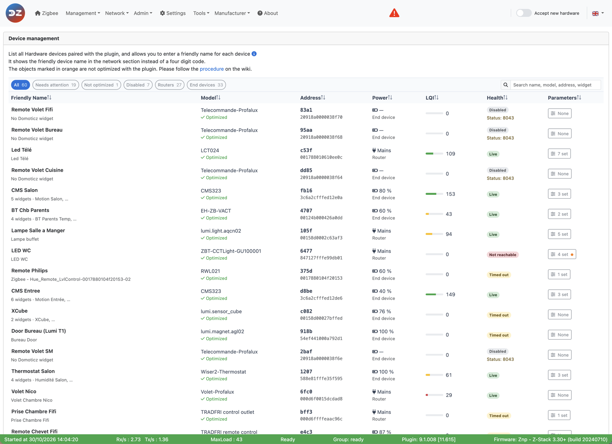
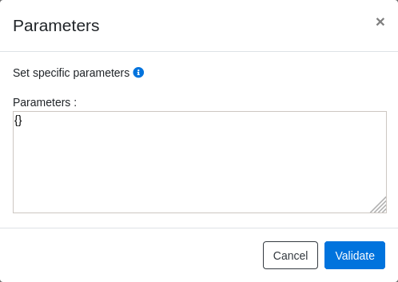
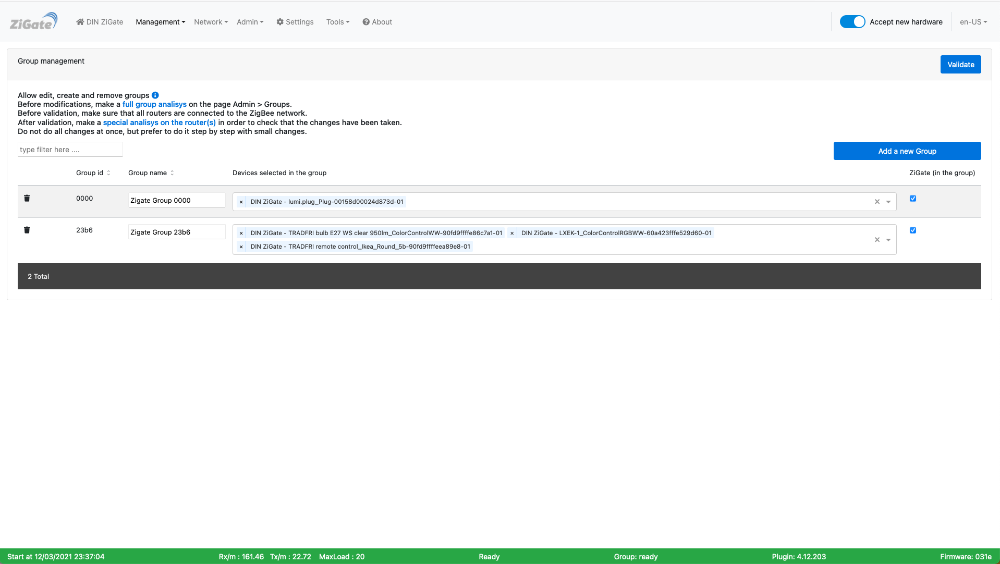

# The Web interface - Management section

Please refer to STEP 3 [Plugin Configuration](Plugin_Configuration.md) to get access to the Web interface administration.

The __Management__ menu contains the pages:

* [Device Management](#device-management)
* [Group Management](#group-management)

------------------------------------------------
## Device Management

The __Device Management__ page (*Management > Device Management*) lists all the devices paired with the plugin.

*This picture may have changed since this documentation was written.*

### Columns

| Column | Content |
|--------|---------|
| Del. | A trash icon to remove the device from the plugin, after confirmation. It only appears for a device the plugin considers broken: no Domoticz widget, not found in Domoticz, or a pairing that did not complete. To remove a working device, see [Remove a device](HowTo_Remove-device.md). |
| Optimized | Green icon: the plugin has a certified configuration for this model. Orange icon: it hasn't (see [Dealing with a non-optimized device](Problem_Dealing-with-none-optimized-device.md)). Clicking either icon copies the device's discovery data to the clipboard, ready to paste into a request for support. |
| Short id | The network address (NwkId) of the device. It can change when the device rejoins. |
| IEEE | The unique, permanent address of the device. |
| Model | The model name reported by the device. |
| Domoticz Widget | The Domoticz widgets created for this device. |
| Friendly Name | A name of your choice, used by the WebUI to identify the device. Click the cell to edit it. |
| Capabilities | What the device announced when it joined: *Full-Function Device* (a router) or *Reduced-Function Device* (an end device), *Main Powered*, *Receiver during Idle* (always listening), security level. |
| LQI | The last link quality seen from this device. |
| RSSI | The last signal strength seen from this device. Only shown when the coordinator reports it. |
| Status | The pairing state of the device in the plugin (`inDB` once fully paired). |
| Health | `Live`, `Not seen last 24hours`, `Not Reachable`, `TimedOut`, `Disabled`… |
| Parameters | A cog icon opening the parameter editor of the device (see below). |

Use the filter box at the top to search any column, and click a column header to sort.

After editing names, click *Validate* to save.

### Parameters

The cog of the *Parameters* column opens a window with:

* **Device enabled**: switch it off to disable the device. The plugin then stops polling and monitoring it, and refuses the commands sent to it; *Health* shows `Disabled`.
* **Parameters**: the device's own parameters, as JSON. The cog is green when the parameters are in sync with the device, and orange when they have not been pushed to it yet. See [Device parameters](HowTo_Device-parameters.md) for the parameters you can set and their values.

------------------------------------------------
## Group Management

The __Group Management__ page (*Management > Group Management*) is where you create and edit the Zigbee groups. Groups must be enabled first with the `enablegroupmanagement` setting (see [Group management settings](WebUI_Settings.md#group-management-settings)).

*This picture may have changed since this documentation was written.*

### Columns

| Column | Content |
|--------|---------|
| Group id | The group address, 4 hexadecimal digits. |
| Group name | The name of the group, given to the group's Domoticz widget when it is created. Required. |
| Devices selected in the group | The device endpoints (widgets) that belong to the group. Pick them from the list. |
| Coordinator (in the group) | Tick it to make the coordinator a member of the group too, so that it receives the commands sent to the group (for example by a remote bound to that group) and the plugin can update the widgets. |
| *(trash icon)* | Delete the group. |

*Add a new Group* adds an empty row; a group needs at least one device, or the coordinator. Click *Validate* to save your changes. When the changes need a plugin restart, the WebUI says so and the *Restart needed* indicator blinks in the menu bar until you restart the plugin.

Refer to the section [How to manage groups](HowTo_Group-management.md) for more information.

------------------------------------------------
Look at the other pages of the [plugin Web interface](Readme.md#plugins-web-interface).
