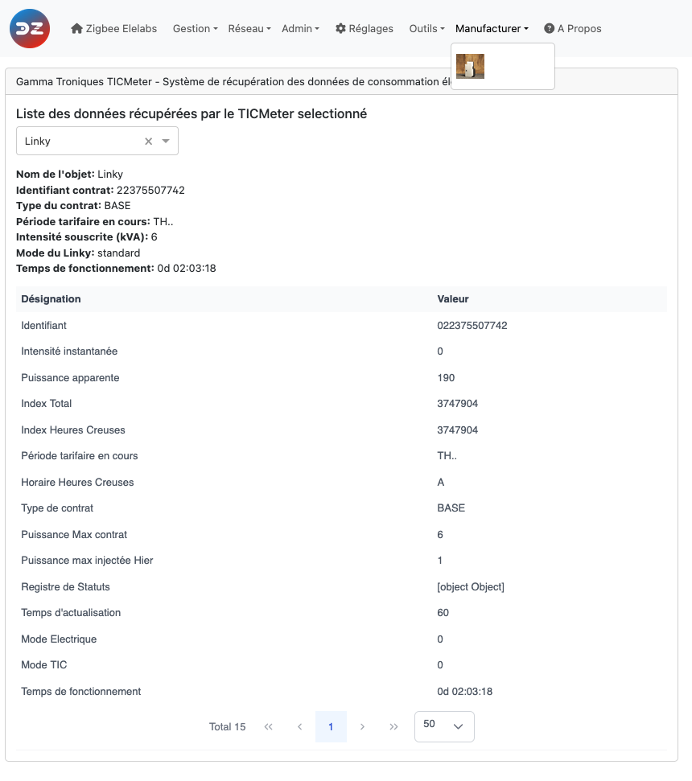

# The Web interface - Manufacturer section

Please refer to STEP 3 [Plugin Configuration](Plugin_Configuration.md) to get access to the Web interface administration.

The __Manufacturer__ menu holds pages dedicated to some devices. The menu only appears when at least one of these devices is paired, and only lists the pages for the devices you have:

* [CASA.iA](#casaia) — infrared air-conditioning controllers
* [ZLinky](#zlinky) — LiXee ZLinky TIC
* [TICmeter](#ticmeter) — Gamma-Troniques TICmeter
* [Chameleon](#chameleon) — Chameleon Technology TIC reader

The ZLinky, TICmeter and Chameleon devices read the customer tele-information (TIC) output of the French Linky electricity meter. Their pages display what the device has collected from the meter: they are read-only. Some labels of the TICmeter and Chameleon pages are only available in French.

------------------------------------------------

## CASA.iA

The __CASA.iA__ page configures the CASA.iA infrared controllers for split air conditioners (model AC201). These controllers drive the air conditioner with infrared codes, so they need to know which code set matches your air conditioner.

The page lists the controllers (short id, friendly name, IEEE, model) with their *Infrared Code*. Enter the code that matches your air conditioner, as given by CASA.iA, and click *Validate*.

------------------------------------------------

## ZLinky

The __ZLinky__ page displays the data collected by a ZLinky. Select the device: the page shows the TIC mode of the meter (historic or standard) and the list of the values read (*Designation*, *Value*).

See [ZLinky integration](Technical/zlinky-integration.md) for the widgets created and the related settings.

------------------------------------------------

## TICmeter

The __TICmeter__ page displays the data collected by a Gamma-Troniques TICmeter. Select the device: the page shows the device name, the contract identifier, the contract type, the current tariff period, the subscribed power, the TIC mode of the meter and the uptime of the TICmeter, followed by the list of all the values read.

See [Gamma-Troniques corner](Corner_GammaTroniques.md) and [TICmeter integration](Technical/ticmeter-integration.md).

------------------------------------------------

## Chameleon

The __Chameleon__ page displays the data collected by a Chameleon Technology TIC reader. Select the device: the page shows the device name, the contract identifier, the contract type, the current tariff period and the subscribed power, followed by the list of all the values read.

------------------------------------------------
Look at the other pages of the [plugin Web interface](Readme.md#plugins-web-interface).
