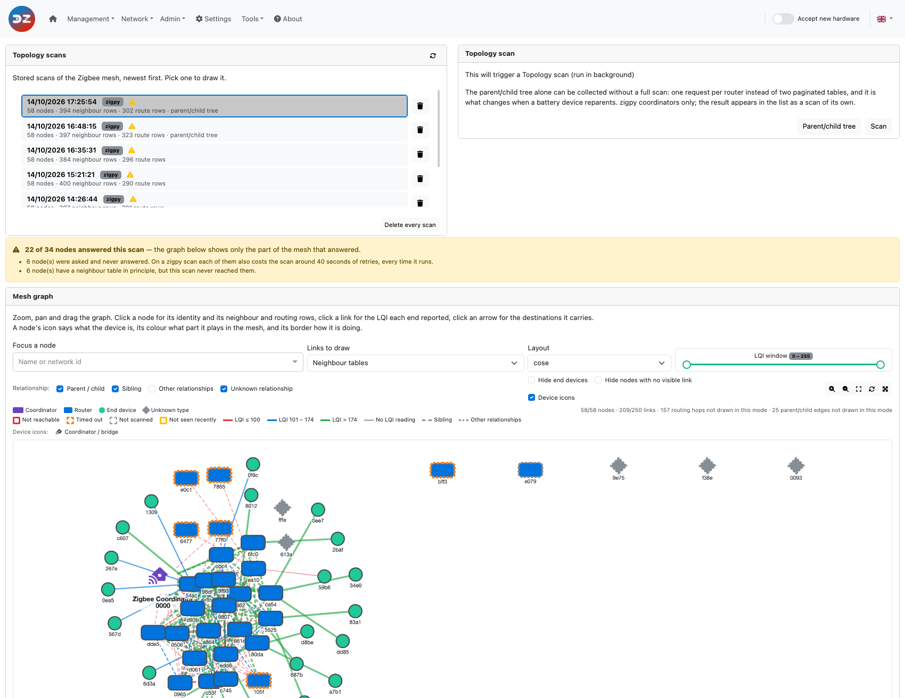
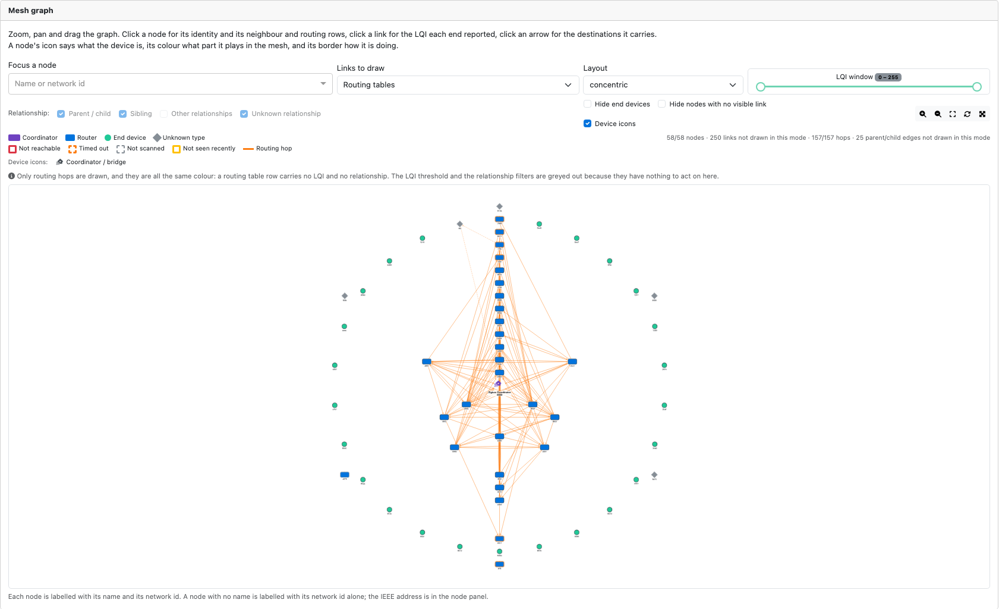
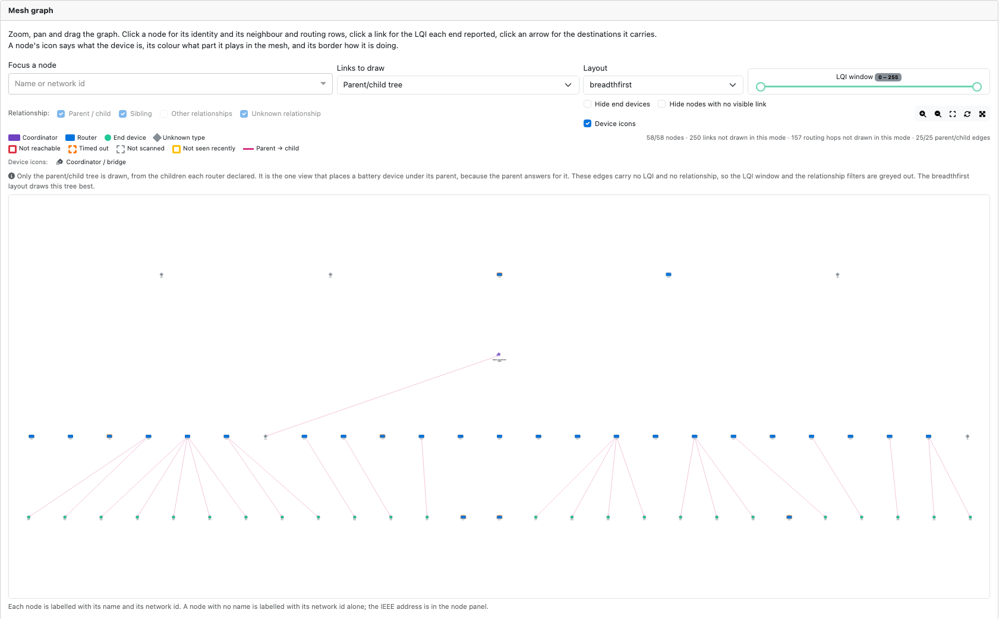
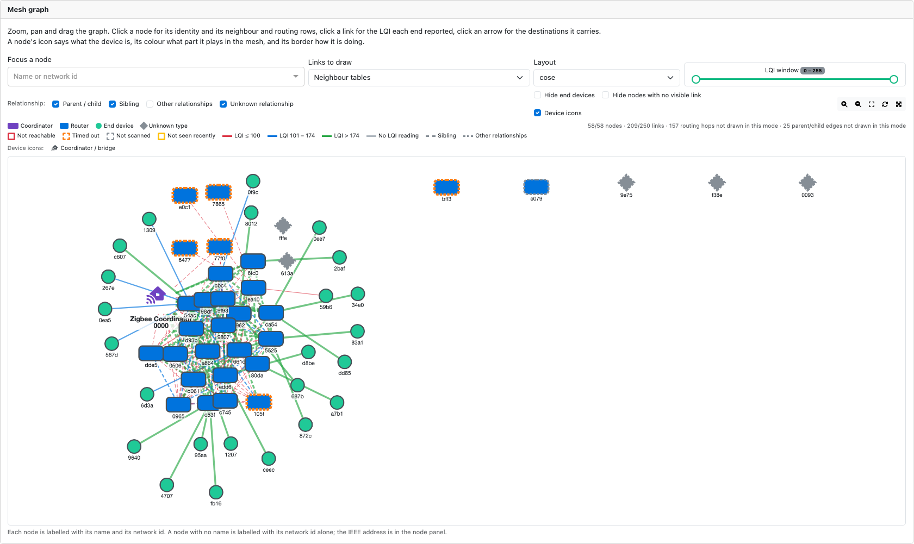
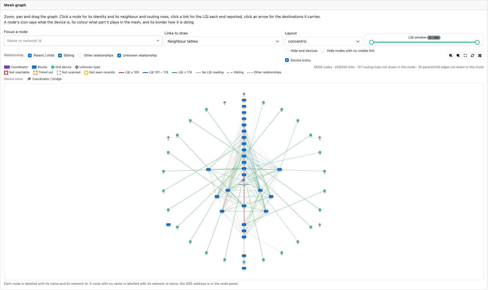

# The Web interface - Network section - Mesh graph

> This page describes the **Mesh graph** page of the plugin Web interface, available from plugin
> version **9.1.008**. It sits beside the two older charts documented in
> [Network section](WebUI_Network.md), which are unchanged: the Topology wheel and the Topology
> graph still read the `/topologie` report, while the Mesh graph reads a second, richer report,
> `/topology-scan`.

The page is reached from the WebUI menu: **Network > Mesh graph** (`/network/mesh`).

*The screenshots on this page are rendered from a real 28-node report, so what they show is a real
mesh rather than a mock-up. The devices appear under their network id because the report carries no
device names; on your own installation each node is labelled with the name you gave it. These
pictures may have changed since this documentation was written.*

Contents:

* [What "mesh" means](#what-mesh-means)
* [Three tables, three different questions](#three-tables-three-different-questions)
* [The relationships](#the-relationships)
* [Routing versus Neighbours](#routing-versus-neighbours)
* [Depth: how to read it, and what it is worth](#depth-how-to-read-it-and-what-it-is-worth)
* [The parent/child tree](#the-parentchild-tree)
* [Layouts: what is best for what](#layouts-what-is-best-for-what)
* [Filters and what they act on](#filters-and-what-they-act-on)
* [Reading the picture](#reading-the-picture)
* [How a scan is performed](#how-a-scan-is-performed)
* [Devices that are switched off, and other gaps](#devices-that-are-switched-off-and-other-gaps)
* [Settings](#settings)
* [References](#references)

------------------------------------------------

## What "mesh" means

Zigbee is a **mesh** network, not a star. A frame does not have to reach the coordinator directly:
it can be relayed, hop by hop, by any mains-powered device on the way. That is what the word means
here - the network is a web of short radio links rather than a set of spokes, and it re-forms
itself around a link that degrades.

Three roles make that possible ([Zigbee specification][zigbee-spec], and
[Silicon Labs - Network Node Types][silabs-devicetypes]):

| Role | Also called | Relays frames | Keeps a neighbour table | Radio |
| ---- | ----------- | ------------- | ----------------------- | ----- |
| **Coordinator** | ZC | yes | yes | always on |
| **Router** | ZR, FFD - Full-Function Device | yes | yes | always on |
| **End device** | ZED, RFD - Reduced-Function Device | **no** | **no** | often asleep |

* The **coordinator** is your Zigbee key/dongle. There is exactly one, it formed the network and it
  holds the keys.
* A **router** is any mains-powered device: a bulb, a plug, a wall switch, a repeater. Routers *are*
  the mesh - they are what a frame hops through.
* An **end device** is almost always battery-powered: a motion sensor, a door contact, a remote,
  a thermostatic valve. It has no neighbour table, relays nothing, and spends most of its life with
  its radio off. It talks to the network through exactly one router, **its parent**, which keeps
  the frames addressed to it until it wakes up and polls.

Two consequences run through the whole of this page:

1. **The backbone is made of mains-powered devices only.** Every battery device hangs off it.
2. **A sleepy end device cannot be asked anything.** Whatever you learn about it, you learn from the
   router that answers on its behalf.

The Mesh graph draws that backbone, the links between the nodes that form it, and - when the scan
collected it - which router each battery device is attached to.

------------------------------------------------

## Three tables, three different questions

A Zigbee node does not know "the network". It knows a few tables about its own surroundings, and a
topology report is those tables, collected node by node and stitched together. The Mesh graph can
draw three of them, and they answer three genuinely different questions:

| Table | Zigbee request | Question it answers | Carries |
| ----- | -------------- | ------------------- | ------- |
| **Neighbours** | `Mgmt_Lqi_req` (ZDP cluster `0x0031`), answered by `Mgmt_Lqi_rsp` (`0x8031`, [spec][zigbee-spec] §2.4.4.3.2) | *Who can this node hear, and how well?* | LQI, relationship, device type, depth, Rx-on-when-idle, permit-joining |
| **Routing** | `Mgmt_Rtg_req` (`0x0032`), answered by `Mgmt_Rtg_rsp` (`0x8032`, §2.4.4.3.3) | *To reach X, who does this node hand the frame to?* | destination, next hop, route status, many-to-one / memory-constrained / route-record flags |
| **Associated devices** | `NWK_addr_req` with `RequestType 0x01` - the *extended* address request - answered by `NWK_addr_rsp` with `NumAssocDev` / `NWKAddrAssocDevList` | *Which devices are this router's children?* | a plain list of network addresses, nothing else |

They overlap, but none of them is a substitute for another: two nodes can be neighbours with no
route between them, a route can exist through a node that is not in the neighbour table, and the
parent/child tree is in neither.

The **Links to draw** control on the page selects which of them is drawn. They are exclusive modes
rather than overlays, because a pair of nodes can appear in all three at once and the picture would
say nothing.

A mode is only offered when the selected scan actually carries that table. The scan listing says
what each one holds, and a control for a table that is absent is greyed out rather than drawing an
empty graph.

------------------------------------------------

## The relationships

Every row of a neighbour table carries a **relationship** field: what the reporting node believes
the neighbour is *to it*. The Zigbee specification defines five values, and the plugin adds a sixth
for a value it cannot decode:

| Value | Meaning |
| ----- | ------- |
| `parent` | the neighbour is this node's parent - the node it joined through |
| `child` | the neighbour joined through this node; this node is its parent |
| `sibling` | both share the same parent |
| `none_of_above` | heard, in radio range, but with no tree relationship - two routers that simply hear each other |
| `previous_child` | was this node's child and no longer is: the device has **reparented** |
| `unknown` | the radio reported a value this plugin does not recognise |

The graph groups the six into four, because three of them answer the same question for a user -
*is this the tree, or just radio range?*

| Graph group | Holds | Drawn |
| ----------- | ----- | ----- |
| **Parent / child** | `parent`, `child` | on by default. `parent` and `child` are one relationship seen from its two ends, so they collapse into one group |
| **Sibling** | `sibling` | on by default |
| **Other relationships** | `none_of_above`, `previous_child` | **off** by default |
| **Unknown relationship** | `unknown` | on by default |

`none_of_above` is the most common value on a healthy mesh of mains-powered devices and it is not a
fault - it is two routers that hear each other without one having joined through the other. It is
off by default because on a large network it can double the number of edges without changing the
conclusion. Switch it on when you are looking for redundancy: those are the links the network
*could* fall back on.

`previous_child` is worth switching on when a battery device has moved: it is the trace left behind
in the former parent's table.

### Direction, and why both are drawn as one link

A neighbour row is a **measurement made by the node that reported it**. "A reports B at LQI 204"
is a statement about A's receiver, not about the pair. The two ends of the same radio link
routinely disagree, and the report carries both rows separately.

The graph collapses the two rows into one drawn link, and keeps both readings:

* click a link, and the panel shows each end's own reading - *"A hears B at 204"*, *"B hears A at
  141"*.
* the link is coloured and filtered on the **better** of the two readings.
* a link only one node reported is flagged as such. That means either the other end did not answer
  the scan, or it genuinely does not hear this one - a one-way link, which is a real and common
  fault.

This asymmetry is one of the more useful things in the report: a device that hears the mesh well but
is not heard back will drop commands while looking perfectly healthy in a signal-strength reading.

### A note on LQI

**LQI** is a 0-255 link quality estimate, described in [Network section > Terminology](WebUI_Network.md#terminology).
It is not an RSSI and is not a dBm: a neighbour table carries LQI only. The graph bands it as:

| Band | LQI | Colour |
| ---- | --- | ------ |
| Poor | 0-100 | red |
| Fair | 101-174 | blue |
| Good | 175-255 | green |
| No reading | neither end measured one | grey |

`0` **is** a reading - it means heard at LQI 0. "No reading" is a different statement and is drawn
differently.

------------------------------------------------

## Routing versus Neighbours

This is the distinction that causes the most confusion, so it is worth stating plainly:

> A **neighbour** link is *radio adjacency*: these two nodes can hear each other.
> A **route** is a *forwarding decision*: to reach that destination, this node hands the frame to
> that neighbour next.

One is the map of the roads, the other is the signposting.

| | Neighbours | Routes |
| --- | --- | --- |
| What a row means | "I hear this node, at this LQI" | "For this destination, my next hop is this node" |
| Direction | a measurement by the reporter | a forwarding decision by the reporter |
| Has an LQI | yes | **no** - a routing row carries no quality at all |
| Has a relationship | yes | no |
| Symmetric | usually, but not always | no: the return path can be different |
| Survives a reboot | rebuilt as the radio hears traffic | discovered on demand, ages out |

In **Routing tables** mode the graph draws one arrow per `(reporter, next hop)` pair, not one per
routing row: a router typically reaches a dozen destinations through the same neighbour, and a dozen
parallel arrows say nothing one does not. Click an arrow and the panel lists the destinations it
carries.

Because routing rows carry no LQI and no relationship, the **LQI window** and the relationship
filters are greyed out in this mode - they have nothing to act on.

What to look for in the routing view:

* **Follow the arrows** from a device to the coordinator to see the hops a frame actually goes
  through. `next hop == destination` is a direct, one-hop route and is common and healthy.
* **Route status** (§2.4.4.3.3): `active`, `discovery_underway`, `discovery_failed`, `inactive`,
  `validation_underway`. A `discovery_failed` row is a genuine finding. Note that zigpy filters
  `inactive` rows out before the plugin ever sees them, so a route you remember may simply not be in
  the report.
* **`many-to-one`** marks a route created by a many-to-one route request - the concentrator
  mechanism a coordinator uses so that every node has a route *to it* without each one discovering
  one ([Silicon Labs - Zigbee Routing Concepts][silabs-routing]). **`route record required`** is its
  companion: the node must send a route record so the concentrator learns the return path.
* **`memory constrained`** is a router that cannot store many routes - typically a small-memory
  device that will force route discovery more often.

A link in the neighbour view with no route over it is perfectly normal: no traffic has needed that
path. A route over a pair that is not in the neighbour view is more interesting - usually it means
one of the two did not answer the scan.

------------------------------------------------

## Depth: how to read it, and what it is worth

Every neighbour row carries a **depth** field. In the Zigbee specification (§2.4.4.3.2) it is the
*neighbour's* tree depth - its distance from the coordinator in the association tree, `0` for the
coordinator, capped at 15 (`nwkMaxDepth`). Read that way, every node that describes device X should
give X the same depth.

**In practice it does not work like that**, and the field is the one part of a report that is
routinely misread. What follows is measured on a real 28-node ZNP network, over 7 consecutive scans
of roughly 400 neighbour rows each.

### Depth is a property of the reporting radio, not of the neighbour

Each radio behaves in one of three ways, and it behaves the same way in every scan - this is a
fixed trait of the device's stack, not a reading that moves with the mesh:

| Class | What the reporter's depth column looks like | Share of the measured network |
| ----- | ------------------------------------------- | ----------------------------- |
| **No depth** | `15` on every row (or `255` from the coordinator), except the coordinator row, which is always `0` | 7 of 22 answering nodes |
| **Constant stamp** | *one* value on every row whatever the neighbour - almost certainly the reporter's own depth, stamped on each entry | 13 of 22 |
| **Genuine per-neighbour** | varies across the table, consistently with a tree | 2 of 22, plus the coordinator for its own children |

The proof is that reporters contradict each other. In the scan measured here, **21 of 51 nodes are
given two or three different depths by different neighbours**. One router is depth 1 to one
reporter, 2 to another and 3 to a third. It cannot be all three, so the number is not a property of
that router.

Over 394 rows of one scan:

| Value | Rows | |
| ----- | ---- | --- |
| `15` | 260 (66%) | legal, but used as a sentinel by most stacks here |
| `255` | 20 (5%) | out of range; the plugin reports it as unknown |
| `0`-`14` | 114 (29%) | plausible - but most come from a constant stamp |
| of which, from a reporter that varies depth per neighbour | **37 (9%)** | the rows actually worth reading |

### Where it is genuine, it is excellent

The two reporters that do vary their depth are internally perfect:

* one reports its parent at depth 1 - so it is itself at 2 - and both of its children come back at
  exactly 3, including the sleepy end device its Associated Devices table also declares;
* the other reports its four declared children at depth 3, and two independent neighbours put that
  router itself at depth 2.

So the data is good. It is just rare, and nothing in the row says which kind of row you are holding.

### How to read it

1. **Never read a depth off a single row.** Look at the whole column of the node that reported it:
   that is what says whether the number means anything. The node panel lists a node's neighbour rows
   together, which is what makes this possible.
2. **A constant column is the reporter talking about itself.** Treat it as unknown for the
   neighbour.
3. **`0` is always the coordinator.** Every stack gets that one right, and it carries no
   information.
4. **A column that varies is trustworthy.**
5. **Depth is not hop count.** Tree depth says which node you *joined through*; hop distance says
   who you can *hear*. In a Zigbee PRO mesh, routing is mesh routing, not tree routing, so the
   association tree barely participates in how a frame actually travels. A router that stamps depth
   4 can be a single radio hop from the coordinator, and both statements are true.

### What it is good for

* **Anchoring a fragment of the real association tree.** The `parent` and `child` rows of a genuine
  reporter are the only part of the tree the scan can actually prove. The Associated Devices table
  gives parent→child edges but cannot rank them - on the measured network it yields 13 separate
  parent/child stars with nothing placing the parents themselves.
* **Catching a reparenting.** A child's depth should be its parent's plus one. When a genuine
  reporter's arithmetic stops working, something has moved.
* **Recognising a stack.** The depth signature is stable per device, so it effectively identifies
  which firmware family a router runs.

### What to use instead

For the question people actually ask of this field - *how far is this device from the coordinator?* -
use **hop distance over the links the scan reports**, not depth. On the measured network that gives
a complete and unambiguous answer, one coordinator, 23 nodes one hop away and 27 two hops away, all
51 placed - where depth gives 51 nodes with contradictory claims.

The graph already draws that: the **concentric** layout rings nodes by how connected they are, and
**breadthfirst** roots the graph at the coordinator and lays out levels away from it. Both are
computed from the links in front of you, and neither reads the depth column.

> **In short: do not lay a tree out with `depth`, and do not colour nodes by it.** Read it in the
> node panel, in the context of the whole column it came from, and treat a disagreement between two
> reporters as the finding it is rather than as noise.

------------------------------------------------

## The parent/child tree

### What the source of the information is

The tree does **not** come from a `Mgmt_*` table. It comes from the **extended address request**:
`NWK_addr_req` (or `IEEE_addr_req`) with `RequestType 0x01`, which a coordinator or a router answers
with `NumAssocDev`, `StartIndex` and `NWKAddrAssocDevList` - the list of devices associated *to it*.

Three things follow from that:

1. **Only a coordinator or a router is asked.** An end device parents nobody.
2. **zigpy never asks for it.** Its topology scanner collects neighbours and routes only, so the
   plugin collects this third table itself, with its own request and its own paging, and files it
   with the scan it belongs to (see [How a scan is performed](#how-a-scan-is-performed)).
3. **A row is a declaration and nothing else.** No LQI, no relationship, no depth - unlike a
   neighbour row. The tree view's edges are therefore all one colour.

### What it is worth

It is the **only** table that places a sleepy end device in the network.

A battery sensor answers no scan: it is asleep, it has no neighbour table, and asking it costs a
timeout. In the neighbour and routing views it is either absent or an isolated dot. But its *parent*
knows about it and answers for it - so in the parent/child view a Lumi/Aqara sensor, a door contact,
a remote or a valve appears under the router it is actually attached to.

That is the question most people are really asking of a mesh diagram: *which repeater is this sensor
going through, and is that the one I expected?*

It is also the fastest-changing part of a mesh. A battery device **reparents** whenever its parent
goes away or a better one appears, and that happens far more often than the mains backbone changes
shape. The page therefore offers the tree as a collection of its own - see
[Refreshing the tree alone](#refreshing-the-tree-alone).

*Each router declares its own children, and nothing in this table places the routers themselves -
which is why the tree reads as a row of parents with their children under them rather than as one
hierarchy under the coordinator.*

### Contested children

When **two parents both declare the same child**, the graph draws both edges in red and flags the
device.

That is not a malformed report. It is a device that has reparented, leaving a stale entry behind in
its previous parent's table. Seeing it is half the reason to collect this table at all: it tells you
a device has moved, and which way.

### Caveats

* **An empty list is ambiguous on a full scan.** The table is flat - `{node: [children]}` - so a
  router that was asked for its children and timed out reads exactly like a router that has none.
  On a *standalone* tree collection there is no such ambiguity: the per-node scan status then
  reports that collection's own outcome.
* **The rows lag the rest of the scan.** A scan is timestamped when zigpy's neighbour and route
  tables were read; the children are collected over the minutes that follow. A device that joined in
  between can appear as a child of a router whose neighbour rows predate it.
* **"No children" from a router is normal.** Plenty of routers parent nobody.

------------------------------------------------

## Layouts: what is best for what

The **Layout** control chooses how the nodes are positioned. It changes nothing about the data - the
same nodes and the same links, arranged differently. Changing it recomputes the positions; the
**Recompute layout** button re-runs the current one, which is useful after dragging nodes around.

| Layout | What it does | Best for |
| ------ | ------------ | -------- |
| **cose** *(default)* | Force-directed: links behave like springs, nodes repel each other, and the graph settles into its natural shape | **The general-purpose view, and the one to start from.** Clusters emerge on their own, so a group of devices that only hangs together through one router becomes visible as a lobe with a thin neck - which is exactly the fragile part of a mesh |
| **concentric** | Rings around the coordinator, placed by how many links each node has | **Finding the hubs.** The most connected nodes land in the inner rings, the leaves on the outside. Good for answering "which repeaters is this network actually leaning on?" |
| **breadthfirst** | A hierarchy, rooted at the coordinator, level by level | **The parent/child tree** - it is what that view is meant to be read in - and for seeing hop distance from the coordinator at a glance. It is the least useful on a densely meshed backbone, where it has to draw a hierarchy that does not really exist |
| **circle** | Every node on one circle, in order | **Small networks, and auditing a single node.** Nothing is hidden behind anything else, and every link is a visible chord. It becomes unreadable past a few dozen nodes |
| **grid** | Regular rows and columns | **Inventory rather than topology.** Every node occupies the same amount of space, so it is the easiest layout in which to confirm that a particular device is present, or to spot the isolated ones |

The same mesh, in the two layouts that answer the most questions - **cose**, which lets the shape
settle on its own:

and **concentric**, which rings the nodes by how connected they are, so the hubs the network leans
on land in the middle:

Practical sequence that works well:

1. Start in **cose** with **Neighbour tables** to see the shape of the backbone.
2. Switch to **concentric** to identify the hubs the mesh depends on.
3. Switch to **Parent/child tree** with **breadthfirst** to see where the battery devices sit.
4. Switch to **Routing tables** (any layout, **cose** is fine) when you have a slow device and want
   to see what it is going through.

The graph can be zoomed, panned, dragged and put **fullscreen**, and **Focus a node** (by name or
network id) centres the graph on one device and fades the rest - the fastest way to answer a
question about one specific device on a large mesh.

------------------------------------------------

## Filters and what they act on

| Control | Acts on | Notes |
| ------- | ------- | ----- |
| **Links to draw** | which table is drawn | Neighbour tables / Routing tables / Both / Parent/child tree. Greyed out for a table the scan does not carry |
| **Relationship** checkboxes | neighbour links only | see [The relationships](#the-relationships) |
| **LQI window** | neighbour links only | both bounds inclusive. A link neither end measured has no LQI, so it is outside *every* window - it is not hidden by narrowing the range, it is simply not a value |
| **Hide end devices** | nodes | removes the leaves to leave the backbone |
| **Hide nodes with no visible link** | nodes | hides whatever the current filters have left isolated. Useful after narrowing the LQI window |
| **Device icons** | drawing only | turns the per-device icons on or off; nothing is added or removed |

The counters under the graph always read *visible / total*, so a filter never hides the fact that it
is hiding something.

------------------------------------------------

## Reading the picture

**Node colour** is the role the node plays in the mesh: coordinator (purple), router (blue), end
device (teal), unknown (grey).

**Node icon** is what the device *is* - a light, a plug, a switch, a sensor, a valve - resolved from
the device's own descriptors. A device that reported none is drawn as a plain shape.

**Node border** is how the node is doing, worst first:

| Border | Meaning |
| ------ | ------- |
| thick red | **Not reachable** - the plugin's own health for this device |
| thick dashed orange | **Timed out** - it was asked for its tables and never answered. This is a *finding*, not a leaf with no neighbours |
| dashed grey | **Not scanned** - it has a neighbour table in principle, but this scan never reached it |
| amber | **Not seen recently** - no traffic from this device in the last 24 hours |
| plain | fine |

Being able to tell *timed out* from *has no neighbours* is the single most useful thing this page
does that the older charts could not: before, both were drawn as a dot with no links.

**Click anything.** A node opens a panel with its identity (network id, IEEE address, model, type,
health, battery, LQI/RSSI), its scan status, its parent and its children, and every neighbour and
routing row that mentions it. A link opens the two LQI readings. An arrow opens the destinations it
carries.

> The health, model, LQI, RSSI and battery shown for a node are that device's values **now**, not
> its values at the time of the scan. Only the tables are historical.

**The coverage banner** above the graph is not decoration. When it says *"4 of 32 nodes answered
this scan"*, the picture below is a picture of those 4 nodes. See the next section.

------------------------------------------------

## How a scan is performed

### Starting one

The **Topology scan** card at the bottom of the Mesh page has two buttons:

* **Scan** - a full topology scan. The same `/req-topologie` the Topology page has always used.
* **Parent/child tree** - the children collection on its own (zigpy coordinators only).

Both answer immediately: the scan itself runs in the background and takes **minutes**. A scan appears
in the list only once it has finished - there is no half-written report. While one runs, the WebUI
footer reports a topology scan in progress, for both halves of it.

A scan can also start by itself, periodically, if `ZigpyAutoTopology` is enabled (it is **off** by
default - see [Settings](#settings)).

### The zigpy half: neighbours and routes

On a zigpy coordinator (ZNP, EZSP/Bellows, deCONZ, BLZ) the first half is run by zigpy itself:

1. **It walks the device table** and asks **only coordinators and routers**. An end device is skipped
   - it has no neighbour table.
2. **A device with no node descriptor is skipped silently.** The node descriptor is what tells zigpy
   a device is a router at all, and a device whose descriptor the plugin never captured would be
   invisible to every scan. The plugin now hands zigpy the descriptor it holds at startup, and logs
   two lines saying how many devices are described and naming the ones that are not. If a device is
   missing from every report, that startup line is the first place to look.
3. **Each table is paged.** `Mgmt_Lqi_req` is sent with a start index, the answer says how many
   entries exist in total, and the request is repeated until the table is exhausted. Same for
   `Mgmt_Rtg_req`.
4. **Every request is followed by a 1.0-1.5 s pause**, deliberately, so that scanning a large mesh
   does not flood it.
5. **Each request is retried twice**, 1 s apart, with a 5 s reply timeout per attempt.
6. `inactive` routes are dropped before the plugin sees them.
7. At the end, zigpy tries to resolve any network address it saw in a table but does not know.

So the cost of a scan is roughly *(number of routers) x (pages x (request + ~1.25 s))*, twice -
once for neighbours, once for routes. On a few dozen mains-powered devices that is minutes, not
seconds.

### The plugin half: associated devices

When `ZigpyTopologyAssociatedDevices` is enabled, the plugin then collects the parent/child table
itself, because zigpy does not:

* it runs **after** zigpy's half, never alongside it - two scanners interrogating the same routers
  at once would undo zigpy's pacing and make a timeout impossible to attribute;
* it is a state machine ticked from the plugin heartbeat, **one request in flight at a time**, with
  no thread and no event loop of its own;
* each node gets about **10 s** to answer before the collection moves on, and the whole collection
  has a ceiling so that one node whose pages never stop cannot hold the report open forever;
* **commissioning comes first**: while a device is pairing, the collection pauses.

Both halves are filed as **one scan under one timestamp**, which is the moment zigpy's tables were
read.

If the radio restarts mid-collection, the scan is filed with what it has - zigpy's two tables and no
children section. An absent section is how the report says "this table was not collected", which is
a different statement from "collected and found nothing".

### Refreshing the tree alone

**Parent/child tree** runs that second half on its own, without a full scan. One request per router
instead of two paginated tables - much cheaper - and it refreshes exactly the part of the mesh that
changes most often.

It is filed as a scan of its own, carrying the children table alone. Its neighbour and route counts
are zero *because they were never asked for*, and the page labels it as such rather than drawing an
empty mesh. It is refused while any other scan is in progress, and it needs a zigpy coordinator.

### Storage

Reports are kept in the plugin's reports folder (`Zigpy-Topology-XX.json`), newest last, and the
oldest is dropped once there are more than `numTopologyReports` of them (4 by default). Keeping
several is what makes two scans comparable - which is also why each scan must be a fresh reading and
not an accumulation.

------------------------------------------------

## Devices that are switched off, and other gaps

This is the part of a topology report that is most often misread, so it is worth going through
carefully.

### A router that is powered off

A mains-powered device that is unplugged, or a bulb whose wall switch is off, is **still in the
plugin's device list and is still asked**. The scanner has no way to know it is gone until it fails
to answer. What follows:

* **It costs the scan about 35-40 seconds, every time.** Three attempts at 5 s for the neighbour
  table, three more for the routing table, plus the retry delays. Ten dead routers add something
  like six minutes to every scan.
* **It is never written off.** zigpy stops asking a node that *refuses* a request - one that answers
  with a "not supported" status - but a node that stays **silent** is asked again on every single
  scan, forever. A device you removed by pulling the plug is a permanent tax on every future scan;
  remove it from the plugin properly instead.
* **It shows as `timeout`** - thick dashed orange border - and the coverage banner counts it. That is
  the honest answer: *asked, said nothing*.
* **Its children reparent.** The battery devices that were attached to it move to another router,
  usually within minutes to hours. The old parent's declaration may survive in a stale table, which
  is what the red *contested child* edges show.
* **Routes through it break.** Routes are rediscovered on demand, so a routing view taken right after
  a router disappears can be a mixture of paths that work and paths that no longer do.

### Stale links: the caveat that matters most

zigpy's tables are **cumulative per device**. Each scan replaces the rows of each device it
successfully scanned, and leaves the rows of a device that failed exactly as they were. So:

* a router that answered the **first** scan and has been powered off since may keep appearing with
  its **last known links**, scan after scan, for as long as the plugin process lives;
* a node that has never answered since the plugin started shows as `timeout`, with no links, which is
  the correct reading.

> **If you have just switched a lot of things off or on, restart the plugin before trusting a
> topology report as a snapshot of "now".** A plugin restart clears zigpy's accumulated tables; a
> new scan then reports only what answered this time.

The practical rule: a report is reliable about the links it **shows for nodes that answered this
scan**, and should be read with suspicion for every node the coverage banner counts as timed out.

### The classic trap: a smart bulb on a wall switch

A Zigbee bulb is a router. Turn it off at the wall, and you have not "turned off a light" - you have
removed a relay from the backbone. On a mesh where a room hangs off one bulb, that is a hole, and
everything behind it goes quiet or slows down while routes are rediscovered.

In the graph it reads as: one node timed out, a lobe of the network suddenly attached by a single
thin link or not attached at all, and a handful of contested children in the next tree collection.

This is the single most common cause of "my Zigbee network is unreliable in the evening".

### Battery devices are *expected* to be missing from the link views

A sleepy end device is reported as **"No neighbour table"** (`not_supported`), not as a failure. It
is not counted against the scan's coverage. It appears:

* in the **node list**, always;
* in the **neighbour view**, only if a router reported hearing it;
* in the **parent/child tree**, under the router that declared it - which is the view to use for
  battery devices.

### A device the scan never reached

**Not scanned** means the node has a neighbour table in principle, but this scan did not get to it -
a scan cut short by a radio restart, or a device the scanner skipped. It is a gap in the picture, not
a statement about the device.

### Reading the coverage banner

`answered / requested`, where `requested` counts only the nodes that *could* have answered. A node
that cannot answer at all - an end device on a neighbour scan - is not counted against the scan.

When the banner says *"4 of 32 nodes answered this scan"*, the graph below is a picture of four
nodes' opinions about the network. Drawing conclusions about the other 28 from it is the mistake the
banner exists to prevent.

### Getting a good report

1. **Scan when the house is in its normal state** - everything that is usually powered, powered.
2. **Restart the plugin first** if you want a true snapshot rather than an accumulation.
3. **Remove devices you have really removed**, rather than leaving them to time out forever.
4. **Read the coverage banner before the graph.**
5. **Refresh the parent/child tree on its own** when the question is about battery devices - it is
   minutes instead of a full scan, and it is the part that moves.

------------------------------------------------

## Settings

All of these live in the WebUI under **Settings**, in the advanced section.

| Setting | Default | What it does |
| ------- | ------- | ------------ |
| `ZigpyTopologyReport` | **on** | Use the zigpy topology report. With it off, `/req-topologie` falls back to the legacy NetworkMap scan |
| `ZigpyAutoTopology` | **off** | Let zigpy run its own periodic scan (every 12 hours). Only effective when a zigpy persistent database is enabled |
| `ZigpyTopologyReportAutoBackup` | **off** | Keep the report of a scan nobody asked for. With it off, only a scan you requested is filed |
| `ZigpyTopologyAssociatedDevices` | **off** | Collect the parent/child table as the second half of a full scan. Not required for the standalone **Parent/child tree** button - asking for the table there *is* the request |
| `numTopologyReports` | **4** | How many reports are kept before the oldest is dropped |
| `TopologyV2` | **on** | The non-zigpy (native ZiGate) collection path |

On a native ZiGate, `ZigpyTopologyReport` and `ZigpyTopologyAssociatedDevices` are forced off: the
TopologyV2 scan collects all three tables itself, on every scan.

------------------------------------------------

## References

Zigbee:

* [Zigbee specification][zigbee-spec] (Connectivity Standards Alliance) - §2.4.3/2.4.4 for the ZDP
  requests used here: `Mgmt_Lqi_rsp` §2.4.4.3.2, `Mgmt_Rtg_rsp` §2.4.4.3.3, and the extended address
  request `NWK_addr_req`/`IEEE_addr_req` with `RequestType 0x01`
* [Silicon Labs - Network Node Types][silabs-devicetypes] - coordinator, router and end device
* [Silicon Labs - End Devices and Polling][silabs-enddevices] - why a sleepy device answers nothing,
  and how its parent holds frames for it
* [Silicon Labs - Zigbee Routing Concepts][silabs-routing] and
  [Table Routing][silabs-tablerouting] - next hop, many-to-one routing and route records
* [NXP JN-UG-3113][nxp-3113] - LQI and the packet-filtering cost table reproduced in
  [Network section](WebUI_Network.md#interference-level)
* [NXP JN-UG-3101][nxp-3101] - ZigBee PRO stack user guide
* [Understanding Zigbee and wireless mesh networking][bhis] - a plain-language introduction

Plugin:

* [Network section](WebUI_Network.md) - the Topology wheel, the Topology graph and the Interference
  level page, and the LQI terminology
* [Build a ZigBee mesh network](HowTo_Build-a-ZigBee-network.md) - how to get a mesh worth drawing
* [Coexistence between Wifi and ZigBee](Info_ZigBee-and-Wifi.md) - when poor LQI is interference
  rather than distance
* [Plugin settings](Plugin_Settings.md)
* `docs/TopologyScanAPI.md` in the plugin repository - the `/topology-scan` REST contract this page
  is drawn from, for anyone building their own tooling

[zigbee-spec]: https://csa-iot.org/developer-resource/specifications-download-request/
[silabs-devicetypes]: https://docs.silabs.com/zigbee/8.2.2/zigbee-fundamentals/03-network-node-types
[silabs-routing]: https://docs.silabs.com/zigbee/8.2.2/zigbee-fundamentals/04-zigbee-routing-concepts
[silabs-tablerouting]: https://docs.silabs.com/zigbee/9.0.1/zigbee-concepts-network/table-routing
[silabs-enddevices]: https://docs.silabs.com/zigbee/9.0.2/zigbee-concepts-network/end-devices
[nxp-3113]: https://www.nxp.com/docs/en/user-guide/JN-UG-3113.pdf
[nxp-3101]: https://www.nxp.com/docs/en/user-guide/JN-UG-3101.pdf
[bhis]: https://www.blackhillsinfosec.com/understanding-zigbee-and-wireless-mesh-networking/

------------------------------------------------
Look at the other pages of the [plugin Web interface](Readme.md#plugins-web-interface).
