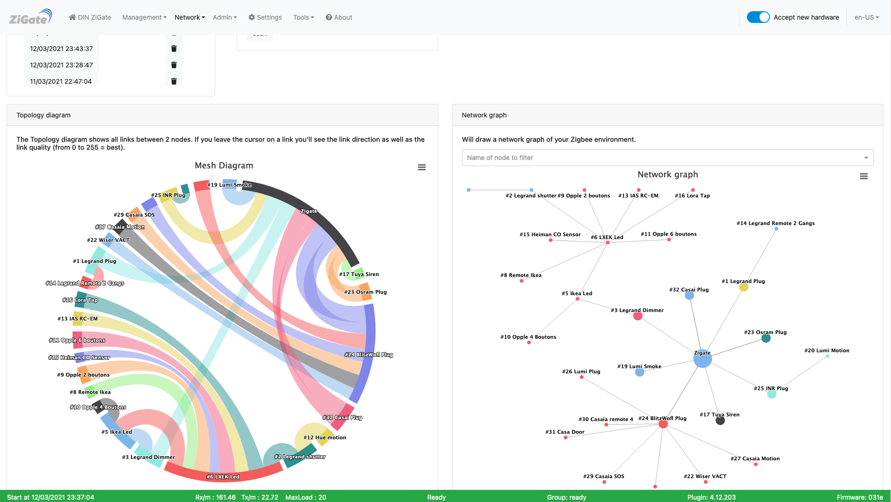
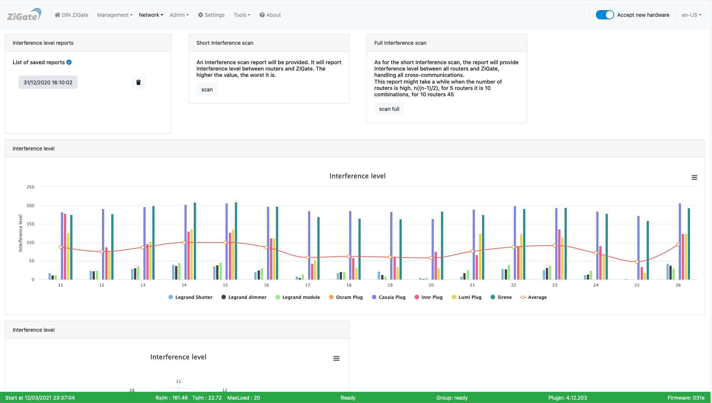

# The Web interface - Network section

Please refer to STEP 3 [Plugin Configuration](Plugin_Configuration.md) to get access to the Web interface administration.

The __Network__ menu contains the pages:

* [Topology](#topology)
* [Mesh graph](WebUI_Network-Mesh.md) — from plugin 9.1.008, a new interactive view of the same mesh
* [Interference level](#interference-level)

------------------------------------------------

## Topology

The __Topology__ page (*Network > Topology*) shows the reports of the topology scans: for each router, the neighbours it hears and the link quality (LQI) it measures.

*This picture may have changed since this documentation was written.*

### Running a scan

The **Topology scan** panel launches a scan with *Scan*. The scan runs in the background and asks every router for its neighbour table (and, with zigpy, its routing table); it can take several minutes on a large network, and the report only appears in the list once it is complete.

From plugin 9.1.008, with a zigpy coordinator, the *Associated devices* button collects only the devices attached to each router. It is quicker than a full scan (one request per router) and shows where battery devices are attached; the result appears in the list as a scan of its own.

Scans are not run automatically, unless the `ZigpyAutoTopology` setting is enabled (a scan every 12 hours).

### The reports

**Topology reports** lists the stored reports, newest first. Click a report to display it, or delete it. The plugin keeps the last `numTopologyReports` reports (4 by default).

A report is displayed in two ways:

* **Topology diagram**: a wheel showing every link between two devices. Leave the mouse on a link to see its direction and the link quality (from 0 to 255, the best).
* **Network graph**: the hierarchical structure of the network. Type a name to filter the nodes; click a device to list, below the graph, the devices linked to it with their LQI, model, status, health and battery.

### See also: the Mesh graph

From plugin version 9.1.008 a third representation is available, on its own page:
[Mesh graph](WebUI_Network-Mesh.md). It is an interactive graph of the same network, and it adds the
routing tables and the parent/child tree to the neighbour relationships drawn here — together with
what a mesh is, what each relationship means, how a scan is actually performed, and why a device
that is switched off changes what you see.

------------------------------------------------

## Interference level

The __Interference level__ page (*Network > Interference level*) shows the energy measured on each Zigbee channel: the higher the value (0 to 255), the more radio activity — Wi-Fi, other Zigbee networks, Bluetooth… — on that channel. Use it to check that the network's channel is a quiet one; see [ZigBee and Wi-Fi](Info_ZigBee-and-Wifi.md) and [Change the Zigbee channel](HowTo_Change-ZigBee-channel.md).

*This picture may have changed since this documentation was written.*

### Running a scan

The **Short Interference scan** panel launches a scan with *scan*. With a zigpy coordinator, the coordinator measures the energy on all the channels, 11 to 26.

The energy is measured on all the traffic heard, so on a busy network the network's own traffic shows on its channel; it is not only noise.

With a ZiGate coordinator, a **Full Interference scan** panel is also shown: every router measures the energy, and the report also gives the number of messages sent (*Tx*) and failed (*Fail*). It takes longer as the number of routers grows.

### The reports

**Interference level reports** lists the stored reports, newest first. Click a report to display it, or delete it. The chart shows one bar per channel for each device that measured, and the average. The plugin keeps the last `numTopologyReports` reports (4 by default).

### LQI and packet filtering (ZiGate only)

On ZiGate (NXP) coordinators, the link cost used for routing is derived from the LQI, and packets over a link of cost 5 or more might be discarded:

| LQI range | Cost |
| ---------| -----|
| >= 51 | 1 |
| 46 - 50 | 2 |
| 41 - 45 | 3 |
| 39 - 40 | 4 |
| 36 - 38 | 5 |

Source: <https://www.nxp.com/docs/en/user-guide/JN-UG-3113.pdf>

## Terminology

1. Neighbor Table:

    * The Neighbor Table maintains information about neighboring devices within the radio range of a Zigbee device.
    * It typically includes details such as the network address, IEEE address (unique identifier), and signal quality of neighboring devices.
    * The Neighbor Table helps in managing direct communication with nearby devices and is essential for forming and maintaining network connections.
    * This table aids in tasks such as device discovery, link quality estimation, and neighbor management.

1. Routing Table:

    * The Routing Table contains information about the network routes that a Zigbee device can use to reach other devices in the network.
    * It includes entries for various destination devices along with the next-hop device and the quality of the route.
    * The Routing Table is crucial for enabling multi-hop communication in Zigbee mesh networks. When a device wants to send a message to a destination that is not within its direct radio range, it uses the Routing Table to determine the best path through intermediate devices (routers) to reach the destination.
    * Zigbee devices use routing tables to make informed decisions about relaying messages within the mesh network, ensuring efficient and reliable communication across the network.

1. LQI stands for Link Quality Indicator.

    It is a metric used to estimate the quality of the wireless link between two neighboring devices. LQI values are reported in the Neighbor Table of Zigbee devices to provide insight into the reliability of communication with nearby devices. Here's a breakdown of LQI and its significance:

    * Definition: LQI is a value typically represented as a numerical score, ranging from 0 to 255 in Zigbee networks. It quantifies the quality of the link between a device and its neighboring device. Higher LQI values generally indicate better link quality, while lower values suggest poorer link quality.

    * Calculation: The LQI value is calculated based on various factors such as signal strength, signal-to-noise ratio, packet error rate, and other parameters related to the wireless communication channel. Zigbee devices continuously monitor these factors to assess the quality of their links with neighboring devices.

    * Interpretation: LQI values provide an indication of how reliable the communication link is between two devices. A high LQI value implies a strong and reliable link, with minimal interference or packet loss. Conversely, a low LQI value indicates a weaker link, which may be prone to interference or packet loss, potentially affecting the reliability of communication.

    * Usage: In the Neighbor Table, LQI values are reported alongside information about neighboring devices such as their network address, IEEE address, and other parameters. This information helps Zigbee devices make informed decisions regarding communication and neighbor management. Devices may use LQI values to prioritize communication with neighboring devices that offer better link quality, leading to more reliable data transmission.

    * Dynamic Nature: LQI values are dynamic and can fluctuate over time due to changes in environmental conditions, signal interference, device mobility, and other factors. Zigbee devices continuously update LQI values in the Neighbor Table to reflect the current state of their communication links with neighboring devices.

Sources:

* <https://www.nxp.com/docs/en/user-guide/JN-UG-3101.pdf> ( page 367 - Section 8.2.3.41 ZPS_tsAplZdpMgmtNwkUpdateNotify)
* <https://en.wikipedia.org/wiki/Received_signal_strength_indication> ( RSSI - Received Signal Strength Indication)

------------------------------------------------
Look at the other pages of the [plugin Web interface](Readme.md#plugins-web-interface).
