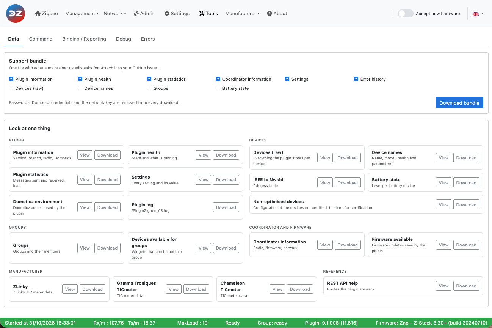
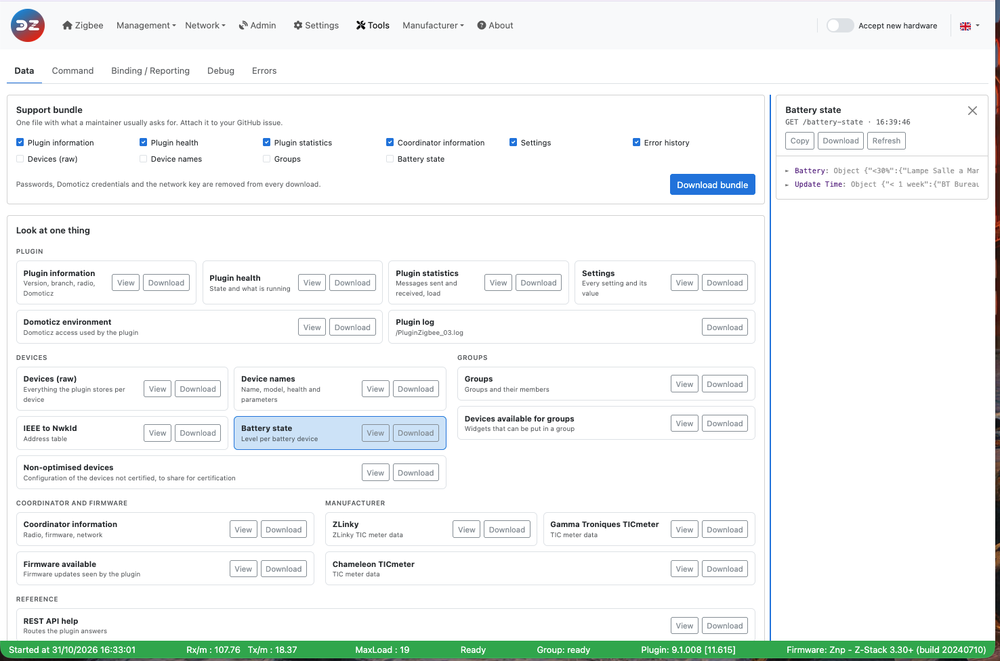
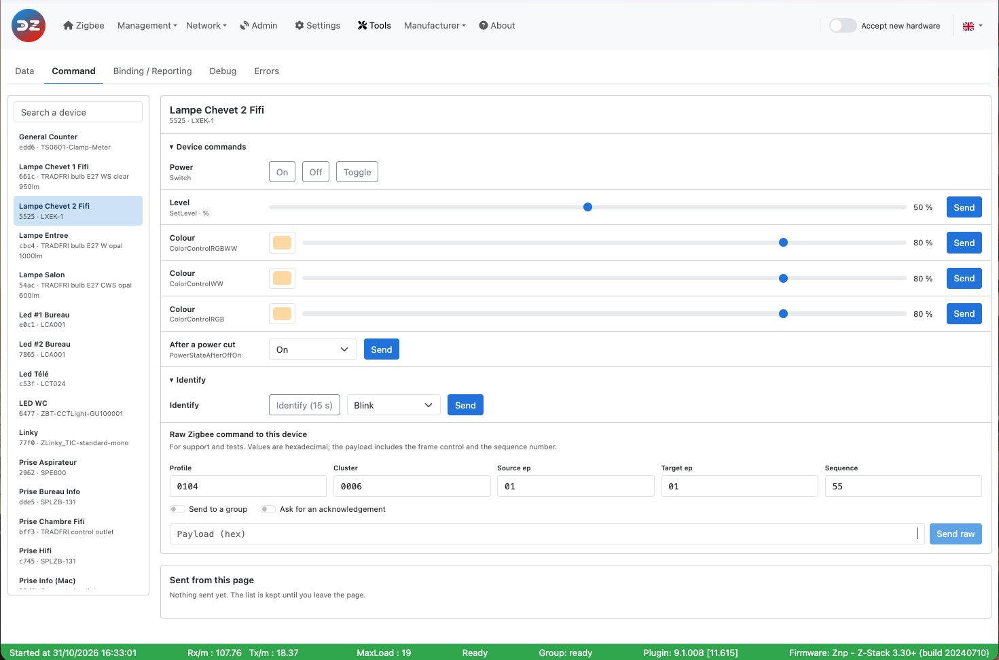
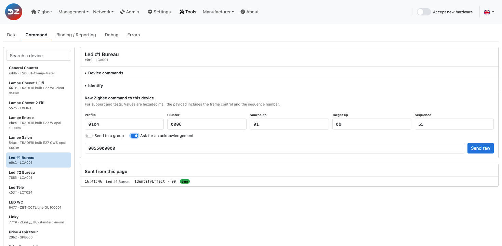
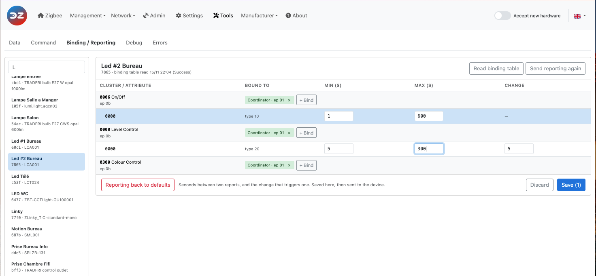
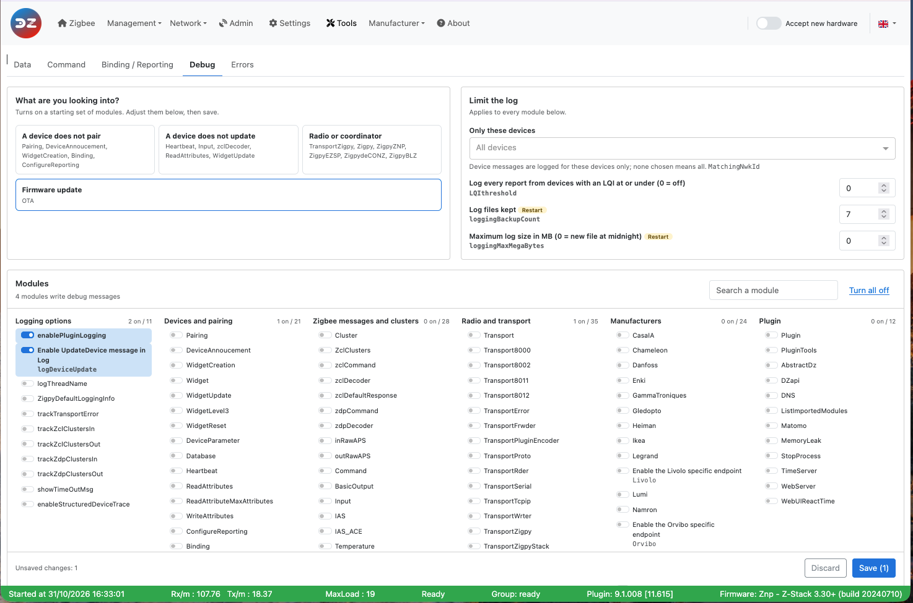

# The Web interface - Tools section

Please refer to STEP 3 [Plugin Configuration](Plugin_Configuration.md) to get access to the Web interface administration.

The __Tools__ page has five tabs:

* [Data](#data) — look at the plugin's data, download it, and build a support bundle
* [Command](#command) — send commands to a device
* [Binding / Reporting](#binding--reporting) — bind clusters, and set how attributes report (zigpy coordinators only)
* [Debug](#debug) — choose which parts of the plugin write debug messages
* [Errors](#errors) — the errors recorded by the plugin

> **Plugin 9.1.009 and later.** This page describes the Tools page available since plugin 9.1.009. In older versions, *Tools* is a drop-down menu with the pages *Tools*, *Command*, *Reporting*, *Binding*, *Debug* and *Error(s)*: the data is shown with one button per item and *Export*, binding is done by choosing a cluster then a source and a target, the debug modules are shown with *Advanced settings* and saved with *Validate*, and the errors are shown with *Log Error History (json)*.

*Tools* in the menu bar opens the *Data* tab. The *Errors* tab carries a red dot while the plugin has errors you have not read.

------------------------------------------------

## Data

The __Data__ tab (*Tools > Data*) shows what the plugin holds in memory, as JSON. It is mainly for troubleshooting and for developers.

*This picture may have changed since this documentation was written.*

### Support bundle

One file with what a maintainer usually asks for: attach it to your GitHub issue. Tick what to put in it, then click *Download bundle*. *Plugin information*, *Plugin health*, *Plugin statistics*, *Coordinator information*, *Settings* and *Error history* are ticked by default; *Devices (raw)*, *Device names*, *Groups* and *Battery state* can be added. The file is named `z4d-support-<date>-<time>.json`.

Passwords, the Domoticz credentials and the network key are removed from the bundle, and from every download and copy of this tab. Including the *Error history* marks the errors as read, as opening the *Errors* tab does.

### Look at one thing

Every item has two buttons:

* *View* opens the item in a viewer on the right of the page, with the REST route it comes from and the time it was read. *Copy* copies it to the clipboard, *Download* saves it, *Refresh* reads it again. Drag the line on the left of the viewer to make it wider (double-click it to go back to the default width); the browser remembers the width.
* *Download* saves the item as `z4d-<item>.json`.

The items are grouped by what they cover: *Plugin*, *Devices*, *Groups*, *Coordinator and firmware*, *Manufacturer* and *Reference*. The *Plugin log* item downloads the current plugin log file; it is only there when the plugin writes its own log file (`enablePluginLogging`).

Refer to [Use the plugin tools](HowTo_Using-tools.md) for what each item returns.

------------------------------------------------
## Command

The __Command__ tab (*Tools > Command*) sends commands to a device directly from the WebUI, without going through Domoticz.

*This picture may have changed since this documentation was written.*

Choose the device in the list on the left (search by name, NwkId or model). The routers come first; end devices are marked *end device, may be asleep*, as a sleeping device only gets the command when it wakes up.

### Device commands

The plugin offers the commands that match the widgets of the device, one row per widget type (the type is written under the row name):

* **Power**: *On*, *Off*, *Toggle*;
* **Level**: a slider, then *Send*;
* **Cover** and **Cover position**: *Open*, *Close*, *Stop*, and a position slider;
* **Set point**: a temperature, then *Send*;
* **Colour**: a colour and a brightness, then *Send*;
* **After a power cut**: the state the device takes when the power comes back (*Off*, *On*, *Toggle*, *Previous state*).

**Identify** makes the device show itself: *Identify (15 s)*, or an effect (*Blink*, *Breathe*, *Okay*, *Channel change*, *Finish the effect*, *Stop the effect*) then *Send*.

*Device commands* and *Identify* can be folded; the browser remembers which ones are folded. When the plugin offers no command for the device, the page says so: the raw Zigbee command below still works.

### Raw Zigbee command

With a zigpy coordinator (ZNP, EZSP/Bellows, deCONZ, BLZ), **Raw Zigbee command to this device** sends a raw Zigbee frame to the device chosen on the left. It is meant for advanced users who know the Zigbee Cluster Library (ZCL): the plugin does not check or build anything, and sends the payload exactly as typed.

*This picture may have changed since this documentation was written.*

All values are hexadecimal, without `0x`.

| Field | What to enter |
| ----- | ------------- |
| *Profile* | `0104` (Home Automation) for ZCL commands, `0000` for ZDO/ZDP requests. |
| *Cluster* | The cluster, for example `0000` (Basic), `0006` (On/Off), `0008` (Level Control). |
| *Source ep* | The coordinator's endpoint, usually `01` (`00` for ZDO/ZDP). |
| *Target ep* | The device endpoint that holds the cluster (`00` for ZDO/ZDP). It is filled with the first endpoint of the device. |
| *Sequence* | The sequence number of the request, for example `55`. Use the same value as the sequence number inside the payload. |
| *Send to a group* | Sends the frame as a group (multicast) request, to the *Group id* you enter, instead of the device. |
| *Ask for an acknowledgement* | Asks the device for an APS acknowledgement. |
| *Payload (hex)* | The complete ZCL frame, header included (see below). |

Click *Send raw*. The WebUI only confirms that the command was sent; it does not show the device's answer. The plugin processes the answer like any other message from the device, so look at the plugin log to follow it.

#### Building the payload

The payload is the complete ZCL frame, written as one string of hexadecimal bytes:

| Bytes | Content |
| ----- | ------- |
| 1 | Frame control: `00` for a general (profile-wide) command such as Read Attributes, `01` for a command specific to the cluster. Add `04` for a manufacturer-specific command (`04` or `05`). |
| 2 | Manufacturer code, **only** for a manufacturer-specific command. |
| 1 | Transaction sequence number, the same as *Sequence*. |
| 1 | Command identifier, for example `00` Read Attributes, `02` Write Attributes. |
| n | The command's fields. |

> **Endianness:** Zigbee sends every value longer than one byte in **little-endian** order, least significant byte first. You must reverse the bytes yourself in the payload: attribute `0x0005` is typed `0500`, the manufacturer code `0x115F` is typed `5F11`, and a 16-bit value `0x012C` is typed `2C01`.
>
> This only applies to the payload. The other fields (*Profile*, *Cluster*, *Sequence*…) are typed the normal way, as in the picture: `0104`, `0006`.

The payload of the picture, `0055000000`, sent to the cluster `0006`, reads the *OnOff* attribute of the light:

| Bytes | Meaning |
| ----- | ------- |
| `00` | Frame control: general command, from client to server |
| `55` | Transaction sequence number (same as *Sequence*) |
| `00` | Command Read Attributes |
| `0000` | Attribute `0x0000` (OnOff), little-endian |

More examples:

| Goal | Cluster | Payload |
| ---- | ------- | ------- |
| Read the Model Identifier (attribute `0x0005`) | `0000` | `0055000500` |
| Read the Manufacturer Name and Model Identifier (attributes `0x0004` and `0x0005`) | `0000` | `00550004000500` |
| Switch on | `0006` | `015501` |
| Switch off | `0006` | `015500` |
| Toggle | `0006` | `015502` |

With a ZiGate coordinator this part is replaced by **ZiGate command (raw)**, below the device, which sends a raw command to the ZiGate following the ZiGate protocol.

### Sent from this page

Every command sent from the tab is listed with its time, the device, what was sent and *Sent* (or *Error* when the plugin refused it). The list is kept until you leave the page.

------------------------------------------------

## Binding / Reporting

The __Binding / Reporting__ tab (*Tools > Binding / Reporting*) shows, for one device, what each of its clusters is bound to and, with a zigpy coordinator, how its attributes report.

*This picture may have changed since this documentation was written.*

Choose the device in the list on the left. The table has one row per endpoint and cluster that can be bound (plus any cluster that has a binding or a reporting configuration), with the endpoint under the cluster name.

### Binding

A binding makes the device send its commands or reports for one cluster directly to another device, without going through the coordinator. The *Bound to* column shows the targets found in the device's binding table: another device, the *Coordinator*, or a group.

* *Read binding table* asks the device for its binding table; it shows a few seconds later, when the device answers. The date of the last read is shown under the device name.
* *+ Bind* on a cluster row, then choose the target (the devices that have this cluster, with their endpoint) and click *Bind*.
* The **×** of a target unbinds it.

A battery device sleeps: wake it up (press one of its buttons) just before you read its table or bind it, so that it receives the request.

Refer to the tutorial [Bind two devices](HowTo_Binding.md) for more information.

### Reporting

With a zigpy coordinator, each reported attribute has its own row under its cluster, with its data type and three values: *Min (s)* and *Max (s)*, in seconds, and *Change* (the minimum change that triggers a report, only for values that are numbers). The device sends a report when the value has changed by at least *Change*, but not more often than every *Min*, and at least every *Max* even if nothing changed.

* Change the values, then *Save (N)* stores them in the plugin for this device. *Discard* drops your changes.
* *Send reporting again* sends the reporting configuration to the device now.
* *Reporting back to defaults* drops the values of this device: it goes back to the plugin's default configuration.

With a ZiGate coordinator, only the binding part is shown.

------------------------------------------------
## Debug

The __Debug__ tab (*Tools > Debug*) chooses which parts (modules) of the plugin write debug messages, for which devices, and how the log files are kept.

*This picture may have changed since this documentation was written.*

* **What are you looking into?** Each card turns on a starting set of modules for a type of problem: *A device does not pair*, *A device does not update*, *Radio or coordinator*, *Firmware update*. Adjust the modules below, then save.
* **Limit the log**: applies to every module.
  * *Only these devices* (`MatchingNwkId`): device messages are only logged for the devices you choose; none chosen means all devices.
  * `LQIthreshold`: logs every report from the devices with an LQI at or under this value (0 turns it off).
  * `loggingBackupCount`, the number of log files kept, and `loggingMaxMegaBytes`, the maximum size of a log file (0 = a new file every night). Both need a plugin restart.
* **Modules**: the switches, grouped as *Logging options*, *Devices and pairing*, *Zigbee messages and clusters*, *Radio and transport*, *Manufacturers*, *Plugin*, and *Zigpy libraries* (the `Python/…` loggers of zigpy and its radio libraries). Each group shows how many of its modules are on. *Search a module* filters them; *Turn all off* switches every module off.

The changes are counted at the bottom (*Unsaved changes*). *Save (N)* sends them to the plugin, *Discard* drops them. The modules take effect immediately; when a change needs a restart, the WebUI says so and the *Restart needed* indicator appears.

Refer to [Debugging mode](Problem_Debuging-mode.md) for what each module does, and which ones to enable for a given problem.

------------------------------------------------

## Errors

The __Errors__ tab (*Tools > Errors*) lists the errors recorded by the plugin. It is also where the *Error(s) detected* indicator of the menu bar (blinking red triangle) leads. Opening the tab marks the errors as read: the red triangle and the red dot of the tab go away until a new error is recorded.

*This picture may have changed since this documentation was written.*

On the left, the errors are grouped by plugin start, newest first, with the plugin version of that start. Each error shows its time, its module, its error code if any, the message and the device. *Search message, device or error code* and the module list filter them.

Click an error to see its details: the message, the time, the module and the thread; the device (NwkId, name, model); the plugin at that time (health, whether pairing was open, plugin version, coordinator firmware); and the context the plugin recorded. *Copy as GitHub issue text* copies all this, ready to paste in an issue.

* *Refresh* reads the history again.
* *Download .json* saves the whole history as `z4d-errors.json`, for example to attach to an issue.
* *Clear history…* empties the history, after a confirmation. This cannot be undone: download it first if you need it.

Refer to the tutorial [Deal with plugin errors](HowTo_Dealing-plugin-errors.md) for more information.

------------------------------------------------
Look at the other pages of the [plugin Web interface](Readme.md#plugins-web-interface).
