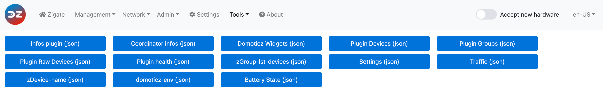
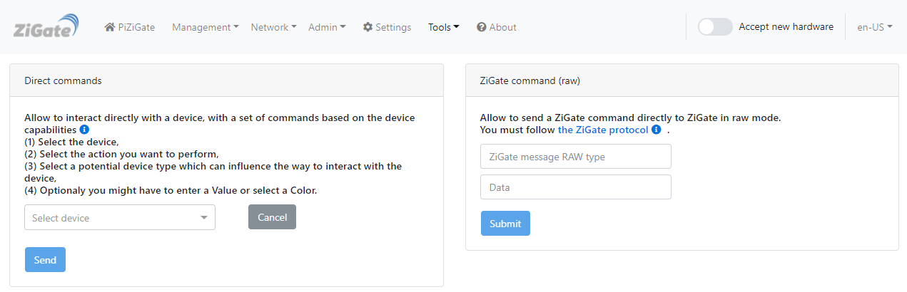
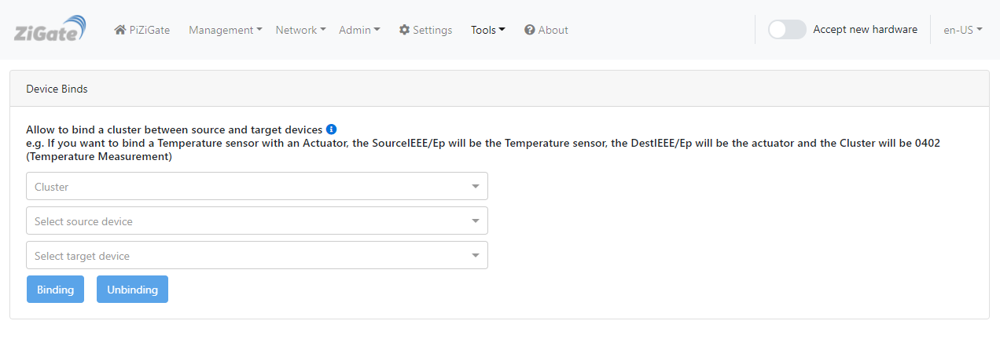
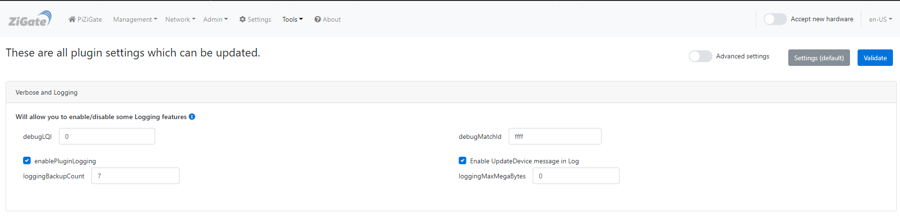
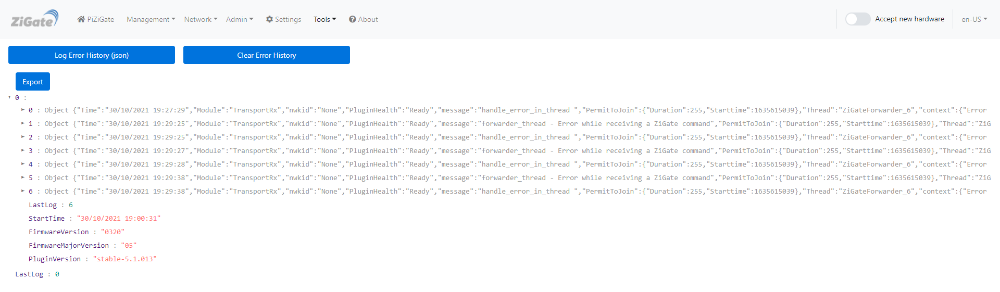

# The Web interface - Tools section

Please refer to STEP 3 [Plugin Configuration](Plugin_Configuration.md) to get access to the Web interface administration.

The __Tools__ menu contains the pages:

* [Tools](#tools) — display and export the plugin's data
* [Command](#command) — send commands to a device
* [Reporting](#reporting) — configure attribute reporting (zigpy coordinators only)
* [Binding](#bindings) — bind and unbind devices
* [Debug](#debug) — debug logging settings
* [Error(s)](#error) — the errors recorded by the plugin

------------------------------------------------
## Tools

The __Tools__ page (*Tools > Tools*) has one button per piece of plugin data (plugin and coordinator info, devices, groups, battery state, traffic, plugin health, plugin logs…). Click a button to display the data as JSON; *Export* downloads it.

*This page may have changed since this documentation was written.*

Refer to [Use the plugin tools](HowTo_Using-tools.md) for the list of buttons and what each one returns.

------------------------------------------------
## Command

The __Command__ page (*Tools > Command*) sends commands to a device directly from the WebUI, without going through Domoticz. It has two panels.

*This page may have changed since this documentation was written.*

### Direct commands

Interact with a device using the actions its capabilities allow:

1. Select the device.
2. Select the action to perform (on, off, level, color…).
3. If asked, select the device type: it can change how the command is sent.
4. If needed, enter a value or pick a color, then click *Send*.

### ZigBee command

A raw Zigbee command for advanced users: select the target device and fill in *GroupAddressFlag*, *AckMode*, *ProfileId*, *ClusterId*, *SourceEp*, *TargetEp*, *Sqn* and the payload (*Data*), then *Submit*.

With a ZiGate coordinator this panel is replaced by **ZiGate command (raw)**, which sends a raw command to the ZiGate following the ZiGate protocol.

------------------------------------------------
## Reporting

The __Reporting__ page (*Tools > Reporting*) is only shown with a zigpy coordinator. It sets which attributes a device reports on its own, and how often.

Select a device: its clusters and attributes are listed with their *Datatype*, *Timeout*, *min interval* and *max interval* (in seconds) and *Change* (the minimum change that triggers a report). The device sends a report when the value has changed by at least *Change*, but not more often than every *min interval*, and at least every *max interval* even if nothing changed.

* *Validate* saves your values for this device.
* *Trigger* sends the reporting configuration to the device now.
* *Reset* drops your values: the device goes back to the plugin's default configuration.

------------------------------------------------
## Bindings

The __Binding__ page (*Tools > Binding*) binds a cluster between two devices, so that the source device sends its commands or reports directly to the target, without going through the coordinator.

*This page may have changed since this documentation was written.*

Select the cluster, the source device (and endpoint) and the target device (and endpoint), then click *Binding* (or *Unbinding* to remove the binding). For example, to bind a temperature sensor to an actuator, the source is the sensor, the target is the actuator and the cluster is `0402` (Temperature Measurement).

Refer to the tutorial [Bind two devices](HowTo_Binding.md) for more information.

------------------------------------------------
## Debug

The __Debug__ page (*Tools > Debug*) holds the logging settings: which parts of the plugin log debug messages, for which devices, and where the logs go. Switch *Advanced settings* on to see the debug modules, tick the ones you need and click *Validate*. *Settings (default)* turns everything back to the defaults.

*This page may have changed since this documentation was written.*

Refer to [Debugging mode](Problem_Debuging-mode.md) for what each setting and module does, and which ones to enable for a given problem.

------------------------------------------------
## Error

The __Error(s)__ page (*Tools > Error(s)*) lists the errors recorded by the plugin. It is also where the *Error(s) detected* indicator of the menu bar (blinking red triangle) leads.

*This page may have changed since this documentation was written.*

* *Log Error History (json)* displays the recorded errors, with their context; *Export* downloads them as a JSON file, for example to attach to an issue.
* *Clear Error History* empties the list.

Either button turns the red triangle off until a new error is recorded.

Refer to the tutorial [Deal with plugin errors](HowTo_Dealing-pluging-error.md) for more information.

------------------------------------------------
Look at the other pages of the [plugin Web interface](Readme.md#plugins-web-interface).
